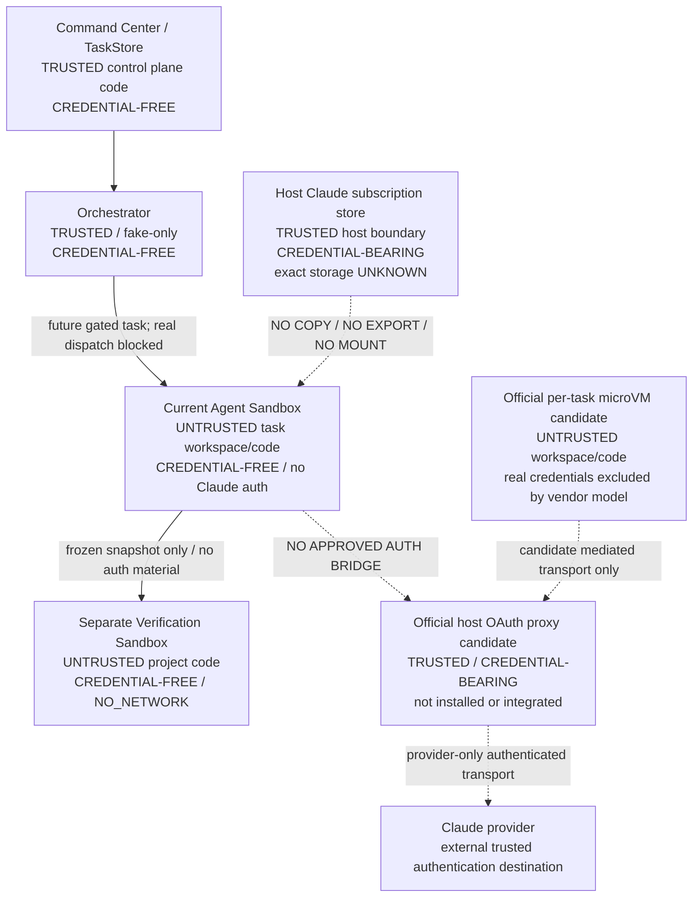
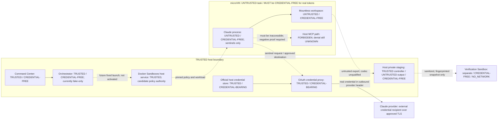
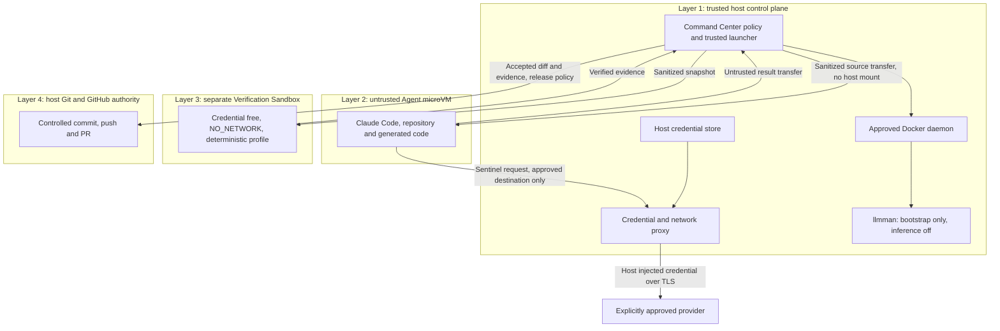

# Phase 3B5A: Claude Docker subscription auth discovery and architecture

Status: **DISCOVERY COMPLETE / AUTH BRIDGE IMPLEMENTATION BLOCKED**.
Decision: **NO_SAFE_SUPPORTED_PATH_FOUND** for the current installed, custom
Docker Agent Sandbox under the full required security contract.
Discovery date: 2026-10-06 (Asia/Singapore). No implementation is included.

An official alternative was found and is recorded below. This decision is not a
claim that subscription isolation is universally impossible. The alternative is
not installed here, is not the existing runtime, and has material policy differences.
It must not be promoted to a compatible, safe implementation without a new
Control Plane architecture decision and the evidence gates in this document.

## 1. Frozen baseline and scope

- Repository: `augusliang23-web/Micro-SaaS-Command-Center`.
- Remote main / discovery baseline: `25692a9a1fdedaf82910630fb767589aa5dccddf`.
- [PR #21](https://github.com/augusliang23-web/Micro-SaaS-Command-Center/pull/21)
  is CLOSED / MERGED. Its reviewed head is
  `a95430ea3fdef5d5a7d30378cc015694c009fd5e`.
- Phase 3B4 proved one bounded host invocation with subscription auth and
  authoritative Sonnet execution evidence. That proof does not establish Linux
  container authentication or credential isolation.
- Orchestrator defaults to `FakeAdapter` and rejects non-fake adapters before
  probe/start. Product Run routing and Agent Console provider activation remain absent.
- Agent Sandbox and Verification Sandbox are separate existing implementations.
- Docker Claude status remains `CLAUDE_AGENT_SANDBOX_AUTH_BRIDGE_REQUIRED`.
- Work is on `codex/agent-console-phase3b5a-claude-docker-auth-architecture`, in
  an isolated worktree from a separate bare Git copy. The app's native worktree
  tool is bound to PM Dashboard, so it was not used to create the wrong repository.
- User-owned dirty main, preservation refs, governance and historical evidence
  are excluded from edits. Only this document and the Phase 3B4 closeout note change.

This is the architectural discovery artifact requested by Control Plane, not
approval to implement a design or execute any future gate.

## 2. Evidence grades and discovery procedure

`OBSERVED_METADATA` means a sanitized read-only command or filesystem metadata
was inspected. `SOURCE_CONTRACT` means exact-baseline repository code.
`DOCUMENTED` means a primary vendor source accessed on the discovery date.
`INFERENCE` is explicitly weaker than observation. `UNKNOWN` never grants access.

Allowed probes performed:

- CLI version, CLI help, auth help, gateway help; no interactive invocation.
- `claude auth status`, captured internally and reduced to exactly loggedIn,
  authMethod, apiProvider, subscriptionType and command exit code. No account
  identity, unfiltered output, token, cookie or environment value is persisted.
- Environment **name presence** only, without reading or printing their values.
- `lstat`/existence on fixed path categories; no file content reads.
- Docker server version/security-option metadata and IDs/status of containers
  carrying the existing `cc.sandbox=1` ownership label; no full inspect output.
- Presence of the standalone `sbx` executable and `docker sandbox --help`.

No Keychain lookup, secret-store listing, credential export, credential file
read, Docker create/start/exec, image pull/build, login/logout or inference ran.
No discovery probe or executable code is added to Git.

## 3. Host authentication: metadata versus secrets

| Fact | Result | Authority / limit |
|---|---|---|
| Installed Claude Code | `2.1.260` | OBSERVED_METADATA; version command |
| Auth status exit | `0` | OBSERVED_METADATA |
| loggedIn | `true` | Sanitized CLI status |
| authMethod | `claude.ai` | Sanitized CLI status |
| apiProvider | `firstParty` | Sanitized CLI status |
| subscriptionType | `pro` | Sanitized CLI status; not a quota claim |
| API/token overrides | All four known overrides absent | Name-presence probe only |
| Other routing/config overrides | Config-dir/base-URL/Bedrock/Vertex/Foundry overrides absent | Name-presence probe; no settings content inspection |
| Default configuration directory | Exists, current-user owned, mode `0755` | Metadata only; this is not a credential-file permission claim |
| Filesystem credential candidate | Does not exist at the default category | Metadata only; does not exclude another location |
| Home configuration candidate | Regular file, current-user owned, mode `0600` | Metadata only; contents deliberately not read |
| macOS Keychain | Documented normal credential store | DOCUMENTED; actual entry not inspected |
| Browser/session credential source | Not established | UNKNOWN; login browser is not proof of persistent cookie dependence |

Authentication classification: **claude.ai subscription is OBSERVED_METADATA;
macOS Keychain storage is DOCUMENTED and consistent with the metadata, but the
exact active secret location is UNKNOWN / SECRET_INSPECTION_NOT_ALLOWED**.
There is no claim that a specific Keychain entry was found or that its contents
were read. Inodes and personal absolute paths are not included in this document.

The [official authentication documentation](https://code.claude.com/docs/en/authentication)
describes macOS Keychain storage, a filesystem fallback, Linux credential files
and config-directory separation. Its current version-dependent features are not
assumed to exist in installed CLI 2.1.260. CLI help exposes an enterprise gateway,
not evidence of a personal-subscription auth socket.

The existing host adapter strips API/OAuth overrides from its child environment
and requires observed `claude.ai` auth. Host adapter source/evidence remains the
accepted authority for Phase 3B4; no new host call was used to reproduce it.

## 4. Existing Docker contract

Source authorities: [policy](../../server/sandbox/sandboxPolicy.mjs),
[runtime](../../server/sandbox/dockerSandboxRuntime.mjs),
[readback](../../server/sandbox/readbackVerifier.mjs),
[workspace view](../../server/sandbox/workspaceView.mjs),
[path safety](../../server/sandbox/pathSafety.mjs),
[image allowlist](../../server/sandbox/sandboxImages.mjs),
[verifier profile](../../server/verifier/verificationProfile.mjs).

| Surface | Exact existing contract | Evidence limit |
|---|---|---|
| Container user | Server-resolved numeric non-root UID:GID; UID must be >0 | SOURCE_CONTRACT; no running agent was inspected |
| HOME / working directory | `HOME=/tmp`; `/workspace` | Fixed source constants, not host environment values |
| Root filesystem | `--read-only` | Strict readback required before use |
| Workspace | One canonical, server-selected, non-recursive bind | Agent RW; verifier source RO |
| Git metadata | `.git` file masked RO or `.git` directory masked by RO tmpfs | Shared host Git authority never mounted |
| Capabilities / privilege | `--cap-drop=ALL`, no-new-privileges, private IPC | No host PID namespace, devices or Docker socket |
| Scratch writes | `/tmp` tmpfs: `rw,noexec,nosuid,nodev,size=64m` | Ephemeral; not secure separation from same-UID code |
| Agent default limits | 1 CPU, 512 MiB, no extra swap, 128 PIDs, 120000 ms, 1048576 output bytes | Source defaults, not a live resource observation |
| Environment | Fixed minimal base; reject secret/provider/routing/proxy names; no generic host-env inheritance | Unknown fields and extra mounts rejected |
| Image | Server-selected immutable reference; create uses pull=never | Default test image is scratch-only, not an approved Claude image |
| Workspace guard | Escaping symlinks, hardlinks, nested Git, special nodes and boundary scans blocked; recheck before start | Non-recursive bind is primary submount containment |
| Identity | Immutable container ID + ownership labels; strict pre/post readback | Ambiguity remains UNKNOWN, never verified |
| Agent network | `PROVIDER_NETWORK` maps to Docker `bridge` | **Not an Anthropic endpoint allowlist** |
| Verifier network | `NO_NETWORK` maps to Docker `none` | Must stay credential-free and independent |
| Verifier private writes | `/verify` tmpfs `rw,exec,nosuid,nodev,size=1g`; source RO | Separate dependency/snapshot runner |
| Verifier command limits | 2 CPU, 2048 MiB, 256 PIDs, 180000 ms, bounded stdout/stderr | Server-owned fixed profile |

Observed Docker Engine: `29.8.1`. Security-option metadata reports builtin seccomp
and cgroup namespace support. There are zero currently owned `cc.sandbox=1`
containers, so **no live Agent Sandbox config or auth is claimed**.
Standalone `sbx` is absent; `docker sandbox --help` is unavailable. Engine version
alone does not establish Docker Sandboxes capability.

Missing today: approved Linux Claude image, container-specific subscription auth,
credential mediation, endpoint-enforced egress, revocation/isolation proof and an
adapter integration that preserves the existing contract. The source comment
`ProviderAuthMount` is not a supported auth interface or authorization to mount secrets.

## 5. Options evaluated

| Option | Decision for current runtime | Concrete reason |
|---|---|---|
| A. Copy/mount host credentials | REJECT | Long-lived secrets become readable in the task trust domain; RO is not confidentiality. Keychain data is not a portable Linux login. Violates lifecycle and compromise containment. |
| B. OAuth/API token environment | REJECT | Process environment, descendants and inspect surfaces can expose the token. API credentials risk PAYG; OAuth still exposes reusable subscription auth. Generic env policy already forbids this. |
| C. Direct login in current container | REJECT for this contract | Official CLI supports container browser/code login, but Linux stores credentials under the CLI user's config. A separate directory with mode 0600 is still readable by compromised same-UID code. Tmpfs removes persistence, not access; persistent volumes introduce cross-task secrets. |
| D1. Custom host transport-only broker | HOLD / not supported here | No installed documented personal-subscription transport delegation interface was established. Do not extract Keychain tokens or reverse-engineer OAuth requests. Ordinary HTTPS CONNECT forwarding alone cannot supply missing CLI auth. |
| D2. Host executes full Claude CLI | REJECT as equivalent sandbox solution | The CLI and its file tools execute on the host; Docker wrapping another process does not relocate those tools. Phase 3B4 proves a different boundary. |
| E. Credential sidecar | REJECT direct secret handoff; HOLD transport-only variant | A sidecar that returns tokens or mounts its volume recreates A/B. A transport-only sidecar needs the same unsupported subscription delegation, authorization and egress proof as D1. Root/compromise boundaries must be explicit. |
| F. Official Docker Sandboxes managed OAuth proxy | DOCUMENTED CANDIDATE, NOT ADOPTED | Official proxy keeps real OAuth outside its microVM, but this is a different backend, absent locally; default privilege, writable state and lifecycle differ from the current runtime. No documented attachment to this custom Docker runtime was established. |

The [official devcontainer instructions](https://code.claude.com/docs/en/devcontainer)
describe container sign-in, browser callback/code handling and a config volume
for rebuild persistence. Non-root login is possible; persistence is not evidence
of isolation from task code. No login or volume setup was attempted.

[Docker credential documentation](https://docs.docker.com/ai/sandboxes/configuration/credentials/)
describes host-managed OAuth for Claude, sentinel credentials and an optional
passthrough mode that reduces isolation. No existing host credential was imported.
OAuth support does not prove this CLI/version/kit combination interoperates with
our raw-container backend. Passthrough, API-key preference and missing binding
must all prevent execution under this contract.

[Docker architecture](https://docs.docker.com/ai/sandboxes/architecture/)
places the mediation proxy outside a microVM. It is transport mediation, not host
execution of the entire Claude CLI. [Its defaults](https://docs.docker.com/ai/sandboxes/security/defaults/)
include sudo, writable/persistent VM state and shared skills. Adopting that backend
without reapproval would change the reviewed sandbox contract. Its default Claude
[startup command](https://docs.docker.com/ai/sandboxes/agents/claude-code/)
also includes bypass-permissions behavior; it is not our restricted edit-only argv.

[Claude gateway documentation](https://code.claude.com/docs/en/llm-gateway)
is not proof of forwarding a personal Pro login. The published
[credential-use guidance](https://code.claude.com/docs/en/legal-and-compliance)
distinguishes a user signing into unmodified Claude Code from a third-party
application intermediating subscription tokens. A custom token broker must not
be approved on an assumption of support. Hosted/product use would need its own
Control Plane support/terms review; this document is not legal clearance.

## 6. Single architecture decision

**NO_SAFE_SUPPORTED_PATH_FOUND** for the current baseline and installed runtime.
No copy, token-env, shared config volume, secret-returning sidecar, SDK/OAuth
wrapper or full host execution fallback is recommended.

The strongest next **discovery question**, not a second implementation
recommendation, is whether a version-pinned official Docker Sandboxes
host-managed OAuth backend can preserve/re-establish every required boundary.
Control Plane must first decide whether a backend change is in scope. If not,
remain blocked and keep the existing fake-only product. Do not infer unsupported
compatibility merely because the vendor offers a separately isolated product.

### Trust-boundary diagram

Solid edges describe control/data separation; dotted edges are blocked or
unimplemented proposals, not running connectivity. The host CLI proved in 3B4
is outside the current Agent Sandbox and is not a Docker sandbox claim.

| Credential question | Current answer | Required before any candidate is accepted |
|---|---|---|
| Where do secrets exist? | Host CLI-managed auth; exact storage UNKNOWN | Official external credential store, no guest passthrough |
| Which process can read them? | Host CLI necessarily consumes its own auth; exact additional readers UNKNOWN | Only approved vendor auth/proxy components and trusted OS administration |
| Which filesystem? | Actual active backing store uninspected | No task-visible bind, volume, environment or shared-memory location |
| Claude Read/Edit/Write access? | Current container has no injected secret | Negative proof against real-secret locations without printing them; synthetic canary first |
| Generated code access? | No provider credentials supplied to current task | No secret in any guest process, filesystem, inherited env or output |
| Another task? | No introduced shared credential surface | Per-task transport authority, fresh isolation, no shared writable auth/skills state |
| Verification Sandbox? | No provider identity/mount/env and NO_NETWORK | Remain completely excluded; snapshot must contain no auth artifacts |

## 7. Required security contract: all 18 principles

These are acceptance conditions, **not** claims of an implemented bridge.
Every condition must PASS; unresolved or unavailable evidence means HOLD.

| # | Required invariant | Concrete acceptance condition |
|---|---|---|
| 1 | Pro subscription-first | Official unmodified Claude login; authoritative claude.ai/firstParty/Pro metadata at the relevant sandbox boundary |
| 2 | No PAYG fallback | Reject API-key, bearer-helper, Console/cloud-provider and imported API-secret paths; no automatic retry into another provider |
| 3 | No browser arbitrary credentials | UI submits task IDs/profiles only; manual vendor login outside product credential fields |
| 4 | No TaskStore secrets | Only auth availability, provider classification and opaque task identity; no secret-bearing blobs |
| 5 | No evidence secrets | Closed schema of sanitized metadata; reject raw headers, token responses, credential file output |
| 6 | No log secrets | No debug/raw transport/auth logging or unsanitized stderr; bounded diagnostics and controlled crash handling |
| 7 | No UI secrets | Availability and blocked reason only, never masked-prefix token values |
| 8 | No Git secrets | Documentation/source only; no auth exports, cached auth files or capture fixtures |
| 9 | No image secrets | Approved immutable image and build inputs contain no credential material; no login during image build |
| 10 | Code cannot read secrets | Credentials outside guest/task process and filesystem boundary, not merely a mode-0600 directory |
| 11 | Code cannot exfiltrate secrets | No raw guest secrets; authenticated transport only to reviewed provider destinations; output/header leak tests |
| 12 | No traversal into auth | No auth bind/volume inside task namespace; reject symlink/hardlink/submount/special-node escapes |
| 13 | One task cannot persist auth compromise | Fresh task isolation, scoped/revocable transport authority; no guest refresh token or persistent shared writable store |
| 14 | Revocation possible | Demonstrate transport denial immediately; separately establish official OAuth revocation, with no implied equivalence |
| 15 | Auth failure closes execution | Missing binding, unavailable proxy, expired login, wrong provider or failed preflight prevents model call |
| 16 | UNKNOWN is not authenticated | Positive authoritative boundary metadata required; UNKNOWN cannot become PASS from prose or a created VM |
| 17 | API versus subscription distinct | Preserve exact auth-method/provider evidence; dummy env tokens or a proxy placeholder are not subscription proof |
| 18 | Verifier credential-free | No OAuth store, provider env, auth socket or network; immutable sanitized snapshot only |

## 8. Network model and provider requirements

- Current `NO_NETWORK`: proper verifier profile, incapable of remote Claude inference.
- Current `PROVIDER_NETWORK`: ordinary Docker bridge, not provider-only egress.
  It is **not** an acceptable production auth-bridge network proof.
- `PROVIDER_ONLY_NETWORK`: potential future mediated model; all TCP/UDP/DNS,
  redirects, IPv6, alternative ports, CONNECT destinations and proxy bypasses
  default-denied. Do not rely on tool allowlists to constrain compromised code.
- `HOST_BROKER_ONLY`: task can reach only a reviewed transport mediator; the
  mediator may authenticate, but must never run file tools on the host or return
  tokens. There is no approved implementation here.

The [official network reference](https://code.claude.com/docs/en/network-config)
lists inference, OAuth/account and optional update/telemetry destinations.
`api.anthropic.com` is an inference destination; browser login/refresh may need
additional documented account endpoints. This is not a complete observed trace
for installed 2.1.260. The exact endpoint/method/redirect set is **UNKNOWN** until
version-specific review and a separately authorized sanitized trace.

Any future proposal must separate admin bootstrap/login traffic from task
inference traffic. Approve exact vendor destinations from the pinned CLI/kit,
never `*.anthropic.com`, arbitrary CONNECT, unrestricted bridge, package registry
or user-selected proxy URLs. Disable optional traffic where supported without
changing installed settings now. [Docker's network policy](https://docs.docker.com/ai/sandboxes/governance/access-controls/network/)
is a candidate native enforcement surface; current code does not use it.
Even an allowed provider can receive malicious task content. Destination filtering
alone is not data-loss prevention or protection against subscription quota abuse.

## 9. Credential lifecycle and fail-closed state machine

No credentials are created, moved or retired in this phase. Existing host auth
remains under the CLI/user's control. Its active backing store, refresh behavior
and exact revocation semantics are UNKNOWN / SECRET_INSPECTION_NOT_ALLOWED here.

Required future lifecycle:

1. Install/approve a version-pinned native mechanism without secrets or inference.
2. Explicitly authorize manual official login, if required; never scrape/import
   existing host credentials. Same Pro account is not the same token/session.
3. Authorize only the reviewed subscription transport for one task. Do not grant
   API-key fallback, global all-task bindings or token passthrough.
4. Refresh only within the trusted vendor auth boundary; failures block new calls.
5. On task end/cancel/timeout, deny transport before any reuse; confirm guest and
   ephemeral storage absence. A stopped VM is not proof of deletion.
6. On compromise, revoke transport then use the vendor-supported login revocation
   procedure after separate authorization. Removing a local binding/file is not
   assumed to revoke a provider refresh token.
7. Reuse no task VM or guest auth cache. Cross-task authorization is independently
   reassessed. Verifier inputs exclude all credential and session artifacts.

Future states: `BRIDGE_REQUIRED -> CAPABILITY_REVIEWED -> AUTH_UNAVAILABLE or
AUTH_UNKNOWN or AUTH_SUBSCRIPTION_CONFIRMED`. Only the last state with verified
sandbox, egress, scope and expiry permits a separately authorized call. Expired,
ambiguous, API-backed or missing observations transition to BLOCKED. Current
state remains `BRIDGE_REQUIRED`. No existing Orchestrator code is changed.

## 10. Threat model

PASS here means an existing baseline boundary/no-change rule is retained.
HOLD means a proposed auth bridge lacks required implementation/negative evidence.
Residual risk is never removed by a prompt or by naming a directory private.

| Threat | Required mitigation | Residual risk | Status |
|---|---|---|---|
| Malicious model output | Restricted edit-only tools, structured policy enforcement, no auth output surfaces | Model can misuse allowed edits and provider calls | HOLD for authenticated sandbox |
| Malicious repository content | No project hooks/plugins/settings loaded; immutable trusted launcher and config | Prompt injection remains possible | HOLD for new backend integration |
| Dependency scripts | Run project builds/tests only in credential-free NO_NETWORK verifier; no installs in authenticated task domain | Dependency/vulnerability risks persist within verifier | PASS boundary retained; new integration HOLD |
| Path traversal | Canonical workspace, no credential mount, exact route/path checks | Native backend semantics unverified | HOLD |
| Symlink/hardlink/submount tricks | Reuse fail-closed workspace scans, non-recursive bind and pre-start rescan | TOCTOU and new VM mount semantics require proof | HOLD |
| Environment leakage | No raw token env, fixed allowlist, synthetic inspection tests | Same-UID code reads any accidentally inherited secret | HOLD |
| /proc leakage | No raw guest secrets, private PID boundary, no secret broker colocated with tools | Guest memory is readable after guest compromise | HOLD |
| Process inspection | No secrets in argv/stdin outside trusted auth flow; no shared task process namespace | Trusted-host administrator remains privileged | HOLD |
| Docker inspect leakage | No secret Config.Env, command, mount source or labels; inspect allowlisted fields only | Full debug/inspect output would expose accidental secrets | HOLD |
| Container/VM escape | Non-root/no-new-privileges/cap-drop baseline; immutable images; native boundary review | Docker/kernel/hypervisor/vendor compromise remains a trusted-boundary risk | HOLD; no absolute escape guarantee |
| Credential-volume leakage | No task-visible secret volume; native OAuth passthrough forbidden | Vendor bug/misconfiguration can breach separation | HOLD |
| Logs | Sanitized closed schemas, no header/token/raw auth output | Unexpected vendor stderr may contain sensitive data | HOLD |
| Crash dumps | Disable guest cores; no guest secrets; trusted-host crash telemetry must be reviewed | Host auth/proxy memory contains secrets | HOLD |
| Child processes | No shell/MCP/customization in agent; verifier alone runs project code | New launcher/CLI behavior must be rechecked | HOLD |
| Cross-task persistence | Destroy task VM/ephemeral storage; no shared skills/auth writes; bind per task | Official default persistence/shared skills do not satisfy this automatically | HOLD |
| Compromised previous task | Never reuse previous guest; deny its transport; rotate/revoke only through authorized native flow | Revocation propagation and concurrent-session scope unknown | HOLD |
| Malicious PR code | External exact-SHA review/clean checkout before trusted execution; repo cannot redefine its own safety gate | Malicious yet-approved change or compromised host remains possible | PASS no runtime edits; future gate HOLD |
| Network exfiltration | Enforce host-mediated destination policy, no arbitrary DNS/CONNECT/UDP, no guest raw credentials | Allowed provider endpoints can carry task content/quota abuse | HOLD |

Critical blockers: no compatible official mechanism installed; no supported
transport-only attachment to the current runtime; direct-login secrets share a
task trust domain; no enforced provider-only egress; alternative backend policy
and lifetime/revocation semantics unproved. No live Production fault is asserted.

## 11. Future gates: conditional, not authorized

Because no safe compatible path is accepted, these are stop-gated follow-up
outlines, not an executable implementation plan. Control Plane must first approve
whether to evaluate a different native backend. No automatic provider or auth budget
is granted by this document. Actual budgets below are future upper bounds that
still need explicit per-gate authorization.

| Gate | Allowed changes / evidence after separate approval | Forbidden | Rollback / stop boundary | Provider-call budget |
|---|---|---|---|---|
| 3B5B1: official capability qualification | Pin vendor versions/kit/source/provenance; decide raw-container compatibility versus explicitly reviewed backend change; prove a supported subscription-only transport and retained privilege/mount/resource policy | Secret reads/imports, login, inference, runtime integration, network relaxation | If no supported compatible design, retain this BLOCKED decision; uninstalling future tooling requires its own permission | 0 |
| 3B5B2: isolation foundation and synthetic negatives | Only after revised architecture approval: isolated server-owned integration/tests using fake credentials and a synthetic responder; prove traversal, env/proc/inspect/log/header/redirect/passthrough and cross-task denial; retain fake-only product | Real credentials, provider access, auth operations, verifier networking, Orchestrator activation | Discard isolated branch/fixtures; retain current backend; no production rollback needed | 0 |
| 3B5B3: official auth and sanitized preflight | Separate authorization for user-operated native login if necessary; validate subscription-only method, mediated storage, non-root/config/egress readback and revocation test procedure | Credential export/copy/mount, API fallback, secret diagnostics, inference | Deny transport; user/vendor-supported logout/revocation only if expressly authorized; never silently revoke existing host sessions | 0 |
| 3B5B4: one bounded sandbox smoke | Exact reviewed frozen source and synthetic fixture; one invocation, authoritative model/denial, exact output, no leak/persistence, resources/process/guest cleanup; compare host auth metadata and verifier exclusion | Retry, larger scope, billing fallback, product dispatch, deployments | Stop guest/deny transport using preauthorized cleanup; preserve sanitized FAIL/UNKNOWN evidence; no automatic login recovery | At most 1, separately authorized |
| 3B5B5: independent security review | Review exact head and sanitized evidence; verify all 18 principles and denied paths; review-only call if explicitly budgeted | Additional task smoke, implementation, merge/deploy, token inspection, product activation | Any blocker retains BRIDGE_REQUIRED; implementation/live approval remains separate | 0 by default; at most 1 review-only call if separately authorized |

## 12. Unresolved unknowns and final recommendation

- Actual host secret store/entry and all readers: UNKNOWN / SECRET_INSPECTION_NOT_ALLOWED.
- Installed CLI support for any external subscription-auth socket: NOT ESTABLISHED.
- Exact official Sandboxes version/kit and compatibility with CLI 2.1.260: UNKNOWN;
  not installed, not downloaded, not tested.
- OAuth-only precedence, placeholder/auth-status semantics, passthrough protection,
  effective task binding, refresh/revocation behavior and guest-crash handling:
  vendor model documented in part; this application's proof remains UNKNOWN.
- Exact runtime egress and account endpoints for the pinned versions: UNKNOWN.
- Retaining non-root/no-sudo, immutable root, .git masking, resources and per-task
  destruction under another backend: UNKNOWN; defaults differ materially.
- Official licensing/hosting suitability and any additional tooling/subscription
  cost: NOT VERIFIED; do not invent cost or subscription quota telemetry.

**Final recommendation: NO_SAFE_SUPPORTED_PATH_FOUND.** Keep Docker subscription
auth and real product execution blocked. Review this documentation-only Draft PR;
if Control Plane wants the official native alternative, authorize a separate
capability/architecture gate before any installation, login or implementation.
There is no second equally recommended path and no host-provider fallback.

## 13. Validation and safety record

This patch contains Markdown only. Validate structural Markdown, local links,
required sections/security/threat/gate coverage, exact diff scope and
`git diff --check`. No dependencies, executable probes, runtime source, image,
auth policy or governance are changed. No full test suite, local build or live
smoke is required or claimed. Local document checks are not GitHub CI; GitHub
currently reports zero exact-head checks for this baseline.

Inference calls: **0**. Login/logout/setup-token: **0**. API PAYG: **no**.
Credential contents read/copied/exported/mounted: **no**. No Docker state-changing
operation, deployment, Orchestrator activation or historical-evidence alteration.

---

## Phase 3B5B1 — Official Docker Sandboxes backend qualification

### B1. Decision, exact baseline and evidence grades

**OFFICIAL_DOCKER_SANDBOX_BACKEND_REQUIRES_INSTALLATION_TO_QUALIFY**.
This is a completed documentary qualification, not backend approval. The native
candidate is promising, but the mandatory enforcement/readback properties below
cannot be responsibly concluded on this host without a separately authorized
installation and synthetic qualification. No installation is authorized here.
The historical 3B5A decision **NO_SAFE_SUPPORTED_PATH_FOUND** is unchanged for
the existing custom raw-Docker Agent Sandbox. No supported attachment of native
OAuth mediation to that runtime is established.

Qualification date: 2026-10-06, Asia/Singapore. Before research, PR #22 was
OPEN / Draft / UNMERGED at `76d76a038bd6acc1ad840419f8d8556cf67dbee6`, based on
remote main `25692a9a1fdedaf82910630fb767589aa5dccddf`. A clean isolated checkout
was created at that exact commit; the dirty original main was not checked out,
reset, pulled, stashed or used for execution. Only this appended section changes.

- **DOCUMENTED**: current primary vendor documentation, linked at each finding.
- **OBSERVED_LOCALLY**: metadata commands only; no sandbox runtime experiment.
- **CONFIGURABLE**: a documented setting/mechanism, not proof it works here.
- **UNKNOWN**: absent, incomplete, version-dependent or untested authority.
- **INCOMPATIBLE**: a specific default/mode violates the required property;
  this does not prove every possible custom workload has that incompatibility.

The comparison uses MATCH / CAN_BE_CONFIGURED / UNKNOWN / INCOMPATIBLE. MATCH
means a documented analogous boundary, never an installed or tested PASS.
Only local qualification of all mandatory rows could promote this candidate.

### B2. Local capability and exact installation prerequisite

| Metadata | OBSERVED_LOCALLY |
|---|---|
| `sbx` executable on PATH | Absent; no `sbx` command was executed |
| `docker sandbox --help` | Exit 1; command unavailable |
| Docker CLI / Engine | 29.8.1 / 29.8.1 |
| Docker Desktop bundle version / build | 4.93.0 / 240920 |
| Host architecture / OS version | arm64 / macOS 27.0.1 |
| Official local Sandboxes capability | Not available through either checked CLI surface |
| Required capability state | **INSTALLATION_REQUIRED** |

Docker now distributes a separate `sbx` CLI/local microVM backend; Desktop or
Engine presence does not establish it. The documented Mac prerequisites are
Apple silicon and macOS 14+. Its official install source is Docker's own
`docker/tap/sbx`, or vendor release artifacts/manual instructions. The vendor's
latest release metadata observed today is **v0.47.0**, published
2026-10-05T15:46:13Z; v3 kits need at least v0.45. Future authorization must pin
and verify the official package/artifact, version and signature/checksum first.
No installer, tap change, download, feature enablement or daemon start occurred.
[Installation][D1], [official release][D2], [kit versions][D3].

Installation does not authorize `sbx login`, Claude login, image pulls/builds,
sandbox creation, governance changes or provider requests. Docker's documented
sign-in is a distinct OAuth operation; do not assume the existing Desktop login
satisfies it. Those prerequisites require separate authority if later needed.

### B3. Security contract comparison

Current-contract authority remains [sandboxPolicy.mjs](../../server/sandbox/sandboxPolicy.mjs),
[workspaceView.mjs](../../server/sandbox/workspaceView.mjs),
[readbackVerifier.mjs](../../server/sandbox/readbackVerifier.mjs) and
[verifier foundation](../../server/verifier/foundation.mjs). Their strict flags,
limits, immutable IDs, path scans and evidence semantics are unchanged.

| Property | Current custom Agent Sandbox | Official default / candidate | Classification / proof still required |
|---|---|---|---|
| Non-root execution | Numeric UID:GID, UID > 0 | `agent` UID 1000; v3 custom image account | CAN_BE_CONFIGURED; read actual UID/GID [D4] |
| Sudo availability | no-new-privileges prevents elevation | Standard v2 requires passwordless sudo; v3 example omits sudo | CAN_BE_CONFIGURED via v3, not v2; negative elevation proof [D4][D5] |
| Root filesystem immutability | Read-only root mount | Default VM writes persist; no complete equivalent established | UNKNOWN for custom v3; default INCOMPATIBLE [D6] |
| Workspace write scope | `/workspace` and bounded scratch only | Mountless private working directory possible; broader guest writes default | CAN_BE_CONFIGURED for host exposure; guest write restriction UNKNOWN [D7] |
| Host filesystem exposure | One non-recursive bind; no home/secret mounts | Explicit mounts/skills are exceptions to VM isolation | CAN_BE_CONFIGURED with zero host mounts, skills off [D8] |
| .git isolation | Read-only mask; host Git control unavailable | Direct mode exposes .git; clone mode mounts source RO | CAN_BE_CONFIGURED: mountless sanitized source without Git [D8] |
| Docker socket exposure | No Docker socket | Host daemon isolated; standard templates have guest Docker | CAN_BE_CONFIGURED: no-Docker custom image; prove no socket [D5][D8] |
| Device exposure | No host devices | Optional GPU/USB/display interfaces | CAN_BE_CONFIGURED: omit all; verify device readback [D9] |
| Capabilities | cap-drop=ALL, strict readback | Non-privileged template available; exact drop set unestablished | UNKNOWN; privileged=false is insufficient [D5] |
| No-new-privileges equivalent | Kernel no-new-privileges flag required | No authoritative corresponding setting/readback established | UNKNOWN; do not infer from microVM [D10] |
| PID/process isolation | Private namespace, no host PID | Separate VM kernel/process boundary | MATCH documented VM separation; inspect after installation [D8] |
| IPC isolation | Private IPC namespace | Separate kernel isolates host/other VMs; guest IPC details unproven | UNKNOWN for full equivalent [D8] |
| Resource controls | Server-owned bounded policy | CPU/memory creation controls; remaining controls below | UNKNOWN until effective limits readback [D9] |
| CPU limits | 1 CPU default | Explicit `--cpus`; default 0 may allocate all host CPUs | CAN_BE_CONFIGURED; never accept 0/default [D9] |
| Memory limits | 512 MiB, equal swap ceiling | `--memory`/sandbox memory setting documented | CAN_BE_CONFIGURED; prove effective cap/swap, not just requested value [D9] |
| Process/PID limits | 128 PIDs default | No documented equivalent located in reviewed local interfaces | UNKNOWN; timeout alone does not prevent exhaustion |
| Disk limits | Root RO; `/tmp` 64 MiB tmpfs | Kit volume sizing / Docker storage size settings | UNKNOWN for total root/workspace/cache growth [D5][D11] |
| Timeout supervision | 120000 ms, observed exit required | Local agent/session/VM supervision not qualified | UNKNOWN; CLI disconnect is not stopped execution |
| Stdout/stderr limits | Bounded streaming; overflow UNKNOWN | No equivalent native stream bound established | UNKNOWN; host supervision must bound and confirm termination |
| Writable temp areas | Ephemeral noexec/nosuid/nodev tmpfs | Kit tmpfs mounts possible; full option equivalence unproven | UNKNOWN; inspect flags, size and lifetime [D5] |
| Persistent VM state | Per-task disposal required | Stop/start retains guest packages/files/configuration | INCOMPATIBLE if reused; fresh-create/destroy candidate [D6] |
| Shared state | No shared mutable task state | Shared skills and host credential/binding/MCP state exist | CAN_BE_CONFIGURED partly; credentials/gateway scope UNKNOWN [D12][D13] |
| Per-task destruction | Owned immutable ID; confirm removal | `sbx rm` deletes VM contents | CAN_BE_CONFIGURED; require absence, not stop success [D7] |
| Cross-task persistence | No VM/session/approval reuse | State retained on restart; some host records survive removal | UNKNOWN for full no-reuse equivalence [D13] |
| Skills persistence | No shared agent skills | Shared store default readonly, optional readwrite/off | CAN_BE_CONFIGURED: `--skills=off`; readonly is not isolation [D12] |
| Network default | Ordinary bridge; not provider-only | Policy proxy; unmatched local traffic can request approval | CAN_BE_CONFIGURED, not automatically a strict task allowlist [D14] |
| DNS control | Bridge supplies ordinary resolver | Internal resolver governed by network policy | MATCH documented mediation; bypass/rebinding negatives untested [D8] |
| IPv4 control | No endpoint filter | Host/IP/port policy grammar | CAN_BE_CONFIGURED; exact hosts/443 only [D15] |
| IPv6 control | No endpoint filter | IPv6 policy grammar; kit enforcement limitations differ | UNKNOWN for chosen kit/runtime version; no fallback bypass [D5][D15] |
| Redirect handling | No redirect restriction | All TCP policy mediation documented, exact chain untested | UNKNOWN; each new destination and auth-header recipient must be checked |
| HTTP CONNECT handling | Unrestricted bridge destinations | Forward/transparent proxies enforce policy | UNKNOWN for CONNECT/SNI/Host/port bypass proof [D8] |
| Credential visibility | No safe custom subscription bridge | Proxy substitutes sentinels; passthrough optionally exposes tokens | CAN_BE_CONFIGURED: OAuth only, passthrough false [D5][D16] |
| Credential lifetime | No accepted transport lifecycle | Host storage/refresh; guest sentinel files and persistent state | UNKNOWN for per-task transport expiry [D16] |
| Credential revocation | Must block subsequent task transport | Removing secrets/bindings is not proof of provider revocation | UNKNOWN for in-flight/refresh/replay scope [D16][D17] |
| Cross-task credential reuse | Independently authorized task transport | Global services/bindings and shared OAuth refresh possible | UNKNOWN; scope binding and replay negatives required [D16][D17] |
| Workspace snapshots | Sanitized, fingerprinted, metadata guarded | Native transfer/saved templates have different semantics | UNKNOWN until hostile export/import tests [D7] |
| Verification Sandbox compatibility | Separate credential-free NO_NETWORK runner | Agent output must cross a new extraction boundary | CAN_BE_CONFIGURED architecturally; transfer proof UNKNOWN |

The default template is not accepted. Its broad guest privilege and persistent
filesystem are not substitutes for cap-drop/read-only/no-new-privileges. V3's
non-sudo example prevents a blanket claim that all native backends inevitably
require sudo. Undocumented remaining controls stay UNKNOWN, not NOT_SUPPORTED
or MATCH. No custom nested security runtime is proposed as a proven workaround.

### B4. Claude launcher and repository configuration

| Control | Qualification |
|---|---|
| Custom launcher | CONFIGURABLE: v3 image ENTRYPOINT/CMD or v2 full entrypoint replacement; not merely appended flags [D4][D5] |
| Default bypass flag | INCOMPATIBLE: native built-in Claude launches with `--dangerously-skip-permissions`; flags after `--` normally preserve it [D18] |
| Executable/model/profile/cwd/env | CONFIGURABLE in host-owned, digest-pinned workload plus fixed launcher; no browser/task argv or repository-selected kit/env file |
| Timeout/output | UNKNOWN effective VM supervision; host-side bounded capture must also stop/observe the guest and revoke transport |
| Tool availability | CONFIGURABLE via explicit `--tools=Read,Edit,Write,Glob,Grep`; `--allowedTools` alone is not a tool boundary [C1] |
| Bash/PowerShell/shell/WebFetch/WebSearch | Deny by exact tool names plus restricted mode; OS compromise confinement is a separate unqualified boundary |
| Browser/Chrome | No browser kit, display/USB/clipboard-image bridge or Chrome flag; no remote-control session [D9][D11][C1] |
| Subagents/background agents | No agents-view, `--bg`, resume/continue, task tool or project agent discovery; inspect available tool classes for the pinned CLI [D18][C1] |

Required future launcher: server-selected absolute executable and immutable
image/kit; non-interactive print mode; server profile/model/effort; fixed cwd and
minimal environment; existing restricted/safe-mode and strict tool-denial rules;
strict empty MCP configuration; no arbitrary argument tail, add-dir, plugins,
agent definitions, sessions or browser. Preserve structured process/model/tool
proof; prose remains non-authoritative. This is a requirement, not launch code.

Docker does not import host `~/.claude` by default, but does expose project
configuration in a mounted workspace. Kit instructions do not replace project
CLAUDE.md, and v2 child kits inherit permissions, MCP settings and volumes.
`locked` kit fields govern kit composition, not all repository configuration.
Do not pass an untrusted kit, sbxenv.yaml, host lifecycle command, credential
command resolver or local override file to the trusted service. [D5][D18].

Claude's `--restricted` ignores user/project settings and confines built-in file
tools; `--safe-mode` skips project customization. Managed policy still applies,
including some managed executable hooks, so managed files must also be trusted
and protected. CLI tool limits do not automatically disable MCP. Use explicit
MCP deny and empty strict config, and test the selected version rather than
assuming current documentation equals its installed behavior. [C1][C2].

Project `.claude/`, settings, hooks, plugins, skills, commands, MCP definitions,
agent definitions and CLAUDE.md must not enable tools, hooks, network, providers,
browser or background processes. Under the proposed launcher, preventing that
is **CONFIGURABLE at Claude configuration discovery; UNKNOWN at the complete
native startup boundary**. The official v3 example makes persistent shell setup
agent-writable; copying it verbatim would let earlier guest state influence
startup before Claude's flags apply. Never reuse it; fixed trusted shell startup
and fresh creation must be proven. If a repository/guest can override the
trusted launcher or its policy, qualification fails. [D4][D10].

### B5. SSH and host MCP — separate authority paths

SSH forwarding is documented ON when the client supplies an SSH agent.
Private-key confidentiality does not remove signing/authentication authority.
The official global switch is `ssh.agentForwardingEnabled=false`, followed by a
daemon restart. No per-kit/per-task switch was established. A future dedicated
trusted daemon must prove it remains false; merely clearing one client's
SSH_AUTH_SOCK is insufficient. No host SSH socket, Git/signing identity,
credential helper or GitHub/registry service grant is permitted. No key/agent
contents were inspected. [D11].

Docker documents a gateway for every sandbox, automatic configuration in supported
integrations, and dynamic catalog/attach tools. Static mode removes dynamic
helpers, but is not an OFF switch. Local stdio MCP servers execute on the host;
MCP Toolkit configuration is separate. No documented general gateway-disable
switch was established. Claude's empty/denied MCP config is only an agent-level
barrier; it does not prove compromised guest code cannot call the gateway.
Host gateway denial and guest discoverability remain **UNKNOWN / BLOCKER**.
Organization MCP policies can forbid gateway requests, but their local
availability/account entitlement is unobserved. They do not cover direct remote
MCP traffic, which also needs network denial. No MCP registration, discovery,
authentication or tool invocation was performed. [D19][D20].

### B6. Credential proxy and subscription-only control

The official proxy intercepts OAuth token responses, supplies guest sentinels,
and substitutes real credentials on approved provider requests. With proxy
management active and OAuth `passthrough:false`, real reusable tokens remain in
the trusted host storage/proxy boundary. Passthrough true is **INCOMPATIBLE**.
If API key and OAuth both resolve, API key wins; missing required bindings can
warn and start without credentials. Neither sandbox creation success nor the
kit's required flag proves subscription auth. [D5][D16][D18].

Future target: an explicitly approved OAuth-only credential capability/binding;
no API-key capability or fallback, no inherited service/registry grants, no raw
credential environment, no dynamic secret-output command, no importing the
current host login. Missing, ambiguous, API-backed or expired auth must prevent
agent start. Exact subscription-only resolution, sentinel placement, guest
memory/files/logs, refresh, revocation and cross-task authorization are UNKNOWN
until approved synthetic tests and a later distinct manual-auth gate. Native
host reuse of a Pro account is not an authorization for every future task.

Host-managed credentials may outlive a VM; `sbx rm` cannot be treated as provider
revocation or deletion of global bindings. Future teardown must first deny that
task's transport, then destroy/check absence and retire its scoped authorization.
Never persist real credentials in guest env/files, argv/stdin/stdout/stderr,
workspace, TaskStore, evidence/logs/UI, images or Git. Sentinels are not tokens;
their inability to authenticate outside their authorized scope still needs proof.
No credential store, token, cookie, SSH identity or user configuration was read.

### B7. Network governance and no guest self-approval

| Surface | Native documentary capability / unresolved proof |
|---|---|
| TCP/HTTP/HTTPS | DOCUMENTED host proxy enforcement; CONFIGURABLE exact destination/port rules [D8][D14] |
| UDP | Disabled by default; never enable experimental egress for this task runtime [D6] |
| DNS | Policy-aware resolver; DNS exfiltration/rebinding and all resolver bypasses remain UNKNOWN [D8][D17] |
| IPv4/IPv6 | Grammar supports both; chosen release/kit enforcement must be tested [D15] |
| Redirects / CONNECT | UNKNOWN end-to-end auth-header and destination enforcement; positive provider and negative escape tests required |
| Alternate ports | Host without port matches more than 443; require exact host:443 and reject all alternate ports [D15] |
| Proxy bypass | `no_proxy` bypasses upstream proxy, not native network policy; prove unsetting guest HTTP_PROXY still cannot bypass native proxy [D11] |
| Package registries / GitHub / arbitrary websites | No runtime allow grants; installation/build traffic is a separate trusted phase, not agent egress |
| New destination approval | DOCUMENTED developer/host-side CLI workflow; trusted Command Center automation and guest inability to exercise host authority are UNKNOWN [D14] |

Approval queues do not themselves grant access, but approvals expand later
requests. Never auto-approve a guest request. Local unmatched traffic may ask for
approval, and broad presets/kit allows are not provider-only policy. An
organization allowlist can deactivate local/kit allow expansion; only trusted
host-side authority may change it. A blanket deny followed by provider allow is
not a valid recipe: matching deny wins. Effective rules must permit only the
reviewed hosts/ports, with no interactive/self-approval expansion and no guest
access to policy RPC/CLI credentials. That complete policy is **UNKNOWN** here.
No policy was inspected through secret-bearing state or changed. [D14][D15].

Current Claude docs distinguish inference `api.anthropic.com`, account sign-in
`claude.ai`/`claude.com`, and OAuth exchange/refresh/revocation
`platform.claude.com`. MCP proxy, browser bridge, updates, plugins, npm/GitHub
and telemetry destinations are not task grants. Exact version-specific endpoints,
methods and redirect chains must be reviewed; don't copy a wildcard vendor list.
Admin login/refresh and guest inference have separate policies. No network trace
or provider request was made. [C3][C4].

### B8. Exactly one candidate workspace and lifecycle

**Recommend mountless mode only**, conditional on qualification. Create with
no workspace path; subsequent attach must identify that sandbox. A bare
`sbx run` without a path auto-mounts the current directory and is not mountless.
Direct mode violates host write/Git isolation. Clone mode protects host writes,
but its source mount still exposes ignored/untracked files and Git metadata;
it is not a sanitized-input boundary. [D7][D8].

The future trusted host imports only sanitized task source without .git, auth,
configuration or caches into a fresh private guest directory. Native `sbx cp`
provides a documented transfer interface, not a verified safe snapshot codec.
Guest output is untrusted: export to private staging, stop writers, apply
protected-path/diff guards and independently sanitize before host Git operations.
Orchestrator alone creates branches/commits/pushes/PRs; never consume guest refs,
hooks, remote configuration or Git executable commands. [D7].

Create a unique fresh sandbox for one task; never resume/reuse a stopped guest.
Remove it, verify exact owned identity absence and no running process/session;
if teardown is ambiguous, block task reuse and transport. Native removal deletes
VM contents, but host workspace, shared skills, credential bindings and MCP
registrations can survive. Never save a whole VM template as verifier input.
Shared skills must use `--skills=off`; no shared mutable state, skills/packages,
sessions/environment/history/project changes or network approvals may transfer
to another task. Native global-state cleanup remains unqualified. [D7][D12][D13].

### B9. Resource governance and verifier compatibility

CPU and memory have documented explicit creation controls; numeric requests are
not effective-limit proof. Docker storage size settings do not bound all guest
root/workspace writes. Native process/PID ceilings, read-only root, complete
capability/no-new-privileges state and total disk bounds remain UNKNOWN. Future
host duration/output/count supervision must reserve one owned sandbox per task,
cap concurrent creations, count stdout/stderr bytes and kill/revoke/remove on
limits. It must observe guest termination, not merely kill the attached CLI.
A hostile guest's process/disk exhaustion cannot be solved by a timer alone;
reject launch if mandatory native limits or readback are unavailable. [D9][D11].

Verification remains separate, credential-free, deterministic **NO_NETWORK**.
No code/image/profile changes are made. Compatibility work is a new trusted
input/output transfer adapter, not sharing the Agent VM or its auth state. Preserve
existing symlink containment, hardlink rejection, special-file rejection,
non-recursive/submount containment and .git masking/exclusion. Reject ambiguous
exports, path traversal, device/FIFO/socket nodes and foreign mount artifacts.
Rebuild regular files/directories rather than trusting guest UID/GID, set safe
permission modes while retaining reviewed executable bits, ignore timestamps as
identity but detect concurrent writes, and recompute content fingerprints and
manifest authority. Guest caches, sessions, skills, credential/sentinel files,
MCP/project config and Git control data must not enter verifier input. The
existing foundation's host paths and integrity checkpoints are not a native VM
export/import implementation; ownership, links, timestamps and transfer races
require later negative proof before any integration.

### B10. Proposed boundary — candidate only, not implemented

Real subscription credentials may exist only in the official trusted host store,
proxy memory/refresh channel and approved provider transport. They MUST NOT exist
in Command Center/Orchestrator state, microVM/Claude memory or filesystem,
workspace, verifier, argv/stdin/output, logs/evidence/UI, images or Git. This
placement is DOCUMENTED for mediated OAuth and a REQUIRED future invariant; no
real credential flow was observed here. Host/proxy compromise remains outside
guest isolation guarantees. MCP denial and the native enforcement gaps are
explicitly unresolved, not hidden behind the microVM boundary. [D16].

### B11. Real blockers, next gate and safety

1. **INSTALLATION_REQUIRED**: no native `sbx` capability is available locally.
2. Required read-only root, cap-drop/no-new-privileges, PID/IPC/disk ceilings,
   authoritative guest termination/readback and guarded transfer are UNKNOWN.
3. Complete host MCP inaccessibility, startup/config immutability and inability
   to alter host network approvals are not established; agent flags alone are
   insufficient for compromised guest code.
4. OAuth-only selection, task-scoped lifetime/revocation/replay and cross-task
   host-state isolation lack synthetic proof. Standard defaults are unacceptable.

These are blockers to adoption, not claims of an active incident or a proven
fundamental impossibility of every v3 workload. Decision remains exactly
**OFFICIAL_DOCKER_SANDBOX_BACKEND_REQUIRES_INSTALLATION_TO_QUALIFY**.
Next gate: **explicit installation authorization** for the pinned official local
component and bounded metadata-only verification, with 0 Claude calls, 0 auth,
0 credentials and no sandbox/policy creation. Docker sign-in, image provisioning
and synthetic sandbox/network/credential negatives need separate explicit scope
if required later. Only after renewed qualification could 3B5B2 be authorized;
it must use synthetic credentials, 0 auth operations and 0 real provider calls.
No gate, installation or implementation is approved by this document.

Safety in this task: Claude inference 0; auth login/logout/setup-token 0;
credential contents read/copied/exported/mounted no; API PAYG no; Docker sandbox
created no; image pulled/built no; network policy changed no; SSH auth no; guest
MCP calls no; Orchestrator activation no; deploy no; Production/UAT/cloud changes
no; governance changes no. Historical evidence and 3B5A text remain unchanged.
Validation is documentation-only: structure/fences, local links, all comparison
properties/required sections, append-only preservation and exact diff scope.
No executable code, test suite, runtime or dependency installation is needed.
Local document checks are not GitHub CI; PR #22 remains OPEN / Draft.

### B12. Primary source register (accessed 2026-10-06)

Live vendor documentation can change. The observations above are date-scoped;
future installation must pin the package/kit/Claude versions and recheck the
supported behavior. Specific v3 and CLI references override assumptions drawn
from older built-in/v2 defaults; conflicting generic descriptions never grant
access. Only vendor sources were used as capability authority.

[D1]: https://docs.docker.com/ai/sandboxes/install/
[D2]: https://github.com/docker/sbx-releases/releases/tag/v0.47.0
[D3]: https://docs.docker.com/ai/sandboxes/customize/
[D4]: https://docs.docker.com/ai/sandboxes/customize/author/build-an-agent/
[D5]: https://docs.docker.com/ai/sandboxes/customize/kits-v2/
[D6]: https://docs.docker.com/ai/sandboxes/security/defaults/
[D7]: https://docs.docker.com/ai/sandboxes/usage/
[D8]: https://docs.docker.com/ai/sandboxes/security/isolation/
[D9]: https://docs.docker.com/ai/sandboxes/configuration/environment-files/
[D10]: https://docs.docker.com/ai/sandboxes/customize/author/base-images/
[D11]: https://docs.docker.com/ai/sandboxes/configuration/settings/
[D12]: https://docs.docker.com/ai/sandboxes/workflows/agent-skills/
[D13]: https://docs.docker.com/ai/sandboxes/configuration/environment-files/
[D14]: https://docs.docker.com/ai/sandboxes/governance/access-controls/network/
[D15]: https://docs.docker.com/ai/sandboxes/governance/concepts/
[D16]: https://docs.docker.com/ai/sandboxes/configuration/credentials/
[D17]: https://docs.docker.com/ai/sandboxes/release-notes/
[D18]: https://docs.docker.com/ai/sandboxes/agents/claude-code/
[D19]: https://docs.docker.com/ai/sandboxes/mcp-gateway/
[D20]: https://docs.docker.com/ai/sandboxes/governance/access-controls/mcp/
[C1]: https://code.claude.com/docs/en/cli-reference
[C2]: https://code.claude.com/docs/en/permissions
[C3]: https://code.claude.com/docs/en/network-config
[C4]: https://code.claude.com/docs/en/authentication

---

## Phase 3B5B1.1 — sbx 0.47.0 installation observation

Date: 2026-10-06 (Asia/Singapore). Starting PR #22 HEAD:
`a5c092596010ec9de1cef0c72aa81622316853c3`, OPEN / Draft / UNMERGED.
The preceding 0.46.0 authorization stopped before installation when the official
stable cask resolved to 0.47.0. A subsequent explicit authorization opened only
installation of stable 0.47.0 and bounded metadata verification.

**Installation succeeded; CLI metadata qualification remains BLOCKED.**

- Official Docker cask: `docker/tap/sbx`, version 0.47.0; vendor release
  `docker/sbx-releases v0.47.0` was not prerelease or draft.
- Authorized cask digest, release DMG digest and the Homebrew-downloaded artifact
  all matched SHA-256
  `bcd6bf72d46f882279638ccb52f8a78bbcb1a91ea299055d2124ecfb73feb726`.
  The live cask blob was `32c23cf92e0520f77b2ca1170c9c01e6ad76ece1`.
- Homebrew 7.0.8 required an explicit official `brew tap docker/tap` after
  `brew trust docker/tap` before it could resolve the cask. The effective local
  cask matched the live vendor definition immediately before installation.
  Installation used `brew install docker/tap/sbx`, with auto-update, automatic
  install upgrades, analytics and cleanup disabled. No package dependencies
  beyond architecture/OS requirements or unrelated package upgrades occurred.
- Homebrew receipt and signed bundle version metadata report 0.47.0 / v0.47.0.
  Binary link: `/opt/homebrew/bin/sbx`; target category: Homebrew Caskroom /
  sbx / 0.47.0 / Sbx.app. Architecture arm64; current-user owned; mode 0755.
- Deep/strict code-signature verification passed. App identifier
  `com.docker.sandboxes`; Docker Inc Developer ID / TeamIdentifier `9BNSXJN65R`.
  Docker CLI/Engine remain 29.8.1; Desktop remains 4.93.0.
- The cask only installed the bundle binary and shell completions; it had no
  installation-start daemon hook. No automatic daemon/background startup was
  observed after installation. No matching LaunchAgent/LaunchDaemon registration
  or new sbx background process was observed during the metadata checks.

The sole attempted CLI metadata command, `sbx --version`, exited 1:
`unknown flag: --version`. It created a previously absent host state category
containing a `sandboxes` directory and six initial directory/file entries.
Only existence/type/mode metadata was inspected; state contents, credential
stores and individual sandbox records were not read. No inference about those
uninspected contents is made. This initialization failed the metadata-only
no-runtime-state precondition, so all subsequent CLI help/version commands were
withheld. Every requested local help surface remains UNKNOWN, not OBSERVED_HELP.
The [official version reference](https://docs.docker.com/reference/cli/sbx/version/)
documents the `sbx version` verb; it was not substituted or run after the stop.
No native runtime enforcement or sandbox availability proof is claimed.

The correctly versioned, signature-verified package remains installed. Rollback
was not needed: package installation did not fail or install an unapproved
version. New host state was not removed, credentials were not inspected, and no
recovery/configuration was attempted. Control Plane must review the initialization
and authorize any further bounded metadata discovery separately.

Actual operations: Claude inference 0; Codex execution through sbx 0; sbx/Claude
auth 0; OAuth browser flows 0; credential contents read/imported/copied/exported/
mounted no; sandbox/VM create/start commands 0; image pull/build commands 0;
network-policy/SSH/MCP operations 0; Orchestrator activation/deploy/Production/
UAT/cloud/governance changes no. No network policy command ran; initialized
state-file contents remain uninspected. No authentication or runtime qualification
is inferred from installation. Historical 3B5A/3B5B1 conclusions and text remain
unchanged; only this sanitized observation is appended. PR #22 stays Draft.

---

## Phase 3B5B1.2 — static installed-package metadata qualification

### S1. Exact baseline and zero-execution scope

Review date: 2026-10-06 (Asia/Singapore). Local HEAD and remote PR #22 metadata
agreed on `1383bee511c5cc523a8ae5459ad1df797bdff160`; PR was OPEN / Draft /
UNMERGED. PR metadata was read through the existing GitHub research connector,
not a host-side GitHub/network command. The worktree began tracked-clean.
This append is local only: no fetch, push, remote update, rebase or merge runs.
Historical 3B5A, 3B5B1 and 3B5B1.1 text/conclusions remain byte-identical.

**Static review is ready for Control Plane review. Runtime qualification remains
unproved.** No sbx/llmman/sbx-gui executable or completion script was run, sourced,
evaluated, imported as executable code or invoked indirectly. Only static
package text, public signature metadata and allowed top-level host-state
metadata were read. No runtime-help discovery is substituted for static proof.

### S2. LOCAL_STATIC_EVIDENCE — installed identity and versions

| Static authority | Observation |
|---|---|
| Homebrew installed cask listing | `sbx 0.47.0`, with HOMEBREW_NO_AUTO_UPDATE=1 and analytics disabled |
| INSTALL_RECEIPT.json | `source.tap:docker/tap`, `source.version:0.47.0` |
| Sbx.app Info.plist | CFBundleShortVersionString 0.47.0; CFBundleVersion 0.47.0 |
| MacOS/sbx-version.json | version v0.47.0 |
| Resources/sbx-version.json | version v0.47.0 |
| Auxiliary installed sbx.json | Empty object; no independent version authority |
| Mach-O architecture metadata | arm64 |
| Binary ownership/mode | Current-user owned, regular target file, 0755 |
| Deep/strict public signature verification | Passed; Docker Inc; TeamIdentifier 9BNSXJN65R; app identifier com.docker.sandboxes |
| Approved DMG provenance | Prior verified digest bcd6bf72d46f882279638ccb52f8a78bbcb1a91ea299055d2124ecfb73feb726; not redownloaded |

Leading `v` in static resource labels is a notation difference, not a different
version. All actual local version authorities agree on 0.47.0. Receipt fields
are nested under `source`; an absent version key in an empty auxiliary JSON
must not be fabricated into a contradictory version or an authentication claim.
No CLI version execution was used as evidence in this gate.

Package filenames include `sbx`, `sbx-gui`, `llmman`, static version JSON,
completion resources and `nerdbox-kernel-arm64` under libexec. These are file
presence observations only. They prove neither a running service nor a complete
llama.cpp runtime, guest boot, model store, downloader or sandbox capability.
No binary internals or model/credential stores were inspected.

### S3. Completion adapters: static command and flag authority

| Installed adapter | Read-only evidence | SHA-256 |
|---|---|---|
| Bash, 15,973 bytes | Runtime request assembled at line 26; evaluation at line 48 | 4f984b7fa30e49d3629a0335b16dd59189a73098104be55463c16f1a11886c43 |
| Zsh, 7,640 bytes | Runtime request assembled at line 49; evaluation at line 60 | cd993275c528fec96b6d57e3ed338f92b8af09437e19dafbd807f47ffda35676 |
| Fish, 9,417 bytes | Runtime request assembled at line 22; evaluation at line 25 | 9e6d8f4eba2bd76a2ccb78a38f46608ba8da29b112ba0e3467aa08d7a03dc77e |

All three are generic dynamic adapters to the program's `__complete` entry
point. They contain no embedded declaration table for the requested commands
or flags. Bash uses the word "version" in generic debug messages about Bash
compatibility; it is not a `version` subcommand declaration. Reading a script
is permitted; invoking it, tab-completing sbx, sourcing it or evaluating its
request would violate this gate. Dynamic completion is not static help.

Classification definitions: STATICALLY_PRESENT requires an actual static
command/flag declaration. NOT_PRESENT denotes a meaningful closed static table
that omits a surface. UNKNOWN applies here because enumeration is delegated to
forbidden executable evaluation. Literal absence from an adapter is not proof
that the installed CLI lacks a command.

| Requested command | LOCAL_STATIC_EVIDENCE | OFFICIAL_DOCUMENTATION |
|---|---|---|
| version | UNKNOWN | Listed in official root CLI reference |
| daemon | UNKNOWN | Listed |
| run | UNKNOWN | Listed |
| create | UNKNOWN | Listed |
| rm | UNKNOWN | Listed |
| stop | UNKNOWN | Listed |
| reset | UNKNOWN | Listed |
| login | UNKNOWN | Listed |
| logout | UNKNOWN | Listed |
| settings | UNKNOWN | Listed |
| policy | UNKNOWN | Listed |
| secret | UNKNOWN | Listed |
| mcp | UNKNOWN | Listed |
| kit | UNKNOWN | Listed |
| skills | UNKNOWN | Listed as experimental |
| setup | UNKNOWN | Listed as experimental |
| diagnose | UNKNOWN | Listed |
| cp | UNKNOWN | Listed |
| exec | UNKNOWN | Listed |
| ports | UNKNOWN | Listed |
| template | UNKNOWN | Listed |
| volume | UNKNOWN | Listed as cloud-only |

Documentation authority: [Docker root CLI reference](https://docs.docker.com/reference/cli/sbx/).
These documented names are not locally observed executable support.

| Requested flag | LOCAL_STATIC_EVIDENCE | Documentary cross-check |
|---|---|---|
| --rm | UNKNOWN | v0.47.0 release notes; absent from reviewed generic run option table |
| --cpus | UNKNOWN | Generic run option table |
| --memory | UNKNOWN | Generic run option table |
| --skills | UNKNOWN | Generic run option table |
| --provider | UNKNOWN | Models guide; absent from reviewed generic run option table |
| --model | UNKNOWN | Models guide; absent from reviewed generic run option table |
| --kit | UNKNOWN | Generic run option table |
| --template | UNKNOWN | Generic run option table |
| --cloud | UNKNOWN | Generic run/global option table |
| --detached | UNKNOWN | Generic run option table |
| --name | UNKNOWN | Generic run option table |
| --clone | UNKNOWN | Generic run option table |

Sources: [run reference](https://docs.docker.com/reference/cli/sbx/run/),
[v0.47.0 release](https://github.com/docker/sbx-releases/releases/tag/v0.47.0),
[models guide](https://docs.docker.com/ai/sandboxes/configuration/models/).
The release-specific cleanup addition is stronger documentary evidence than
absence from a generic table; neither is local runtime proof. Do not infer that
an installed flag was removed, accepted or safely implemented from this mismatch.

Other requested indications — SSH, MCP, credential passthrough, network policy,
sandbox lifecycle, workspace modes and mountless operation — are all UNKNOWN
from these adapters. The earlier vendor-source register documents candidate
mechanisms, not static declarations in this installed completion material.
The [SSH setting](https://docs.docker.com/ai/sandboxes/configuration/settings/),
[credential descriptor](https://docs.docker.com/ai/sandboxes/configuration/credentials/)
and [mountless workflow](https://docs.docker.com/ai/sandboxes/usage/) must not be
reported as observed local controls.

Additional discrepancy/stop boundary: v0.47.0 notes say local kit inspection,
validation and pulling require a running daemon. They cannot be used here as
an apparently static workaround. The generic release-notes index currently
stops at 0.46.0 while the version-specific GitHub release documents 0.47.0.
Current web references are not a complete immutable 0.47.0 help dump.

### S4. Real state — top-level metadata only

The previously initialized real host state category exists as a directory,
current-user owned, mode 0700, with **one top-level entry**. No entry contents,
child directories, stored records, settings, auth files or secret-bearing data
were inspected or enumerated deeply. Top-level existence/type/owner/mode/count
are the only retained facts. The six nested initial entries reported in the
historical installation note used a different scope; this review does not
repeat that enumeration or claim entries disappeared.

Directory existence proves no login, no subscription identity and no credential
availability. Authentication state remains UNKNOWN. No state reset, deletion,
migration or configuration occurs. Only matching before/after top-level metadata
can be claimed; byte-for-byte state-content preservation is not asserted.

### S5. FIRST future daemon start: documentary effects and uncertainty

| Possible effect | Grade | Authority / limit |
|---|---|---|
| sandboxd process | DOCUMENTED | Daemon start reference; not executed locally |
| Local model service / llmman | DOCUMENTED | Models guide says daemon starts/stops it, even without model selection |
| llama.cpp runtime download | DOCUMENTED, conditional if missing | Models guide requires network for the first missing-runtime download; exact endpoints/checksums/retries UNKNOWN |
| State initialization | LIKELY | Daemon-managed stored state described in troubleshooting; exact first-start writes UNKNOWN |
| Settings/state database initialization or migration | LIKELY | Database-version incompatibility is documented; current schema, writes and migrations uninspected |
| Daemon log writes | DOCUMENTED as a daemon diagnostic surface | Exact first-start files/volume/retention UNKNOWN |
| Local audit files | DOCUMENTED, conditional | Requires signed-in governed users with AI Governance licensing; not unconditional without auth |
| Host-side network activity | DOCUMENTED download risk; other destinations UNKNOWN | No safe host-side egress cap or complete endpoint set observed |

Sources: [daemon start](https://docs.docker.com/reference/cli/sbx/daemon/start/),
[local model service](https://docs.docker.com/ai/sandboxes/configuration/models/),
[0.46.0 startup change](https://docs.docker.com/ai/sandboxes/release-notes/),
[state/database troubleshooting](https://docs.docker.com/ai/sandboxes/troubleshooting/),
[conditional local audit](https://docs.docker.com/ai/sandboxes/governance/audit/local/).
Only documentation and static package filenames support this analysis. The
presence of bundled llmman is corroboration of packaging, not an observation of
service start, downloaded runtime, inference or current auth.

A native sandbox `deny-all` policy does not establish that the host daemon or its
model helper cannot download. Proxy settings route traffic; they are not proof
of an OS-level egress denial. No documented no-model-service startup switch was
established in the reviewed references; do not invent an environment flag or
assume skipping `--model` suppresses the helper. Network, TLS/DNS/update/telemetry,
Keychain access and persistent paths remain unqualified for first execution.

### S6. Future gate design — NOT AUTHORIZED OR EXECUTED

Name: **3B5B1.3 — one supervised offline first-daemon attempt**.
This is a conditional plan for Control Plane review. No current command,
credential grant, filesystem/network guard, HOME change or daemon permission is
created by it. If its isolation preconditions cannot be demonstrated, the
future executor must return HOLD before any sbx execution.

| Frozen future boundary | Proposed minimum |
|---|---|
| Version / identity | sbx 0.47.0 only; recheck receipt, signed resources, arm64, Docker TeamIdentifier and binary hash immediately before start |
| Network allowance | NONE externally: no DNS, IPv4/IPv6/TCP/UDP/HTTP/CONNECT/updates/telemetry/download destination; allowed remote destinations = empty set |
| Local IPC | Only the task's private Unix control socket; no access to existing host services, MCP or credential brokers; local-model network failure is acceptable |
| Runtime download | Forbidden; no image/model/llama.cpp/runtime download, prefetch, installer or existing user cache import |
| HOME / state | Fresh private temporary HOME for the supervised child only; fresh state/log/cache paths; never the real HOME or initialized real sbx state |
| Credential boundary | Fixed child environment, no API/OAuth/SSH/Git/cloud tokens or proxy inheritance; OS enforcement must also deny real credential files and Keychain access |
| Startup count / duration | One foreground daemon-start attempt; omit detach, max 60 seconds; no retry/restart or automatic policy widening |
| Output / resource budget | Proposed ceilings: 64 KiB each stdout/stderr, 512 MiB aggregate owned-process RSS, 32 owned processes and 128 MiB disposable writes; enforce before launch or HOLD, never silently widen |
| Process inventory | Before/after PID, parent/session lineage, executable identity and creation time; track daemon, llmman and every owned descendant, not names alone |
| Filesystem inventory | Before/after bounded metadata/hashes in the fresh synthetic home; real state remains top-level metadata-only; write/read boundary enforced before launch |
| Auth / runtime | No login/logout/setup-token/OAuth/browser/secret import; no sandbox/VM creation; no agent, provider inference, SSH or MCP operation |
| Stop / cleanup | Gracefully terminate owned process tree; bounded grace then kill only proven owned survivors; confirm absence of daemon/helper/socket/listeners before finishing |
| Rollback | Remove only this gate's disposable synthetic home after confirmed process absence and sanitized evidence capture; no uninstall, reset or real user state/credential deletion |

**Required pre-start proof:** a separately reviewed, already-qualified host-side
supervisor must impose the filesystem/credential and egress boundaries on the
daemon and all helpers before executable launch. Temporary HOME alone does not
isolate a macOS Keychain or paths derived from the OS account. An environment
allowlist or sbx guest network policy alone is not that proof. No available
mechanism is assumed to satisfy these restrictions in this static review.
Creating accounts, installing guards, changing global firewall rules or enabling
VMs would require separate explicit scope; none is authorized by this plan.

The [documented start](https://docs.docker.com/reference/cli/sbx/daemon/start/)
is foreground unless detached, and has a `--policy` initialization option.
A future approved attempt may initialize only its isolated fresh policy as
`deny-all`; this is a newly authorized state mutation, not current permission or
a replacement for host egress enforcement. The real daemon/settings must not be
shared. Do not rely on an unqualified CLI launcher to contain itself.

Stop before launch if exact version/signature/hash, isolated paths, credential
store denial, process ownership, network denial or cleanup cannot be proven.
During the one attempt, abort on any out-of-scope write/read, auth prompt/browser,
unknown child, unauthorized socket/listener, download attempt, network attempt,
sandbox/VM creation, resource/output bound breach or timeout. A safe denied
startup is an acceptable observation; it is not daemon qualification or reason
to retry with broader access. Preserve unknown outcomes. Do not use an unscoped
`sbx daemon stop`, `sbx reset`, wildcard process kill or real-state deletion as
cleanup. The official stop surface remains documentary only in this gate.

No runtime download destinations are approved. If a later proposal needs a
runtime artifact, its official URL, redirect chain, signature/digest, traffic
allowlist and explicit download authorization must be reviewed as another gate.
The exact runtime distribution endpoints have not been established here.

### S7. Validation, delivery and safety

This task validates static package agreement, completion provenance/read-only
interpretation, Markdown structure/local links/fences, append-only historical
preservation, exact one-file documentation scope and unchanged top-level real
state metadata. No executable file, test suite, build or provider smoke is added
or run. Local document validation is not CI.

All sbx/daemon/llmman executions in this gate: **0**. Claude/Codex provider calls,
auth/OAuth, credential contents read/copied/imported/exported/mounted, sandbox/VM
creation, image/runtime download/build, network policy/SSH/host-MCP operations,
Orchestrator activation, deploy/Production/UAT/cloud/governance changes: **0/no**.
Installed package material is read only; the real sbx state is not read deeply,
reset or deleted. Only existing research surfaces retrieved vendor docs and PR
metadata; no host-side network command or Homebrew update occurred. PR #22 stays
OPEN / Draft. This section is a local review artifact, not a pushed PR update,
backend approval or authorization for the proposed first-daemon gate.

---

## Phase 3B5B1.3A — host isolation supervisor feasibility

### H1. Baseline, scope and decision

Review date: 2026-10-06 (Asia/Singapore). Local and remote PR #22 HEAD:
`5bf7e5658a197ca0008c28ccb873cefe2bc8952a`. PR metadata was OPEN / Draft /
UNMERGED; the existing architecture branch and worktree were clean. The gate was
`AGENT_CONSOLE_PHASE3B5B1_2_STATIC_METADATA_GATE_PASS_FIRST_DAEMON_HOLD`.
This section is append-only. Historical 3B5A, 3B5B1, 3B5B1.1 and 3B5B1.2 text
remains unchanged. No implementation or supervisor qualification is performed.

**Decision: NO_SAFE_HOST_ISOLATION_SUPERVISOR_FOUND.**

No reviewed complete mechanism currently establishes all five requirements for
the installed, unchanged macOS sbx package: real credential denial, empty remote
destination set, complete process containment, enforced filesystem separation
and failure before launch when any of these is unknown. This is a scoped review
result, not a claim that macOS isolation is universally impossible. Privilege
alone does not resolve the missing mechanisms. Creating a user plus a UID PF
rule must not be promoted to a complete architecture on that basis.

The architecture review is complete; **the first-daemon gate remains HOLD**.
There is no viable preferred execution design or exact host mutation plan ready
for approval. A single research candidate is identified in H8, without adopting
it or authorizing its setup. No runtime experiment is substituted for evidence.

### H2. Observed host and installed-package metadata

| Observation | Result | Limit |
|---|---|---|
| Operating system | macOS 27.0.1, build 26A434 | Read-only OS metadata |
| Hardware | Apple M5, arm64 | No VM or nested-virtualization capability API invoked |
| Built-in tools | sandbox-exec, pfctl, launchctl and Application Firewall binary present | Existence does not prove active policy or sufficient enforcement |
| sandbox-exec support | Installed Apple manual explicitly marks it DEPRECATED | It was not invoked, even for help |
| Public sandbox.h | SDK header is deprecated; sandbox_init says No longer supported | No custom/private profile is designed or compiled |
| Package access | All inspected parents have other-search permission; sbx, llmman and sbx-gui are 0755 | A different ordinary UID can traverse/read/execute by these observed modes; no account exists to test it |
| Bundle resources | Resources/libexec and bundled kernel have other-read/search permission | Static access only, not proof of virtualization capability |
| ACL inspection | No extra ACL entries displayed on inspected package-parent paths | No real credential paths or state contents inspected |
| Public entitlement readback | codesign exited 0 and emitted no entitlement payload for sbx, llmman or sbx-gui | No App Sandbox/inherit entitlement observed; not proof that inherited kernel restrictions are impossible |

The package remains sbx 0.47.0 as established in 3B5B1.2. No executable was
launched from it. Package paths were inspected by metadata and public code-signing
readback only. Full package integrity, helper launch behavior, alternate-user
compatibility and runtime initialization remain untested. The installer user can
modify the Homebrew tree; a future gate needs pinned identity/readback at the
actual execution boundary rather than assuming the tree is immutable.

Local Apple authorities: sandbox-exec(1), sandbox(7), pf.conf(5), launchd.plist(5),
launchctl(1), and the public SDK sandbox.h. Only their installed text was read.
No PF/firewall status, rule command, launch job, sandbox API or Keychain command
was run. Apple's OS sandbox diagnostic service and sbx's daemon are distinct;
the presence of Apple's sandbox machinery is not an sbx startup observation.

### H3. Options A through F

| Option | Credential / filesystem boundary | Network / process boundary | Decision |
|---|---|---|---|
| A. Temporary HOME, current user | Changes a path convention. Same UID, security context, readable real paths and existing broker access remain. Sanitizing environment is necessary but insufficient. | No socket denial or descendant ownership separation. | REJECT as containment; use only inside a separately enforced boundary. |
| B1. Seatbelt / sandbox-exec | Kernel resource restrictions exist and can restrict files/services, but this review establishes no supported sbx-specific profile denying both real files and security services. | Generic child inheritance is documented; already-open resources and services acting outside the tree remain relevant. Exact network/profile semantics are unqualified. | REJECT as the durable product supervisor; deprecated launcher/API and no reviewed complete profile. No undocumented SBPL supplied. |
| B2. Supported App Sandbox | Official app/container and entitlement mechanism; supported helper integration requires appropriate signed targets. It is not a universal deny-Keychain switch. | Network client/server grants are explicit. The unchanged vendor helper chain has not been shown to inherit a reviewed sandbox. | CANDIDATE ONLY; supported mechanism exists, but this package integration is unproved. Do not re-sign the Docker package. |
| C. Dedicated non-admin user | Separate identity/HOME and user security context materially help. Files that are public/shared remain readable without an additional deny boundary. System Keychain is not automatically removed. | Exclusive UID improves cleanup, but does not prevent privilege transitions or services launching work under another UID. No network isolation by itself. | USEFUL COMPONENT, insufficient alone. |
| D. Dedicated user plus PF | Adds no credential or filesystem denial. | Direct TCP/UDP socket ownership can be matched. Other-UID brokers, unknown/forwarded ownership, existing states and skipped interfaces prevent a complete empty-destination proof from a UID rule. | REJECT UID PF as the sole egress guard. |
| E. VM wrapper | A VM with no host shares, credentials, integration channels or NIC is a stronger candidate boundary, if correctly configured. | A complete Sandboxes runtime needs reviewed nested virtualization. A daemon-only attempt may not exercise it; startup requirements are UNKNOWN. Linux sbx would be a different artifact/backend. | NOT QUALIFIED for the frozen host/package/resource contract; a narrower guest-only experiment needs a separate decision. No VM created. |
| F. Other official mechanisms | App Sandbox, Unix permissions/ACLs and separate security sessions help. Endpoint Security offers pre-operation authorization/telemetry, not a preinstalled ready-made policy. | Network Extension has origin-aware flow APIs; launchd offers identity/jobs/groups. Restricted entitlements, deployment and complete failure behavior are unproved. | COMPONENTS ONLY; no existing complete supervisor is established. |

Apple documents [supported App Sandbox controls](https://developer.apple.com/documentation/security/protecting-user-data-with-app-sandbox)
and [signed helper integration](https://developer.apple.com/documentation/xcode/embedding-a-helper-tool-in-a-sandboxed-app).
Its [entitlement reference](https://developer.apple.com/library/archive/documentation/Miscellaneous/Reference/EntitlementKeyReference/Chapters/EnablingAppSandbox.html)
describes the network grants and static helper inheritance. These are mechanisms
for integrated code, not vendor confirmation that an arbitrary installed sbx
launcher and every helper can be wrapped unchanged. Absence of entitlement
readback does not itself prove escape; compatibility and coverage remain UNKNOWN.

Apple's [generic nested virtualization property](https://developer.apple.com/documentation/virtualization/vzgenericplatformconfiguration/isnestedvirtualizationsupported)
documents M3 and later hardware. A [macOS boot loader](https://developer.apple.com/documentation/virtualization/vzmacosbootloader)
requires [VZMacPlatformConfiguration](https://developer.apple.com/documentation/virtualization/vzmacplatformconfiguration),
which is a different configuration. No reviewed equivalent establishes sbx's
macOS-in-macOS runtime here; no claim of universal VM incompatibility is made.
Docker documents [nested virtualization for local Linux sandboxes in a VM](https://docs.docker.com/ai/sandboxes/install/).
That alternative needs a separately pinned Linux package, guest OS and backend
decision; it cannot qualify the already installed Mach-O executable.

A credential-free macOS VM without a NIC could be a useful separately scoped
daemon-only observation environment even if later nested VM creation fails.
Do not conflate lack of reviewed nested support with proof that daemon start
itself requires a hypervisor. Conversely, guest-only startup would not qualify
the ordinary host's filesystem/Keychain/service behavior. A pinned guest image,
absence of host shares/IPC integration and actual OS minimum-memory requirements
also need review. The existing 512 MiB aggregate owned-process ceiling cannot be
silently expanded to fit a VM. No safe preexisting VM setup or compliant resource
configuration is established here; this gate does not select that rescope.

### H4. Credential matrix — access potential, never actual secret access

The current-user column describes architectural reach, not a successful lookup.
Dedicated-user cells are conditional on correct UID/groups/security context and
no credentials provisioned. No secret, actual item ACL, browser database,
credential file, environment value or real sbx state content was read.

| Credential/source | Current user process access | Dedicated user access | Temp HOME protection | OS sandbox protection | Remaining risk |
|---|---|---|---|---|---|
| macOS Keychain | Caller context may reach eligible user/System items; actual authorization UNKNOWN | User context separates; shared System items are not a blanket denial | NONE established | Requires reviewed implementation/access model; not equivalent to denying securityd | Shared/file-based keychains, item ACLs and service calls |
| Claude auth | Same-user Keychain or readable fallback is a possible source | Private user files normally separated; Keychain caveat remains | Path selection only | File and broker denial both required | Active store unchanged/UNKNOWN; no auth lookup |
| Docker auth | User config and credential helper may be sources | Private config/socket separation helps | Path selection only | Must cover files, helpers and broker IPC | Shared services/helper credentials |
| GitHub credentials | Git/CLI stores, Keychain or environment may be sources | Private files not normally shared | No UID/ACL change | Must deny file/helper/broker channels | Other configured stores not enumerated |
| SSH agent socket | Socket may be inherited or reachable by same UID | No inheritance plus filesystem/socket permissions helps | NONE for an inherited FD/socket | Explicit descriptor/IPC boundary needed | Existing open descriptors and other agents |
| SSH files | Same-user file access possible | Permission/ACL dependent, not guaranteed for public files | NONE for an absolute path | Enforced path denial needed | Symlink/hardlink/shared-copy locations |
| Browser state | Same-user files or services may be reachable | Private profile separation helps | NONE for real profile paths | Files and service integration must both be bounded | Shared data, GUI/session brokers; TCC is not a general guard |
| Cloud/API credentials | Files, environment and helpers may be sources | Private files/env absence help | No protection against absolute paths or inherited values | File, env/FD and broker boundary needed | Shared credentials or helper-held tokens |
| Real sbx state | Same UID could read existing user-owned state | Private 0700 state helps separation | Avoidance only; must deny real path | Enforced real-state denial needed | OS-account-derived paths and external copies |

### H5. Keychain-specific conclusions

Apple's [TN3137](https://developer.apple.com/documentation/technotes/tn3137-on-mac-keychains)
distinguishes file-based and data-protection implementations. Caller context
selects the per-user data-protection keychain; a user file-based search list can
include both login and System keychains. A system daemon uses file-based
keychains, not the user data-protection implementation. Their access-control
models differ. [Platform Security](https://support.apple.com/guide/security/secb0694df1a/web)
also distinguishes per-user and system-level keychains.

1. **Current UID with a different HOME:** not isolated. HOME does not replace
   the caller's OS identity, audit/security context or already-open handles.
   Actual secret access still depends on the item/model; neither universal
   access nor universal denial is claimed.
2. **Different dedicated UID/context:** materially separates the real user's
   private files and data-protection context. It is not proof of no Keychain
   access at all, or denial of credentials in shared System/file-based stores.
   Never assume non-admin means no authorized System item can be read.
3. **Sandboxed process:** the precise sandbox and keychain model matter. No
   reviewed public switch here establishes denial of every real-user credential
   service while preserving the unchanged sbx/helper chain. No custom Mach-service
   profile or item inspection is used to paper over that gap.

Fresh credentials, signing out the user, locking/deleting their keychain or
changing real item ACLs are not acceptable substitutes. Future probes, if
separately authorized, must use only synthetic stores/canaries and must not
query real items. Synthetic denial alone also cannot prove every shared store
or broker is inaccessible without a complete enforcement contract.

### H6. Network boundary and PF limitations

The narrow reviewed PF capability is socket-owner matching, not general causal
process attribution. Installed pf.conf(5) says it covers TCP/UDP, uses effective
IDs at socket creation, and cannot identify forwarded connections by user.
It also documents interface skipping. Active state/rules/anchors were not read.

| Surface | Dedicated-UID PF assessment |
|---|---|
| IPv4 / IPv6 | Rules can express inet/inet6; both families and every path need explicit coverage/readback, not presumed from one rule |
| TCP / UDP | Direct sockets created by the dedicated effective UID are a documented match class |
| DNS | Direct DNS sockets fit TCP/UDP; resolver work owned by another system identity is not covered by a UID-only match |
| HTTP / HTTPS / CONNECT | A direct connection uses transport sockets; proxy or system-service causation is not established by transport ownership |
| Loopback | Must not be automatically allowed or skipped; it can reach host proxies/services |
| Unix / Mach IPC | PF is an IP packet filter, not a filesystem/Mach credential-service guard |
| Descendants | Same effective UID/direct socket creation helps; inherited sockets, another UID or delegated service break that reasoning |
| Other traffic / policy lifetime | Non-TCP/UDP ownership, stateful bypass, rule precedence, skipped interfaces, tunnels and guard failure need coverage; none is proved here |

This service-origin concern is not speculative proof that sbx performs a bypass:
Apple's [sourceProcessAuditToken](https://developer.apple.com/documentation/networkextension/nefilterflow/sourceprocessaudittoken)
explicitly distinguishes a system process connecting on behalf of an app from
the source app. That distinction explains why socket-owner denial cannot be
promoted to complete origin-based denial.

The [macOS Application Firewall](https://support.apple.com/guide/mac-help/block-connections-to-your-mac-with-a-firewall-mh34041/mac)
documents inbound protection, not this required outbound containment. No reviewed
per-UID built-in configuration guarantees the empty remote set for every required
channel. A host-wide PF quarantine might block broker traffic too, but would
affect unrelated workloads and still needs a complete all-path/state/IPC and
rollback review. It is not selected or an automatic fallback.

Official [Network Extension capabilities](https://developer.apple.com/documentation/bundleresources/entitlements/com.apple.developer.networking.networkextension)
offer socket/packet filtering and app-origin information. A signed, approved,
qualified filter with fail-closed handling of unattributed flows could be part
of a different architecture. No such deployed capability, DNS/broker completeness
or failure guarantee is established. The remote allowlist remains empty; sbx
guest deny-all, proxy settings and download failures are not host-enforcement proof.

### H7. Process supervision, resources and filesystem design

An exclusive execution UID materially simplifies ownership, including children
that detach or reparent while retaining that UID. It does not establish that
every effect stays under that UID. A future launcher must use an actual identity
transition, minimal groups and a separate security/bootstrap context; launchctl
asuser alone does not change UID/GID according to its installed manual.

The future evidence model needs PID plus creation time/PID version, real/effective
UID, PPID/original parent, process group, session, executable and signing identity.
Record fork/exec/exit and revalidate identity before signalling. PID, PPID, a name
or an occasional ps snapshot alone cannot prove a complete tree. Reparenting,
setsid, quick children, PID reuse and different-UID/XPC work require explicit
handling. No private libproc unique-ID API is assumed to be a supported solution.

Apple's [Endpoint Security](https://developer.apple.com/documentation/endpointsecurity)
and [process records](https://developer.apple.com/documentation/endpointsecurity/es_process_t)
are official candidates for authorization and richer identity telemetry. This
requires restricted entitlement/deployment and validated event completeness;
it is not installed or implemented by this task. Missing attribution, dropped
events or guard failure must prevent launch or invalidate the attempt. A future
policy must prevent untracked privilege/broker escapes, not discover them only
after secrets or traffic could have been accessed.

launchd.plist(5) offers UserName for system-domain jobs, security sessions and
process-group cleanup. Group cleanup covers only members still in that group.
No KeepAlive, timer, socket activation or automatic retry may relaunch the payload.
Do not set system-domain resource keys casually: the installed manual describes
global kern.maxproc/kern.maxprocperuid effects for NumberOfProcesses. ResidentSetSize
is per-process and describes memory-pressure preference, not an aggregate hard
512 MiB tree limit. Polling RSS is observation with possible overshoot. Per-file
size limits likewise do not prove a total 128 MiB write budget. These required
bounds remain unqualified; they must not be silently weakened.

Conceptual paths, **not created**: a private task root `TASK_ROOT`, with distinct
`home/`, `state/`, `cache/`, `logs/`, `tmp/` and `ipc/` children. HOME must agree
with the execution account's canonical home where APIs derive paths from the OS.
Only that task root is writable; the approved vendor bundle and minimal system
runtime are read-only. Real user HOME/state/SSH/Claude/Docker/browser/cloud roots
must be denied, not omitted from a prompt. Path aliases, symlinks, hardlinks,
mounts, inherited descriptors, shell startup files and broker channels need
enforcement. No real credential-location enumeration or permissions change ran.

Before any future launch, close all non-allowlisted descriptors/handles, omit
SSH agent/proxy/API/OAuth/cloud environment inheritance, and admit only fixed
synthetic stdio and understood private IPC. Allowing an arbitrary Unix socket
or same-user service is not isolation. If Keychain/service denial or these
filesystem/resource boundaries lack an enforceable mechanism, launch budget is 0.

### H8. Preferred architecture and conditional setup requirements

**Preferred viable architecture: NONE FOUND for this gate.** Select no execution
design on incomplete evidence. The single preferred direction for further
research is **a dedicated non-admin identity with supported, integrated app/OS
resource restrictions and origin-aware egress enforcement**, plus an exclusive
single-use task root and exact process supervision. This is a research candidate,
not a credible complete supervisor already established or adopted here.

It improves on HOME-only by changing the security principal; it improves on UID
PF alone by requiring service-origin coverage. It avoids treating deprecated
private profiles or a different VM artifact as qualification of this package.
Its remaining blockers are the unchanged Docker package's supported integration,
complete Keychain/broker denial, network attribution/guard failure and hard tree
resource/cleanup proof. There is no recommended implementation until resolved.

No exact privileged mutation sequence is ready for authorization. The following
are **conditional requirements for that research candidate**, not permission to
create resources or assurance that performing them will qualify a supervisor:

| Potential future change | Classification | Required prior decision |
|---|---|---|
| Dedicated non-admin execution UID/group, no real-user/admin group membership or interactive auth provisioning | REQUIRED if candidate approved | Exact unused identity, canonical home, security context and lifecycle reviewed |
| Private task HOME/state/cache/log/tmp/IPC directories with minimal ownership/permissions | REQUIRED if candidate approved | Exact disposable paths and exclusive ownership; no inherited user state |
| Enforced denial of real user HOME and other credential roots/services | REQUIRED; mechanism UNRESOLVED | Complete supported guard contract; any ACL changes require separately frozen targets and rollback |
| One-shot identity launcher/supervisor and prelaunch active guards | REQUIRED; implementation UNRESOLVED | No root sbx payload, no privilege escape/retry, exact process and resource guarantees |
| Supported vendor App Sandbox/helper packaging changes | REQUIRED for that integration route, not a host setting | Vendor support/identity decision; do not locally re-sign or modify sbx |
| Entitled Network/Endpoint Security components | OPTIONAL alternative components, not existing capability | Separate engineering, signing/entitlement, approval and qualification gates |
| Dedicated UID PF anchor | OPTIONAL defense in depth only | Cannot discharge broker/credential requirements; exact scope/order/state/rollback needed |
| Application Firewall toggle, global sysctl changes, host-wide PF shutdown/quarantine, user Keychain edits | NOT_REQUIRED / NOT_SELECTED | Not approved as workarounds |
| VM creation, image/model/runtime download, provider/auth setup | NOT_REQUIRED in this architecture gate | Would require a different explicit scope |

### H9. Revised first-daemon contract — BLOCKED / NOT AUTHORIZED

This appended assessment controls interpretation of the earlier conditional S6
proposal without rewriting it. S6 is not a runnable gate: its required qualified
supervisor has not been found. **Current permitted attempts: 0.**

| Contract field | Required future proof; current disposition |
|---|---|
| Execution identity | Dedicated non-admin security principal, separate canonical HOME/session; not created |
| HOME/state/cache/log/tmp | Fresh private task root, immutable approved package access, no real-user traversal; enforcement UNKNOWN |
| Credential denials | Files, Keychain implementations, shared/broker access, env/FD/SSH/browser channels all denied before exec; UNKNOWN |
| Network | Empty remote destinations across both IP families, transport/DNS/proxy and system-origin channels; fail-closed active enforcement UNKNOWN |
| Supervisor | Exact identities/fork/exec/exit, exclusive UID and privilege/service containment; implementation UNKNOWN |
| Resources | Keep proposed 512 MiB aggregate RSS, 32 processes, 128 MiB aggregate writes; no proven hard enforcement, so HOLD |
| One-attempt budget | After separate qualification and authorization only: one foreground attempt, no restart/detach/retry |
| Timeout/output | Proposed 60 s wall time, 64 KiB each stdout/stderr, bounded termination grace; guard behavior must be qualified |
| Expected daemon/helper behavior | Vendor models guide documents llmman lifetime and a conditional missing-runtime download; neither daemon nor helper launched |
| Runtime download | Always denied for this prospective attempt; no endpoint or artifact permission |
| Cleanup | Quiesce launch sources, terminate only proven owned identities, bounded grace then proven-owned kill, verify UID/tree/helper/socket/listener absence |
| Evidence | Sanitized guard readback, identities, bounded protocol/output, denied synthetic requests, isolated filesystem metadata; ambiguity never PASS |
| Rollback | Remove only future task-owned disposable state after process absence; preserve real state/credentials/package and unrelated jobs/policies |
| Stop conditions | Any missing prelaunch proof; auth prompt, out-of-scope access, unknown child/UID/broker, guard loss, traffic/download/VM attempt, bound breach or incomplete cleanup |

The [models guide](https://docs.docker.com/ai/sandboxes/configuration/models/)
supports the helper/download risk; it does not supply a host containment layer.
Failure under incomplete guards is not a permissible discovery technique.

**Next gate:** Control Plane review of this negative result, followed, if desired,
by a separately scoped read-only vendor/platform support clarification for the
single research candidate. Require a supported whole-chain credential/egress
contract and credible hard resource/cleanup mechanism before proposing an exact
setup gate. If unavailable, choose a separately qualified platform/backend with
native isolation. Do not jump from this report to user creation, PF changes or
the first sbx execution. Any later synthetic capability probes need their own
exact scope and contain no real credentials/provider calls.

### H10. Validation and safety

Documentation-only validation covers required sections/options, the nine-source
credential matrix, source/local links, fences, one-file scope, unchanged historical
prefix and git diff --check. No full suite, build, runtime probe, supervisor
implementation or local validation labelled CI is included.

sbx executions 0; sbx/OS daemon operations 0; llmman launches 0; Claude/provider
calls 0; auth operations 0; Keychain queries 0; credential contents inspected no;
users created 0; firewall/PF/network changes 0; VM/sandbox creation 0; runtime
downloads 0; MCP/SSH auth 0; Orchestrator activation 0; deploy no;
Production/UAT/cloud changes no; governance unchanged. PR #22 remains Draft.
Only approved architecture text is added; no secret or personal absolute path
is persisted. Native research/PR metadata reads are not provider execution or
network policy changes. This report grants no additional host authority.

---

## Phase 3B5B1.3B — trusted host daemon / guest trust boundary reconciliation

### T1. Exact baseline and binary trust decision

Review date: 2026-10-06 (Asia/Singapore). Starting local and remote PR #22 HEAD:
`6ff7c86c4dea9d4a40744d3edc2f01cd32a85c06`. PR was OPEN / Draft / UNMERGED;
the existing architecture branch/worktree was clean. Control Plane gate:
`AGENT_CONSOLE_PHASE3B5B1_3A_GATE_PASS_TRUST_BOUNDARY_REFRAME_REQUIRED`.
This is architecture/documentation only; every historical section is preserved.

**Binary decision: DOCKER_HOST_CONTROL_PLANE_TRUST_MODEL_ACCEPTED.**

Command Center accepts the approved Docker host control plane as part of its
trusted computing base for the prospective native backend. The primary boundary
is the untrusted microVM versus trusted host. The trusted proxy may access a
host credential and host networking to perform its intended function. This
access is distinct from exposing the credential or host capability to the guest.

This is the architecture decision requested by this gate, not conditional
selection of a third trust model. Local runtime qualification, subscription
authentication, policy enforcement and provider execution are still unproved
and require separate gates. Acceptance does not authorize a daemon command.

The 3B5B1.3A **NO_SAFE_HOST_ISOLATION_SUPERVISOR_FOUND** conclusion remains valid
for the stronger requirement that the sbx host daemon itself be denied host
credentials/network. It is neither deleted nor disproved by this decision.
That stronger supervisor is no longer a prerequisite for the selected trusted
host model. Historical 3B5A conclusions about the custom raw-Docker runtime also
remain intact. The accepted candidate is a different native backend, not an
automatic retrofit of the existing Agent Sandbox. No PF/Seatbelt fallback work
or governance migration is opened here.

### T2. Trusted host component register

Trust applies only to approved identities/versions and documented functions;
it is not inherited by arbitrary code a trusted executable could launch.

| Host component | Classification | Boundary / qualification obligation |
|---|---|---|
| sbx CLI | TRUSTED_REQUIRED | Pin approved 0.47.0 package, Docker signing identity and integrity; server-owned arguments/configuration only |
| Sandboxes daemon | TRUSTED_REQUIRED | Own VM lifecycle and host state; verify executable/instance identity and documented behavior before integration |
| Credential proxy | TRUSTED_REQUIRED | Host OAuth resolution/injection and refresh; never export raw values to guest or evidence |
| Network proxy | TRUSTED_REQUIRED | Authoritative enforcement of guest destinations and permitted credential injection channels |
| llmman | TRUSTED_REQUIRED for documented daemon startup | Bootstrap/model helper belongs to host TCB; inference/model/provider routing stays disabled for this target |
| Other Docker-supplied helper processes | UNKNOWN until identity/function enumerated | A pinned, reviewed helper may become TRUSTED_REQUIRED; new/unknown helper blocks qualification, not automatic blanket trust |
| SSH forwarding, host MCP, remote control and shared skills integrations | OPTIONAL_DISABLE | Target OFF; disabling must be proved, not inferred from lack of use |

Host OS, Keychain service, hypervisor and approved artifact verification are
underlying dependencies of the trusted platform. Downloaded native runtime code
is a supply-chain extension of that TCB and needs its own provenance record.
Package signing alone does not attest every subsequently fetched binary.
The previous package/signature observations remain historical evidence; no new
sbx/helper process or credential store was inspected in this gate.

Repository contents, project scripts, generated code, agent decisions and every
process inside the microVM remain UNTRUSTED, including privileged guest processes.
Repository-authored hooks, credential resolvers, environment files or commands
do not become trusted merely because Docker can run them on the host.

### T3. Four-layer product model — TARGET, NOT IMPLEMENTED

Layer 1 owns registry/policy, fixed launcher/configuration, VM lifecycle, transfer
guards, host credential mediation and network enforcement. It does not execute
repository scripts on the host. Layer 2 edits only its private task data;
its assertions and stdout are not PASS evidence or Git authority. Layer 3 runs
the fixed server-owned verification profile without credentials or external
network; it never uses the sbx credential proxy. Layer 4 exclusively performs
host commit/push/PR after accepted diff/evidence and governance checks. A guest
Git installation grants no host Git/GitHub authority or GitHub credential binding.

The current Orchestrator remains fake-only. This diagram is a future target,
not an adapter activation, browser Run route or permission to merge/deploy.

### T4. Credential invariant and disclosure boundary

Docker's [architecture](https://docs.docker.com/ai/sandboxes/architecture/)
places destination checks and credential replacement after a request crosses
the microVM boundary. The host proxy resolves the credential and replaces a
non-secret sentinel before forwarding. Command Center accepts that mediation
model; requiring the proxy to be unable to read its credential would defeat it.

| Location | Real reusable credential permitted? |
|---|---|
| Trusted host credential store | YES, under host OS controls and approved binding |
| Trusted Docker credential proxy memory | YES, for scoped injection/refresh |
| Provider request after host injection | YES, to the approved authenticated endpoint over verified TLS |
| MicroVM filesystem/environment/argv/stdin/stdout/stderr | NO |
| Workspace, transferred source or result | NO |
| TaskStore, Command Center UI or evidence | NO |
| Git/history or Verification Sandbox | NO |

The guest may receive protocol-defined non-secret OAuth access/refresh sentinels,
including a credential-shaped JSON file containing only sentinels. A sentinel is
not a reusable credential and is not proof of the effective authentication mode.
Never infer host OAuth authorization from a token-shaped placeholder or agent
self-report. Future proof must combine approved effective binding/passthrough
metadata with synthetic disclosure tests; do not expose real secrets to compare
them or persist them in an evidence log.

Raw token responses, proxy debug headers, response reflection, crash diagnostics
and exported files are potential disclosure surfaces to qualify. Approved
provider transport is also an authorized data/capacity channel, not proof that
a compromised guest cannot misuse that channel. Scope destinations, task data,
binding lifetime and execution budget; sentinel isolation alone is insufficient.

### T5. Claude Pro contract — SUBSCRIPTION_ONLY or BLOCKED

Future target is host-managed Claude subscription OAuth with **passthrough=false**.
No raw reusable access/refresh token may enter the guest. Docker's
[credential guide](https://docs.docker.com/ai/sandboxes/configuration/credentials/)
documents OAuth masking and API-key precedence when both resolve. The
[credential capability specification](https://github.com/docker/sandbox-kit-spec/blob/main/docs/spec/capabilities/com.docker.sandbox/credential%401.md)
defines sentinel rendering and passthrough as an isolation downgrade. These are
current documentary contracts, not observed installed 0.47.0 readback.

The trusted launcher must obtain authoritative **non-secret effective-source
metadata** before admitting an Anthropic task. Account/subscription identity,
OAuth binding, OAuth selection and passthrough=false must be proved. Absence of
an API-key environment variable alone is not sufficient. Block Anthropic API-key
configuration from every effective task source: global/sandbox-scoped store,
kit/credential binding, environment, custom/dynamic resolver and model-provider
route. A configured or ambiguous source yields BLOCKED, even if it appears unused.
Do not delete a user's existing key to make the gate pass.

No API-key fallback, no --provider/--model/overflow routing through llmman, and no
alternative PAYG transport is permitted for the subscription-only target. If
installed metadata cannot authoritatively establish source selection and absence
of applicable API-key configuration without inspecting secrets, return BLOCKED.
No trustworthy metadata interface is claimed already qualified by this document.

The [Claude Code integration guide](https://docs.docker.com/ai/sandboxes/agents/claude-code/)
describes a subscription OAuth flow initiated through the agent. That does not
prove the host's existing Claude Pro session is automatically available to sbx.
Any future interactive auth/OAuth setup needs a separate explicit gate. No login,
token copy, Keychain lookup or provider request is performed here.

### T6. Distinct host and guest network contracts

| Domain | Future authority | Separate evidence |
|---|---|---|
| Trusted host daemon/helper traffic | Explicit host bootstrap/update/account/provider transport approval by phase; not guest policy | Approved artifact/endpoints, safe destination/process metadata, provenance, bounded transfer and before/after inventory |
| Untrusted guest traffic | Server-owned deny-by-default effective policy; only explicitly approved provider destinations | Authoritative policy/source/override readback plus negative probes for unauthorized TCP/UDP/DNS/host-service destinations and positive approved transport proof |

Host networking need not equal the guest allowlist. Allowing a trusted bootstrap
artifact transfer does not allow the guest to browse the internet. Conversely,
guest deny-all does not attest the daemon's own network behavior. Account/OAuth
and provider transport may become approved host functions in later gates; they
are **not approved for the bootstrap-only 3C attempt**.

The [default posture](https://docs.docker.com/ai/sandboxes/security/defaults/)
and [isolation layers](https://docs.docker.com/ai/sandboxes/security/isolation/)
describe mediated networking. Defaults are not the Command Center effective
allowlist. Review all global/task/kit/phase/organization sources and precedence;
an override, wildcard, unknown rule, DNS leak, upstream-proxy ambiguity or host
service route that widens scope blocks launch. No arbitrary guest web access,
UDP enablement, ICMP exception, host loopback proxy or cross-sandbox path is admitted.
Host credential injection is restricted to reviewed service/resource endpoints;
generic forwarding must not create a credential-bearing arbitrary destination.

### T7. Mandatory future optional-integration policy

| Surface | Frozen target | Required proof, all currently UNPROVEN |
|---|---|---|
| SSH agent forwarding | OFF | Effective forwarding disabled, no socket/FD inheritance or signature/authentication path from guest |
| Host MCP gateway | OFF | No guest gateway/server/tool access or host stdio/container launch path; empty server inventory alone is insufficient |
| Shared skills | --skills=off | No shared host store or mutable cross-task agent state; check creation-time config and actual mounts |
| Workspace | MOUNTLESS | No direct host working tree, clone-source mount, .git or ignored file exposure; controlled sanitized import/export only |
| OAuth credential passthrough | false | Effective host-managed sentinel presentation, no raw access/refresh token response or alternate binding |
| Remote control/browser/clipboard integrations | OFF / NOT_APPROVED | No remote/background control or clipboard-based host action/data path; unresolved disablement blocks guest qualification |

Docker [settings](https://docs.docker.com/ai/sandboxes/configuration/settings/)
documents SSH forwarding enabled by default, creation-time skills modes, and
settings precedence/restart behavior. This target must be enforced despite any
default. No invented MCP-off or helper-disable flag is provided. A supported
disable mechanism and its readback still need qualification. Settings reads can
start a daemon; none were executed in this zero-execution gate.

Mountless is selected as the one future workspace mode. A no-path create followed
by controlled attachment is the documentary candidate; a generic sbx run defaults
to mounting the current directory and is not an acceptable substitute. Transfer
must reject secrets, links escaping scope, special files, path traversal,
unexpected Git state and protected configuration, and apply diff/path/size guards
before host import. Guest output remains untrusted data until verified.

### T8. MicroVM security and lifecycle contract

The [Docker security model](https://docs.docker.com/ai/sandboxes/security/)
uses a separate kernel/microVM rather than in-guest privilege separation as the
host boundary. Guest sudo is architecturally acceptable for this native candidate
only while the host boundary holds; it is not host privilege. This explicitly
reframes the native candidate and does not weaken existing raw-container policy.

Future guest qualification must prove all of the following before a real task:

- No host filesystem exposure except the approved controlled transfer mechanism.
- No host Docker socket/daemon, host process visibility or direct host credentials.
- No SSH agent signing/authentication, host MCP or shared skills access.
- No direct host workspace/clone-source mount or host working-tree mutation.
- No raw credential in any guest channel, exported data, UI/evidence/store/Git.
- Deny-by-default guest destinations; no arbitrary outbound internet or lateral
  cross-sandbox communication. Indirect shared stores and gateways count too.
- One task per microVM and one exclusive task identity; do not reuse stopped VMs.
- Export bounded sanitized results, revoke task bindings/channels and destroy the
  VM after completion/failure/cancellation; stopping alone is not destruction.
- Verify owned VM/helper/mount/listener removal and no next-task access to prior
  source, result or credential authority. Unknown cleanup blocks completion.

This is a future invariant list, not local proof. Vendor isolation documentation
does not establish the installed effective mounts, policy or binding state.
Model identity and evidence validity remain separately required, as in Phase 3B4.

### T9. Agent policy and repository configuration are separate layers

**YES: tool policy remains a separate required layer above the microVM.**
Allowed tools are exactly Read, Edit, Write, Glob and Grep under fixed task path
constraints. Bash, PowerShell, WebFetch, WebSearch, browser/Chrome, MCP,
unrestricted subagents and background autonomous agents are forbidden. The
trusted launcher must never use **--dangerously-skip-permissions**.

The [Docker Claude startup contract](https://docs.docker.com/ai/sandboxes/agents/claude-code/)
currently includes that bypass flag; adding ordinary flag arguments preserves
it. The unmodified default startup is therefore incompatible with Command
Center's agent policy. Appending allowed-tool flags is not a qualified fix. A
separately reviewed server-owned launcher/entrypoint that omits the flag and
enforces the approved tools is required. This does not change the accepted host
trust decision or permit a launch now. No custom kit/launcher is implemented.

Repository content must not choose the launcher, argument list, credential
resolver, policy source or host commands. Reject/neutralize unauthorized .claude
settings, hooks, plugins, skills, MCP, commands, agent definitions, permission
changes, network additions and browser integrations before load. Also reject
sandbox environment/lifecycle files or credential commands capable of host
execution. Do not auto-approve a repository plan, environment file or plugin.
Keep authoritative configuration outside guest-controlled project data and
revalidate it at launch and relevant checkpoints. Prose cannot expand privileges.

The agent's tool protocol/tool inventory and effective configuration must be
verified; a guest isolation label does not prove this policy. A compromised
guest still must not gain host authority even if its in-VM tool controls fail.
Host export/protected-path guards and the separate verifier remain necessary.

### T10. Bootstrap decision and next 3C gate — DESIGN ONLY

**Bootstrap choice: TRUSTED_VENDOR_BOOTSTRAP_DOWNLOAD_ACCEPTABLE.**
An explicitly approved, bounded runtime/bootstrap transfer by a trusted vendor
helper is acceptable. Model weights, templates/images, provider inference,
unknown destinations and unreviewed native executables are not included. No
download occurs now; architecture acceptance is not a download authorization.

The [bundled model service guide](https://docs.docker.com/ai/sandboxes/configuration/models/)
documents llmman startup with the daemon even without model selection, a download
when its llama.cpp runtime is missing, and shared model-service state. Accordingly
llmman is part of the trusted host startup, not presumed disabled. Local-model
inference and hosted-provider routing remain OFF for this target.

**Next gate: 3B5B1.3C — Trusted Host Daemon Bootstrap. NOT AUTHORIZED HERE.**

The separately approved prompt must freeze the following manifest and procedure:

| Future 3C requirement | Frozen design / unresolved precondition |
|---|---|
| Package | sbx 0.47.0; recheck approved artifact digest and Docker TeamIdentifier 9BNSXJN65R, bundle integrity and executable identity before invocation |
| Artifact trust | Pin actual runtime release/source, allowed redirects/origins, vendor published digest/signature or other reviewed provenance where available, sizes and expected helper identity; no floating artifact or automatic upgrade |
| Unknown bootstrap source | Current docs do not establish exact llama.cpp download URL/digest. Resolve and approve provenance before startup; if not possible, HOLD. A post-download hash identifies bytes but is not independent authenticity proof |
| Host state | Explicitly approve initialization and expected state/cache/log roots. Inventory metadata before/after; preserve existing user state. Fresh task state only through a supported qualified selection mechanism, not an invented HOME/flag guarantee |
| Environment/configuration | Minimal fixed launch environment, no API/OAuth token or SSH/proxy/provider inheritance; do not load repository configuration or user scripts. Trusted host credential access is a TCB function, not a request to copy or inspect values |
| Launch budget | One foreground daemon startup; no detach, cloud mode, restart, retry, settings/help pre-probe that auto-starts it, or autonomous relaunch |
| Bounds | Proposed 60 s wall time, 64 KiB each stdout/stderr, 32 owned processes, 512 MiB aggregate RSS and 128 MiB new task writes. Freeze approved bounds after artifact-size review; no silent widening. Polling/stop thresholds are not claimed as hard kernel aggregate caps |
| Expected processes | Trusted daemon plus llmman and exact approved helper identities; capture PID/parent/group/session/UID/start identity before/after, not names alone; unknown helper invalidates the attempt |
| Host network | Only approved bootstrap/vendor artifact traffic in this phase. Capture safe process/destination/time/transfer metadata where observable; never raw authenticated payloads, headers, cookies or credential values |
| No-auth/no-provider | No login/logout/OAuth browser, token registration/import, automatic OAuth exchange/refresh, API-key setup or provider inference. Strip provider variables by name. Observe non-secret protocol and attributable destinations; unknown traffic cannot prove zero auth/provider activity |
| No-sandbox proof | No create/run/exec or guest VM/image/model creation. Use only separately approved authoritative inventory/status metadata before/after; identify any CLI read that could start/mutate runtime before admitting it |
| State/artifact evidence | Sanitized root-category/type/count/size changes and public runtime hashes/provenance; no real Keychain/auth/config contents, browser data, raw argv/env or credential-bearing diagnostics |
| Cleanup | Stop the owned foreground instance and proven owned helpers with bounded grace; confirm process identities, sockets/listeners and helper absence. No broad kill, reset, real-state deletion or unrelated daemon interruption |
| Outcome | Report observed exit/download/startup/cleanup separately. Missing destinations, inventory, provenance or no-auth/no-sandbox proof yields UNKNOWN/BLOCKED, never bootstrap PASS |
| Rollback | Remove only separately approved disposable artifacts/state after owned-process absence; keep approved installation, prior state and unrelated services intact; preserve sanitized failure evidence |

The [daemon start reference](https://docs.docker.com/reference/cli/sbx/daemon/start/)
documents foreground startup and optional policy initialization. Initializing or
changing global guest policy is a distinct mutation; 3C must not add --policy
merely for convenience. No guest exists or executes in the bootstrap gate.
This plan neither needs the rejected hostile-host-daemon PF/Seatbelt supervisor
nor claims that those controls have been qualified.

Before 3C, existing daemon/helper ownership and state/provenance requirements
must be concretely frozen so cleanup cannot disturb an unrelated user instance.
If there is no safe no-secret inventory/no-auth proof surface, pause that gate
before invocation. Unexpected auth/provider traffic, secret output, helper,
destination, VM creation, bound breach or incomplete cleanup stops the attempt;
do not retry or relax flags automatically.

### T11. Fail-closed admission and operational limits

| Evidence condition | Future admission result |
|---|---|
| Trusted daemon unavailable or package/helper identity unproved | BLOCKED |
| OAuth account/source/passthrough evidence UNKNOWN | BLOCKED |
| Applicable Anthropic API-key source present or ambiguous | BLOCKED; never PAYG fallback |
| Guest credential non-disclosure UNKNOWN | BLOCKED |
| SSH/MCP/shared-skill or other host-integration disablement unproved | BLOCKED |
| Mountless source/result isolation unproved | BLOCKED |
| Effective guest network scope unproved | BLOCKED |
| Agent tool/configuration or approved model evidence unproved | BLOCKED |
| Export, verification evidence or cleanup incomplete | BLOCKED / UNKNOWN; no completion claim |

The accepted trust model is not observed enforcement. 3C can at most qualify
trusted host startup/cleanup and approved bootstrap behavior. It cannot prove
guest isolation, Claude subscription use, a safe launcher, model identity or
provider execution because those actions are forbidden in that gate. Keep all
later guest/auth/agent qualification gates separate and explicitly authorized.
Verification Sandbox remains unchanged, credential-free, deterministic and
NO_NETWORK; no sbx credential bindings or host proxy reach it.

### T12. Delivery validation and safety

Validation is documentation-only: historical-prefix preservation, required
decisions/component/layer/policy coverage, Markdown/Mermaid fences, source/local
links, single-file scope and git diff --check. No full suite/build/runtime smoke
is run or labelled CI. Historical evidence and governance remain unchanged.

sbx executions 0; daemon operations 0; llmman launches 0; auth operations 0;
Keychain queries 0; credential contents inspected no; network/firewall/PF changes
0; runtime/model/image downloads 0; sandbox/VM creation 0; Claude/Codex provider
execution calls 0; MCP/SSH auth 0; Orchestrator activation 0; merge/deploy no;
Production/UAT/cloud changes no. Only this architecture Markdown is appended.
PR #22 remains OPEN / Draft / UNMERGED. No secret or personal absolute path is
added. Research reads and this document's branch delivery do not grant runtime,
bootstrap, authentication or provider authority.

---

## Phase 3B5B1.3C0 — trusted bootstrap artifact / side-effect manifest

### M1. Frozen baseline, authority and decision

Review date: 2026-10-06 (Asia/Singapore). Starting local and remote PR #22 HEAD:
`fa2a2ec79610dcba3bf3d98b32c3e52f98ace293`; OPEN / Draft / UNMERGED. Existing
branch/worktree was clean. Gate:
`AGENT_CONSOLE_PHASE3B5B1_3B_TRUST_BOUNDARY_GATE_PASS_BOOTSTRAP_MANIFEST_REQUIRED`.
Only this documentation is appended; all historical content is preserved.

**Decision: BOOTSTRAP_MANIFEST_INCOMPLETE.**
**Runtime status: BOOTSTRAP_RUNTIME_SOURCE_UNRESOLVED.**
The installed package can be identified, but the exact first-start runtime,
complete helper/write/network set and absence of automatic auth/VM activity
cannot be established from the reviewed static authority. Therefore the 3C
execution gate remains HOLD with zero launch/download permission.

DOCKER_HOST_CONTROL_PLANE_TRUST_MODEL_ACCEPTED remains frozen. This review does
not reopen PF/Seatbelt or require the trusted daemon to be hostile to host
credentials/network. Acceptance of the host TCB does not authorize unbounded
downloads, unidentified code or auth/provider activity in a bootstrap-only gate.

Evidence labels: LOCAL_STATIC = public installed bytes/metadata, not execution;
VENDOR_RELEASE = official release/cask metadata; VENDOR_DOC = official contract,
not installed behavior; SBOM / PROVENANCE = published documents with the binding
limits below; UNKNOWN = not established and grants no permission. String/symbol
presence is a candidate hint, never an executed call graph or effective policy.

### M2. Approved package identity and complete static inventory

Package: sbx **0.47.0**, Info.plist and both static version JSON files agree.
Docker TeamIdentifier **9BNSXJN65R**, Developer ID Application Docker Inc;
deep/strict bundle signature verification exited 0. The approved DMG digest is
**bcd6bf72d46f882279638ccb52f8a78bbcb1a91ea299055d2124ecfb73feb726**.
The current [official cask](https://github.com/docker/homebrew-tap/blob/main/Casks/sbx.rb)
and [v0.47.0 release asset metadata](https://github.com/docker/sbx-releases/releases/expanded_assets/v0.47.0)
agree on that DMG digest; release is non-draft/non-prerelease. No DMG/runtime
artifact was fetched in this task. Installed bytes were hashed, not executed.

Paths below are relative to Sbx.app. All native binaries/libraries listed are
arm64 and signed by Docker with TeamIdentifier 9BNSXJN65R. Payload resources are
covered by the verified bundle seal, not independently signed Mach-O programs.

| Identity / relative location | Bytes | Version / role evidence | Classification |
|---|---:|---|---|
| sbx — Contents/MacOS/sbx | 139696368 | Package 0.47.0; CLI/daemon role VENDOR_DOC | TRUSTED_EXPECTED, not launch-authorized |
| sbx-gui — Contents/MacOS/sbx-gui | 6103728 | Info.plist application executable; package 0.47.0, separate binary version UNKNOWN | OPTIONAL; excluded from daemon-only candidate |
| llmman — Contents/MacOS/llmman | 52759776 | Embedded label 0.1.418 (753687a); model/bootstrap role VENDOR_DOC | TRUSTED_EXPECTED, not launch-authorized |
| containerd-shim-nerdbox-v1 — Contents/Helpers/containerd-shim-nerdbox-v1 | 22232432 | Name identifies a shim candidate; exact first-start role/version UNKNOWN | UNKNOWN_HELPER |
| libsailor.dylib — Contents/Helpers/lib/libsailor.dylib | 92630544 | Mach-O library, not a standalone child; exact startup load role UNKNOWN | UNKNOWN_HELPER / library dependency |
| mkfs.erofs — Contents/Helpers/mkfs.erofs | 311808 | Filesystem-formatting role suggested by name; startup reachability/version UNKNOWN | UNKNOWN_HELPER |
| mkfs.ext4 — Contents/Helpers/mkfs.ext4 | 619520 | Filesystem-formatting role suggested by name; startup reachability/version UNKNOWN | UNKNOWN_HELPER |
| nerdbox kernel — Contents/Resources/libexec/nerdbox-kernel-arm64 | 19728896 | Linux ARM64 Image, little-endian, 16K pages; exact kernel release UNKNOWN | TRUSTED_EXPECTED package payload; guest start forbidden |
| rootfs — Contents/Resources/libexec/nerdbox-rootfs-arm64.erofs | 12247040 | Packaged data image; exact content/release/startup use UNKNOWN | TRUSTED_EXPECTED package payload; VM use forbidden |

Helpers/nerdbox-kernel-arm64 and Helpers/nerdbox-rootfs-arm64.erofs are sealed
symlink aliases to the Resources/libexec payloads; target hashes agree. They
are not additional downloaded helpers. Version JSON files have executable mode
bits but are JSON data, not executable helper programs. No SBOM/provenance-named
file was found in the inspected installed bundle. No library was loaded.

| Relative package identity | LOCAL_STATIC SHA-256 |
|---|---|
| MacOS/sbx | 76316ac512f2ee8eb3a494f1ebf36d2d6c65d79b5addaf874bc848a4ea76b964 |
| MacOS/sbx-gui | 4e4a6005e6ac3921b4520c5c3a77300b2108d220855398a152aea6cda3c836a9 |
| MacOS/llmman | 7b743b89849c27fa50ae9bb11c92fc5fa960ecda2fbfa2667356d6a8275f0cbf |
| Helpers/containerd-shim-nerdbox-v1 | 3f50b0e60efdf7c3b2a79ef9d28e4f308ce7804f579468f76327671a1a329ae6 |
| Helpers/lib/libsailor.dylib | 0e5ea9f5beb74a220992403777edf0d355f142701611dd71335f99729c5e6d3c |
| Helpers/mkfs.erofs | 0cfa676a0ed899691d9850f6a579dfc859da3b3237c74615965796e642bf423a |
| Helpers/mkfs.ext4 | e4fad2e286daa5022bd812997ce620214a21447b93fd00b617c207a0fce56c6e |
| Resources/libexec/nerdbox-kernel-arm64 | 9637042f4699a44951464b9076577a11405c1b5f7d53c92b5939edce440fc8d2 |
| Resources/libexec/nerdbox-rootfs-arm64.erofs | 1f3ba4f9407d2f1504c611913ac09daef33fa25694b1c8290cdb688b8276a324 |

Signing confirms package origin/integrity; it does not establish every helper's
function or permit its first-start use. Any UNKNOWN_HELPER that might launch or
load during bootstrap remains a blocker until its role/reachability is reviewed.
The narrow earlier metadata inventories are historical partial observations,
not claims that these newly inventoried files were absent.

### M3. Build identity, SBOM and provenance limits

Public Go build records were parsed from bytes without running Go, sbx or llmman.
sbx records github.com/docker/sandboxes v0.47.0+dirty, Go go1.27.0, arm64,
source revision 0411f50ee4700fe7bd37e6e7e3aced563e850ca9 and vcs.modified=true.
Both version JSON files name that same source revision. The build's dirty marker
describes vendor build metadata, not this checkout; it does not override the
verified vendor signature or prove reproducible source correspondence.

llmman embeds the display label **0.1.418 (753687a)** and build revision
753687a5d6335a0bfbea462b759f336141e27e1e, with Go go1.25.14/arm64 and a
github.com/llmman/go-shim development module. This is LOCAL_STATIC version/build
evidence, not output of a version command. Docker's
[0.46.0 notes](https://docs.docker.com/ai/sandboxes/release-notes/)
also name bundled llmman 0.1.418; that older note alone would not prove this
0.47.0 bundle. The current signed bytes and SBOM revision corroborate it.

The following **public JSON documents**, not executable/runtime artifacts, were
read into memory with a 1 MiB bound each, verified against VENDOR_RELEASE asset
digests, and not saved as installed/downloaded payloads:

| Docker-published metadata | Bytes | Published/verified SHA-256 |
|---|---:|---|
| DockerSandboxes-darwin-arm64.provenance.json | 117635 | 16d25c335a081421325b5c674dd109be4b4c85b8a366e81e8bf78e5310f80306 |
| DockerSandboxes-darwin-arm64.sbom.json | 772387 | db842cd8b9c78751018c09054b7d976741b0f85aef2bf307f492f12c92d99449 |

Both documents are available from the [Docker release assets](https://github.com/docker/sbx-releases/releases/expanded_assets/v0.47.0).
Their metadata-document redirects reached release-assets.githubusercontent.com;
that observation applies ONLY to these JSON reads, not to a llama.cpp download.

SBOM identifies github.com/llmman/go-shim
v0.0.0-20260915121019-753687a5d633 and github.com/docker/sailor/go/sailor
v0.0.0-20260923081830-19f98075ed20. It does not establish the future downloaded
llama.cpp runtime's digest/provenance. Both documents' subject names
sandboxes-v0.47.0.darwin-arm64.tar.gz with SHA-256
b999bf03208e045312fd2ebbf24b4d0cf674fdcbe8a3453db4c0f055ebdd34b1.
That differs from the published DMG and public Darwin tarball digests. This
may concern a different packaging stage; no binding to the approved DMG is
asserted. No cryptographic attestation verification was performed, and published
metadata document hashes alone do not supply that missing subject relationship.

### M4. Llmman behavior register

| Question | Evidence / result |
|---|---|
| Bundled version | LOCAL_STATIC 0.1.418 (753687a), exact build revision in M3 |
| Role | VENDOR_DOC: model manager/service; local inference or hosted forwarding when requested |
| Starts with daemon | VENDOR_DOC: yes, even without --model; stops when daemon stops |
| Before any sandbox exists | Documentary daemon-lifecycle startup is independent of model selection; exact empty-state startup order UNKNOWN |
| Inference unused | Target YES: no model selection, request, guest or provider route; absence must be observed, not assumed from lack of a model flag |
| Missing llama.cpp | VENDOR_DOC: startup downloads the runtime if needed |
| Automatic download | VENDOR_DOC: yes, conditional on a missing runtime |
| Runtime storage | UNKNOWN exact path/category selection for this build; user state not inspected |
| Shared scope | VENDOR_DOC: model service/store shared across sandboxes; exact downloaded-runtime cache scope UNKNOWN |
| Update/retry/mirror behavior | UNKNOWN for first startup; no finite policy or authoritative disable mechanism established |

Authority: [Docker models guide](https://docs.docker.com/ai/sandboxes/configuration/models/).
The signed llmman bytes additionally contain candidate messages about fetching a
runtime at startup, runtime fallback, llama.cpp and mlx-lm. Presence is not proof
of which branch first startup uses, or that it downloads only one artifact.
Do not enable model-selection features or invoke a model to investigate this.

### M5. Highest-priority runtime artifact / authenticity gap

**BOOTSTRAP_RUNTIME_SOURCE_UNRESOLVED** remains the required status.

| Required field | Reviewed static result |
|---|---|
| Exact vendor source / full URL | UNKNOWN; signed bytes contain a GitHub API base candidate for ggml-org/llama.cpp, not a complete first-start artifact URL |
| Release / version | Literal b10951 is present, but resolver selection/override/fallback is unproved; not an approved version pin |
| Artifact name convention | UNKNOWN authoritative selected name |
| Architecture | Host/bundled helper arm64; exact selected downloaded asset architecture UNKNOWN |
| Compression / expanded format | UNKNOWN |
| Expected compressed / expanded size | UNKNOWN |
| Published digest | UNKNOWN |
| Signature / runtime provenance / SBOM | UNKNOWN; bundle signature and package SBOM do not attest future downloaded bytes |
| Redirect chain / CDN endpoints | UNKNOWN; JSON metadata redirect is not evidence for this download |
| Storage destination / cache reuse | UNKNOWN |
| Supply-chain classification | UNKNOWN for the runtime; candidate HTTPS strings do not establish authenticity |

No artifact URL is synthesized from a version-like string or community naming
convention. No floating latest reference is approved. Docker documentation links
upstream llmman provider material, but outside-Docker upstream/community content
is not used as capability authority under this task's narrower source allowlist.

| Artifact class | Classification / acceptance rule |
|---|---|
| Already installed approved Docker bundle | Vendor signature plus approved DMG digest; identity ready, no re-download authorized |
| Published package SBOM/provenance documents | Document digests verified; subject binding/attestation validation incomplete; not PROVENANCE_READY for runtime |
| Future llama.cpp native executable/runtime | UNKNOWN; BLOCKED until a vendor-authenticated immutable source and reviewed verification rule exist |
| Any alternate backend/runtime/model/package | UNKNOWN / not approved |

A DIGEST_ONLY result would identify bytes without independently proving origin;
HTTPS_ONLY would protect transport without the final authenticity contract.
Neither is silently promoted to PROVENANCE_READY. A post-download hash cannot
retroactively justify executing an artifact whose source was unproved prelaunch.

### M6. First-start network / telemetry manifest

No host destination is approved for execution by this discovery task. The table
records candidates and uncertainty, not packets observed or a new allowlist.

| Class | Candidate destination / transport | Purpose / authority | First-start determination |
|---|---|---|---|
| REQUIRED_BOOTSTRAP | UNKNOWN exact set; api.github.com HTTPS/443 appears in signed runtime-resolver data | LOCAL_STATIC llama.cpp API hint; VENDOR_DOC missing-runtime download | Artifact/redirect/byte scope unproved; no destination admitted |
| OPTIONAL_UPDATE | GitHub release-latest API candidate, HTTPS/443 | LOCAL_STATIC sbx update string | Invocation/timing/disable behavior UNKNOWN; floating update forbidden |
| TELEMETRY | UNKNOWN exact host/port/protocol | Diagnostics upload documented; generic telemetry code present | Optional diagnostic consent exists; all other first-start telemetry remains UNKNOWN |
| AUTH | UNKNOWN first-start set | Credential/account functionality exists; not evidence it runs at startup | Forbidden in 3C; absence not established |
| PROVIDER | UNKNOWN startup activity | Hosted routing supported by llmman | Forbidden in 3C; no inference request permitted |
| MODEL | UNKNOWN selected source | Local model downloads require a model request in documented workflow | Weights/inference forbidden; no automatic startup request assumed absent |
| OTHER | models.dev provider-list candidate, registry/fallback/backend hints | LOCAL_STATIC strings only | Timing/necessity/redirects UNKNOWN; excluded |

An upstream GitHub runtime API request would be artifact bootstrap, not authorized
GitHub project traffic. That distinction still does not approve api.github.com
generally. No wildcard hosts, alternative mirrors, arbitrary web, MCP, SSH,
project GitHub calls or AUTH/PROVIDER traffic are admitted. Exact selected URL,
ports, protocols, redirects and purpose must be frozen before 3C.

| Nonessential surface | Classification | Safe static authority / limit |
|---|---|---|
| Update check | UNKNOWN | Signed binary contains update code; startup trigger/complete disable contract unproved |
| Feature flag fetch | UNKNOWN | No complete first-start contract found |
| General telemetry | UNKNOWN | Code/dependencies do not prove either traffic or its absence |
| Automatic diagnostics | OPTIONAL_DISABLE | VENDOR_DOC diagnostics.autoUpload=no; effective installed value uninspected |
| License/account checks | UNKNOWN | No reviewed guarantee that bootstrap avoids them |

[Settings](https://docs.docker.com/ai/sandboxes/configuration/settings/)
documents diagnostic consent/disablement; settings reads themselves can start
the daemon. No setting was read or changed. The
[troubleshooting guide](https://docs.docker.com/ai/sandboxes/troubleshooting/)
documents queued/retried diagnostic uploads after eligible errors. This is not
the runtime downloader's retry contract. No undocumented no-telemetry/update
environment variable is invented to fill these gaps.

### M7. Host state categories — contents not read

| Category | Proposed classification | Evidence / limit |
|---|---|---|
| Existing real sbx application-support state | EXPECTED_MODIFY | VENDOR_DOC state/database management; initialized directory preserved, no reset/delete/read of contents |
| Daemon logs | EXPECTED_CREATE | VENDOR_DOC diagnostic surface; exact first-start paths, sizes and retention UNKNOWN |
| Cache / downloaded artifact staging | UNKNOWN | Download requires storage; exact selection/layout/cleanup unproved |
| Llama.cpp runtime storage | UNKNOWN | No authoritative build-specific destination established |
| Daemon/control sockets | EXPECTED_CREATE | LOCAL_STATIC sandboxd.sock/container-runtime socket names; exact root and lifetime UNKNOWN |
| PID / lock data | EXPECTED_CREATE | LOCAL_STATIC sandboxd.lock candidate; PID-file existence/timing UNKNOWN |
| Settings / runtime database | EXPECTED_MODIFY | VENDOR_DOC schema/version management; first initialization/migration writes UNKNOWN |
| Local audit | OPTIONAL | VENDOR_DOC conditional on governed authenticated users/licensing; not universally created |
| Model-service configuration/data | UNKNOWN | Shared store documented; llmman.conf literal present, exact paths/startup writes unproved |

[State/database documentation](https://docs.docker.com/ai/sandboxes/troubleshooting/)
and [conditional audit documentation](https://docs.docker.com/ai/sandboxes/governance/audit/local/)
are category authority, not a byte/file allowlist. No personal absolute path,
real settings database, auth record, credential contents or nested user-state
enumeration is included. No temporary HOME is claimed to select every vendor
state path. The existing real state must remain intact; rollback is not reset.

### M8. Expected process tree and executable admission

| Node / expected parent | Executable identity / signer | Role / lifetime | Admission limit |
|---|---|---|---|
| Trusted supervisor / host executor | Future fixed supervisor, not built | One bounded foreground attempt | Not an sbx executable; no launcher implementation here |
| sbx CLI / supervisor | M2 pinned sbx, Docker signer | Start documented sandbox daemon | Exact same-process versus child-daemon relationship UNKNOWN |
| sandbox daemon / CLI or supervisor | Exact executable instance UNKNOWN; CLI docs name sandboxd | Host services until explicitly stopped | Name alone is not an executable identity or parent proof |
| llmman / daemon | M2 pinned llmman, Docker signer | VENDOR_DOC daemon-owned service lifetime | Exact argv/config/descendant set UNKNOWN |
| Additional shim/format tools | M2 signed identities, function/startup reachability UNKNOWN | May relate to VM/runtime operations; do not infer execution from names | UNKNOWN_HELPER blocker if reachable at first start |
| libsailor | M2 signed library, not a process | Native loaded-code dependency | Actual loader/first-start use UNKNOWN; do not treat as a child PID |
| Downloaded runtime/helper | UNKNOWN executable/digest/signer | Runtime startup versus inference lifetime UNKNOWN | No executable admission |

Future evidence must correlate PID, creation identity, PPID/original lineage,
UID/group/session and approved executable hash/signer, including detach/reparent
and cleanup. No process tree was started or observed in this gate. Unknown
executable, unexpected library/helper, incomplete lineage or surviving owned
process makes the bounded qualification unsuccessful. Public OS linkage alone
does not prove the daemon's actual credential access or auth behavior.

### M9. Auth, VM and inference expectations

| Daemon-only question | Classification | Interpretation |
|---|---|---|
| Initialize host credential/network proxy | VENDOR_DOC architecture; exact startup sequence UNKNOWN | Service initialization is not itself provider authentication/inference |
| Inspect existing credential store | UNKNOWN | May be a trusted function generally, but no actual query made or startup guarantee established |
| Refresh OAuth / contact account services | UNKNOWN | No accepted absence proof; an unavoidable exchange would block bootstrap-only 3C |
| Initiate sign-in/browser | UNKNOWN for daemon-only startup | Explicit login workflows are documented separately; no blanket absence guarantee inferred |
| Boot/create microVM | UNKNOWN | Daemon start and create/run are distinct commands; that does not prove no restore/preparation at startup |
| Create template/sandbox or start guest kernel | UNKNOWN | Packaged kernel/rootfs presence is not VM execution; unavoidable creation requires another gate |
| Pull guest image/template | UNKNOWN | No selected template/pull command, but complete startup side-effect guarantee is absent |

Frozen future 3C prohibitions remain: sbx login 0, Claude auth 0, OAuth browser no,
credential registration/refresh/exchange 0 and provider inference 0. No authentic
credential use is inferred from proxy availability. No existing secret contents
or current account state were queried to fill the table.

Inference OFF requires combined evidence: no invocation/model/overflow route,
no guest or inference request, no provider/model destination and attributable
non-secret request/activity records plus bounded outputs. No generated output
or no --model flag alone is insufficient. If no trustworthy observation surface
can establish absence, report UNKNOWN. Do not enable model features, run probes
or trust a provider/model self-report to manufacture this evidence.

### M10. Frozen proposed 3C manifest — HOLD, NOT AUTHORIZED

| Manifest field | Current frozen disposition |
|---|---|
| APPROVED EXECUTABLES | Candidate identities only: M2 sbx and llmman. Actual launch permission EMPTY while blockers remain |
| APPROVED CHILD PROCESSES | EMPTY; daemon identity/parent relation and llmman descendants still unresolved |
| APPROVED HOST WRITES | EMPTY concrete path/file set; only M7 documentary categories, not write authorization |
| APPROVED REMOTE DESTINATIONS | EMPTY; unresolved bootstrap/redirect set, no wildcards |
| APPROVED DOWNLOADS | NONE; intended eventual one immutable, authenticated runtime only |
| APPROVED BYTE LIMIT | 0 runtime-download bytes currently; exact compressed/expanded/cumulative/retry limits must be frozen from an approved artifact manifest |
| EXPECTED SOCKETS | sandbox control/container runtime candidate categories; exact endpoints/ownership/lifetime UNKNOWN |
| EXPECTED STATE CHANGES | M7 categories only; existing state preservation and rollback required |
| FORBIDDEN AUTH EVENTS | Login/OAuth/browser/credential registration/refresh/exchange/account authentication |
| FORBIDDEN PROVIDER EVENTS | Local/remote inference, model selection, provider routing/overflow, model-weight download |
| FORBIDDEN VM/SANDBOX EVENTS | Create/boot/restore sandbox, template VM/guest kernel, guest image pulls |
| FORBIDDEN MCP/SSH EVENTS | Gateway/server/tool setup or use, SSH agent/signing/authentication/forwarding |
| STOP CONDITIONS | Any unresolved prelaunch provenance/identity/path/network fact; unknown process/destination, integrity failure, out-of-scope event, budget breach or incomplete cleanup |

Eventual download policy must admit **one exact version/arm64 artifact**, with
approved source/redirects, independent authenticity rule, bounded compressed and
expanded bytes, cumulative transfer limit, no alternate mirrors/retries/channel
expansion and no extra runtime/model/package. Current sources do not prove the
first-start downloader satisfies that finite set. If startup needs an unknown or
unbounded set, HOLD. Trusting vendor code does not convert that set into one item.
No daemon start, download approval or network rule is created by this document.

### M11. Future outcome model

| State / code | Required interpretation |
|---|---|
| PASS / BOOTSTRAP_VERIFIED | Only after approved manifest, matching artifact/identity/activity evidence, no forbidden event, bounded behavior and complete cleanup |
| BLOCKED / BOOTSTRAP_PROVENANCE_NOT_READY | Runtime/source/provenance not proved before launch; no attempt |
| BLOCKED / BOOTSTRAP_MANIFEST_INCOMPLETE | Process/path/network/auth/VM prerequisites incomplete; no attempt |
| UNKNOWN / UNEXPECTED_PROCESS | Unexpected/unattributed helper; terminate owned attempt safely, never PASS |
| UNKNOWN / NETWORK_DESTINATION_UNPROVEN | Destination/redirect or complete attribution missing |
| UNKNOWN / BOOTSTRAP_OBSERVATION_INCOMPLETE | Missing auth/inference/VM/state/cleanup coverage or exceeded output observation bound |
| FAIL / ARTIFACT_INTEGRITY_MISMATCH | Authoritative downloaded bytes differ from approved digest |
| FAIL / AUTH_ACTIVITY_OUT_OF_SCOPE | Authoritatively observed auth attempt/exchange, not just proxy startup |
| FAIL / SANDBOX_CREATED_OUT_OF_SCOPE | Authoritatively observed VM/sandbox creation/boot |
| FAIL / PROVIDER_ACTIVITY_OUT_OF_SCOPE | Authoritatively observed inference/provider request |

No automatic retry, mirror switch, flag/policy relaxation or second startup
follows any outcome. Process exit alone is not bootstrap PASS. UNKNOWN must not
erase a definite forbidden event or become reassurance about unobserved behavior.

### M12. Missing evidence and next gate

Critical unresolved prelaunch facts are: selected runtime URL/release/architecture,
digest/signature/provenance, redirect/size/storage/fallback contract; complete
daemon/helper/library admission; finite host write/socket set; startup update,
telemetry/account behavior; no automatic auth/inference/VM/pull contract.

Some facts are naturally runtime observations (exact PID tree/listeners, actual
writes, chosen request destinations, exit and cleanup). They can corroborate a
previously approved manifest. Other facts need **prelaunch vendor authority**:
artifact authenticity and finite selection/retry behavior cannot be made safe
merely by observing the first successful download and hashing it afterward.
They may be resolvable through a Docker-published immutable bootstrap manifest,
bound provenance or supplier clarification; this review does not claim that
every missing fact is intrinsically unknowable without execution.

A smaller offline, download-free observation attempt could in principle reveal
startup processes/path attempts, but it is **not safely specified or authorized
here**: no reviewed supported offline/source-selection/no-auth mechanism or
bounded helper/write set has been established for this build. Running help,
version, llmman or an abort-after-start is not a zero-side-effect workaround.
Do not invent flags, start on the real state or reopen the rejected isolation
research to bypass the manifest. Such an attempt requires its own exact,
separately reviewed gate, and could not establish runtime artifact authenticity.

**Next gate: Control Plane review of BOOTSTRAP_MANIFEST_INCOMPLETE; obtain the
missing vendor/static provenance and startup contract before designing 3C.**
No vendor message, issue, auth recovery, executable probe or download is sent/run
by this task. The built-in Claude launcher remains
**INCOMPATIBLE_WITH_COMMAND_CENTER_POLICY** because it uses
**--dangerously-skip-permissions**. Its later custom launcher/kit qualification
follows bootstrap and synthetic guest isolation; no launcher work is included.

### M13. Validation and safety

Documentation/static validation covers all manifest categories, evidence grades,
hash/identity transcription, append-only history, Markdown/fences/source/local
links, one-file scope and git diff --check. No full suite/build is run; local
checks are not CI. No runtime artifacts or executable inspection scripts are
added to Git. Public metadata JSON was read only; user state/credentials untouched.

sbx executions 0; daemon operations 0; llmman/sbx-gui executions 0; dynamic
completion evaluation 0; auth operations/Keychain queries 0; credential contents
inspected no; runtime/model/image artifact downloads 0; network mutation 0;
sandbox/VM creation 0; provider execution calls 0; MCP/SSH auth 0; Orchestrator
activation 0; merge/deploy no; Production/UAT/cloud changes no; governance unchanged.
The existing real sbx state was neither read deeply, reset nor deleted.
Public vendor documentation/SBOM/provenance reads are distinguished from runtime
artifact downloads. PR #22 stays OPEN / Draft / UNMERGED. No personal absolute
path or credential is recorded. This incomplete manifest is reviewable evidence,
not permission for a first daemon execution.

---

## Phase 3B5B1.3C1 — llmman runtime resolver / upstream provenance qualification

### R1. Baseline, scope and result

Review date: 2026-10-06 (Asia/Singapore). Starting local and remote PR #22 HEAD:
`3560ca27ab9aec19cc11ce29da734aea8eaf45c3`; OPEN / Draft / UNMERGED. Existing
architecture branch/worktree was clean. Gate:
`AGENT_CONSOLE_PHASE3B5B1_3C0_GATE_PASS_BOOTSTRAP_HOLD_RESOLVER_PROOF_REQUIRED`.
This section is append-only; all earlier decisions/evidence remain unchanged.

**Decision: RUNTIME_RESOLVER_CHAIN_PARTIALLY_PROVEN.**
**Exactly one recommendation: STOP_NATIVE_SBX_PATH under the current provenance
contract.** No daemon launch is requested or authorized.

Static code now establishes more than the earlier bare literal: the default
llama.cpp pin is b10951, the compiled resolver constructs a macOS arm64 asset
suffix, and the candidate upstream asset has matching release/digest/attestation
metadata. But the effective daemon arguments, fallback closure, source controls,
download/cache integrity and acceptance-before-execution remain unqualified.
This is not RUNTIME_RESOLVER_CHAIN_PROVEN or safe bootstrap permission.

DOCKER_HOST_CONTROL_PLANE_TRUST_MODEL_ACCEPTED remains the chosen host/guest
architecture. That decision does not waive the distinct native-runtime provenance
contract. No PF/Seatbelt research, runtime experiment, auth or launcher work is
included. The stop recommendation changes no installed package, account, policy,
PR state, code or Orchestrator behavior.

### R2. Reconfirmed signed installed identity

| LOCAL_STATIC field | Reconfirmed result |
|---|---|
| Embedded llmman version label | 0.1.418 (753687a) |
| Embedded build revision | 753687a5d6335a0bfbea462b759f336141e27e1e |
| Architecture / format | Mach-O arm64 executable |
| Signer | Developer ID Application: Docker Inc (9BNSXJN65R) |
| TeamIdentifier | 9BNSXJN65R |
| Static SHA-256 | 7b743b89849c27fa50ae9bb11c92fc5fa960ecda2fbfa2667356d6a8275f0cbf |
| Strict signature verification | Exit 0; digest equals prior C0 evidence |

The binary was read as data only. Native symbol tables, bounded ARM64 disassembly,
Mach-O address-to-file mapping and referenced constants were inspected. No
function was loaded/called from llmman; version labels are not CLI output.
Build metadata and candidate source references remain evidence about this exact
signed hash, not proof of reproducible correspondence to a complete source tree.

### R3. Default pin — actual code reference, not a literal-only inference

Classification: **CONFIGURABLE_FIXED** for the llama.cpp version selector.
Default b10951 is proved in the inspected helper; effective first-daemon selection
is not proved because caller configuration and alternative paths remain open.

| Static code anchor in frozen binary | Observation |
|---|---|
| runtime::llama_cpp_pin, VA 0x1001ac2d0–0x1001ac3a4 | Takes optional version input; no-input branch references a seven-byte constant then trims whitespace |
| VA 0x1001ac324–0x1001ac33c | Referenced bytes at VA 0x101771ae2 are b10951 followed by newline; the trimmed default is b10951 |
| VA 0x1001ac2ec–0x1001ac320 | Explicit six-byte latest input has a distinct unpinned result; other supplied versions can replace the default |
| serve_async call at VA 0x1000649a8 | Calls the pin helper using an optional caller field; this is a serve configuration path, not dead literal evidence |
| Additional call references | Other serve/mediagen paths also call the helper; no complete daemon-to-helper effective configuration proof established |

The latest branch is PRESENT. It cannot be treated as a fixed tag or erased by
the fact that the compiled default is b10951. Do not infer a closed resolver from
the absence of a live override read; real user configuration was not inspected.

### R4. Platform asset selection — supported candidate, limited closure

Frozen host target: darwin/arm64. In this compiled arm64 Mach-O,
llama_release::ensure_llama_server at VA 0x10032e608 constructs the actual
23-byte suffix **-bin-macos-arm64.tar.gz** from VA 0x101771a73 and constructs
the backend label **metal**. It passes configuration into its network/cache
resolution path. This is code-use evidence, not a filename guessed from releases.

The current b10951 release metadata contains one asset matching that suffix:
llama-b10951-bin-macos-arm64.tar.gz. Combining the default pin, compiled suffix
and primary release inventory strongly supports the candidate for a fresh
default llama.cpp network resolution.

**Exact effective platform → selected asset result: UNKNOWN.** The entire
asset predicate, caller backend choice, existing-cache route and effective sbx
startup configuration have not been closed. A compiled suffix is not proof that
every first-start branch downloads that filename. No archive was inspected or
downloaded, so its actual contained machine code is also not locally verified.

### R5. Upstream release and exact asset metadata

Primary [ggml-org/llama.cpp release](https://github.com/ggml-org/llama.cpp/releases/tag/b10951),
[release API](https://api.github.com/repos/ggml-org/llama.cpp/releases/tags/b10951)
and [tag ref API](https://api.github.com/repos/ggml-org/llama.cpp/git/ref/tags/b10951)
were read. The tag object directly names the expected commit, rather than merely
trusting the release's target_commitish field.

| VENDOR_RELEASE / upstream primary metadata | Result |
|---|---|
| Tag | b10951 |
| Tag object type / commit | commit / 093a2f86c3e37c54fa3e1f9efb17b304f3433abd |
| Release target commit | Same expected commit |
| Draft | false |
| Prerelease | **true**; not silently classified as a stable release |
| Published | 2026-09-14T04:05:10Z |
| Asset | llama-b10951-bin-macos-arm64.tar.gz |
| Asset ID | 562537950 |
| Asset size | 11145567 bytes |
| Published asset digest | sha256:93d024186f1e6ff1d221f5e0b03567f74dc27a49f5bd42c83066d30af4fbbfec |
| Published download URL | https://github.com/ggml-org/llama.cpp/releases/download/b10951/llama-b10951-bin-macos-arm64.tar.gz |

This verifies publication metadata, not downloaded bytes. No GET/HEAD request to
the runtime asset was made and no redirect chain was followed. A tag-addressed
URL is not itself content-addressed immutability; the approved digest must be
checked against actual bytes before any later execution. Prerelease acceptance
would be part of a separately reviewed artifact rule, not assumed here.

### R6. Attestation binds the asset — metadata versus verification

Classification: **ATTESTATION_BINDS_ASSET** at the inspected statement/metadata
level. The [upstream attestation](https://github.com/ggml-org/llama.cpp/attestations/47247883)
and digest-specific attestation API returned a SLSA v1 DSSE bundle whose decoded
payload includes the exact macOS arm64 subject and expected SHA-256.

| Binding field | Inspected value |
|---|---|
| Subject | llama-b10951-bin-macos-arm64.tar.gz |
| Subject SHA-256 | 93d024186f1e6ff1d221f5e0b03567f74dc27a49f5bd42c83066d30af4fbbfec |
| Repository | https://github.com/ggml-org/llama.cpp |
| Workflow | .github/workflows/release.yml |
| Workflow ref | refs/heads/master, not a directly asserted b10951 tag ref |
| Resolved source commit | 093a2f86c3e37c54fa3e1f9efb17b304f3433abd |
| Run | https://github.com/ggml-org/llama.cpp/actions/runs/34802485537/attempts/1 |
| Public certificate summary issuer | https://token.actions.githubusercontent.com |
| Signature / material presence | One DSSE signature; certificate, tlog entries and timestamp material present |

Tag correspondence is established separately by the tag-ref commit match. This
is stronger than merely finding an attestations page. **No independent DSSE,
certificate chain, transparency inclusion or timestamp verification was
performed**, and no actual runtime bytes were hashed. It is not a claim of
completed cryptographic artifact acceptance. The binding metadata can support a
future pinned verification rule; it does not prove llmman applies that rule.

### R7. URL construction and fallback register

resolve_release code at VA 0x100313990 references the GitHub API base for
ggml-org/llama.cpp and uses tags versus latest endpoint format strings. The
network resolver deserializes release metadata and subsequently uses an asset
URL. It is not proved to build only the literal approved download URL without
consulting remote metadata. Current release API supplies the exact URL in R5.

| Resolver surface | Classification | Scope of proof |
|---|---|---|
| Explicit supplied version | PRESENT | Version input replaces the default pin |
| latest release API | PRESENT | Distinct unpinned helper branch and /releases/latest code references |
| Previously completed cache | PRESENT | Pinned cache check; unpinned branch scans prior directories and can retain a previously downloaded server after network-check failure |
| Pointer release | PRESENT | try_ensure_from_network compares the sole-asset name nightly-tag.txt, fetches pointer text and resolves another release; second pointer has a rejection path |
| Alternate mirror / host retry | UNKNOWN | No closed allowed-host/retry table proved |
| mlx-lm backend | PRESENT | Separate compiled mlx_release/ensure_mlx_server paths; reachability under the effective Docker startup configuration UNKNOWN |
| Different architecture | UNKNOWN | Compiled default suffix identified; all alternate selectors/configuration not closed |
| Source-build fallback | UNKNOWN | No closed absence proof |
| models.dev / custom registry | UNKNOWN for this runtime path | Earlier general binary candidates do not prove llama.cpp resolver use |

No fallback is declared ABSENT_WITH_CLOSED_TABLE. The default fixed-tag path
need not take every listed branch, but Command Center has not proved that its
effective startup disables all artifact-changing paths. Do not approve wildcard
GitHub/CDN access, mirrors or a floating latest download on this evidence.

### R8. Overrides and policy authority

Only static names/interfaces were examined; no actual environment values,
configuration file, settings database or credential-bearing state was read.

| Name/source | Static evidence | Precedence / freeze / repository implications |
|---|---|---|
| --llama-cpp-version / optional version field | Embedded CLI interface plus caller-to-pin code | Fixed default can be replaced; complete CLI/env/config precedence UNKNOWN. Must be server-owned; never repo input |
| LLAMA_CPP_VERSION | Static parser/config name candidate | Binding/precedence not fully qualified; freeze or strip only after interface review, never assume absence |
| --runtime / LLMMAN_RUNTIME | Static runtime-selection interface; path/other backends referenced | Effective Docker-provided setting and priority UNKNOWN; cannot silently choose a different backend |
| --runtime path / host PATH | Embedded help says PATH runtime does not pull | Not proof Docker daemon supports this as an approved preprovision interface; PATH must not resolve project executables |
| LLMMAN_TMPDIR | Referenced temporary-path function | Can affect staging; complete fallback/precedence UNKNOWN; fixed trusted path required if adopted |
| LLMMAN_TLS_CA | Static transport configuration interface | Trust configuration must not be repo-controlled; actual resolver interaction/priority UNKNOWN |
| llmman.conf / sbx settings / feature flags | Configuration surfaces documented or statically present | Startup selection/loading/override precedence unclosed; no real contents inspected |
| Existing cache / completion marker | Actual cache helper code | Can avoid downloading; provenance/reuse validation must be independently established |
| Release API / pointer metadata | Actual network resolver paths | Remote metadata affects selection; tag URL alone does not freeze all returned bytes/URLs |

Future policy must freeze the full argv, environment, working directory, PATH,
config source and cache acceptance, and reject every repository-sourced runtime
override. A configured source is not neutralized merely by stripping one variable.
No current effective override absence or startup configuration is claimed.

### R9. Cache/storage and preprovisioning qualification

| Property | Classification / result |
|---|---|
| Default data-root category | STATICALLY_OBSERVED: data_root at VA 0x1001d7684 calls home_dir then joins .local, share, llmman |
| Runtime cache layout | STATICALLY_OBSERVED: install_dir at VA 0x10032d6b4 joins data_root/llama.cpp/version/backend; this arm64 path uses metal |
| Candidate category | Home-relative .local/share/llmman/llama.cpp/b10951/metal, not an inspected real directory |
| Completion record | STATICALLY_OBSERVED: completed_binary at VA 0x1004f1ad4 tests .llmman-complete then delegates to find_binary |
| Reuse across daemon starts | STATICALLY_OBSERVED reusable cache path; no current cache examined |
| Reuse across sbx versions | Possible when root/tag/backend agree; observed key omits sbx version, not a live cross-version test |
| Integrity on reuse | No pinned hash/signature/attestation check proved in completion helper; marker/file lookup is not authenticity proof |
| Official preprovision support for sbx bootstrap | **UNKNOWN** |

Internal cache layout and marker names are not a supported cache-population
contract. Do not manually synthesize .llmman-complete or seed user state on this
disassembly evidence. --runtime path is a static interface hint, but neither the
official Docker models documentation nor this analysis establishes its safe,
supported end-to-end use by sbx daemon bootstrap with fixed artifact verification.
No preinstall, cache population, local path, download-disable setting or version
override is executed. No real runtime/cache data is read, reset or deleted.

### R10. Verification behavior and execution order

The inspected **llama.cpp download path is TRANSPORT_ONLY at this scope**:
download_to_file at VA 0x10032de18 requests the asset URL, checks HTTP response
information and streams bytes to a file. No pinned digest, asset-digest,
signature or attestation comparison was found in that complete bounded function.
The presence of SHA/sigstore functions elsewhere in the binary does not establish
they protect this path; some observed hash functions belong to the MLX backend.

The download closure at VA 0x1002ce01c calls download_to_file at VA 0x1002ce088;
the success branch updates status and directly calls extract at VA 0x1002ce14c,
then removes staging data. There is no artifact-verification call between the
successful download and extraction in that closure. The cache helper likewise
does not prove cryptographic validation. A completed path becomes available to
the higher-level runtime flow without a pinned-acceptance result established here.

**End-to-end acceptance-before-execution classification: UNKNOWN**, not
SAFE_ORDER_PROVEN. The complete eventual loader/execute chain and every inlined
or higher-level acceptance check were not exhaustively proven. Accordingly this
report does not assert a live UNSAFE_ORDER event or that absolutely no check can
exist elsewhere. It does explicitly flag that the reviewed download/extract/reuse
path fails to establish the required pinned authenticity gate. Treat potential
execution of an unaccepted HTTPS-fetched artifact as BLOCKED, not safe by virtue
of the updater's Docker signature. No downloaded or cached runtime was executed.

### R11. Chain decision, sole recommendation and next gate

**RUNTIME_RESOLVER_CHAIN_PARTIALLY_PROVEN** is selected because the candidate is
strongly supported by executable-code references and upstream metadata, not just
the old b10951 literal. It fails the full requirements: effective selection is
configurable, fallback/override closure is incomplete, and a cryptographic
acceptance barrier before reuse/execution is unproved. Some effective behavior
could be runtime-observed, but observations alone cannot supply authenticity.

**Recommendation: STOP_NATIVE_SBX_PATH under the unchanged provenance contract.**
No supported verified preprovision interface is qualified, so that cannot be
recommended as if ready. Trusting the signed updater without prelaunch artifact
acceptance would consciously weaken the contract and is not approved by this
task or by the earlier host-TCB acceptance. No daemon smoke is requested to
work around either gap. This is one recommendation, not a fourth architecture
option or an automatic policy exception.

**Next gate:** Control Plane review of this resolver result and stop
recommendation. Further continuation would need a new explicit architecture
decision and evidence addressing the missing contract; do not launch, download,
prepopulate cache, alter policy or uninstall anything as a follow-up action.
No supplier message/issue is sent. Claude's built-in launcher remains
**INCOMPATIBLE_WITH_COMMAND_CENTER_POLICY** with
**--dangerously-skip-permissions**; no custom launcher/kit implementation occurs.
Model weights/downloads, local/remote inference, Claude/Codex execution and
provider forwarding remain outside scope.

### R12. Documentation validation and safety

Validation checks baseline identity, code-address/constant transcription,
upstream metadata/subject agreement, evidence scope, section completeness,
append-only history, Markdown/source/local links/fences, one-file scope and
git diff --check. No full suite/build/runtime test is run or labelled CI.

sbx executions 0; daemon operations 0; llmman executions 0; runtime executions 0;
runtime artifact downloads 0; dynamic completion 0; auth/Keychain queries 0;
credential contents inspected no; network mutation 0; sandbox/VM creation 0;
provider execution calls 0; MCP/SSH auth 0; Orchestrator activation 0; merge/deploy
no; Production/UAT/cloud changes no; governance unchanged. Only public release/
attestation metadata and signed installed bytes were read. No runtime asset
request or real user credential/state/cache inspection occurred.
PR #22 remains OPEN / Draft / UNMERGED. No secret or personal absolute path is
recorded. This report does not authorize bootstrap or weaken the provenance gate.
