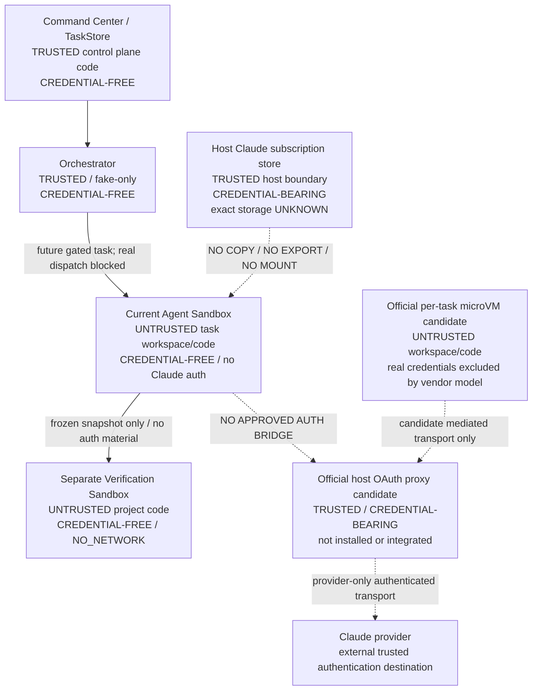
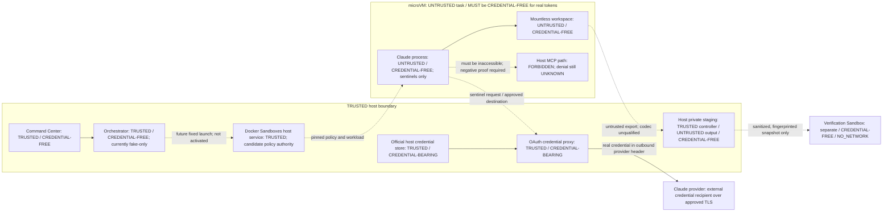

# Phase 3B5A: Claude Docker subscription auth discovery and architecture

Status: **DISCOVERY COMPLETE / AUTH BRIDGE IMPLEMENTATION BLOCKED**.
Decision: **NO_SAFE_SUPPORTED_PATH_FOUND** for the current installed, custom
Docker Agent Sandbox under the full required security contract.
Discovery date: 2026-10-06 (Asia/Singapore). No implementation is included.

An official alternative was found and is recorded below. This decision is not a
claim that subscription isolation is universally impossible. The alternative is
not installed here, is not the existing runtime, and has material policy differences.
It must not be promoted to a compatible, safe implementation without a new
Control Plane architecture decision and the evidence gates in this document.

## 1. Frozen baseline and scope

- Repository: `augusliang23-web/Micro-SaaS-Command-Center`.
- Remote main / discovery baseline: `25692a9a1fdedaf82910630fb767589aa5dccddf`.
- [PR #21](https://github.com/augusliang23-web/Micro-SaaS-Command-Center/pull/21)
  is CLOSED / MERGED. Its reviewed head is
  `a95430ea3fdef5d5a7d30378cc015694c009fd5e`.
- Phase 3B4 proved one bounded host invocation with subscription auth and
  authoritative Sonnet execution evidence. That proof does not establish Linux
  container authentication or credential isolation.
- Orchestrator defaults to `FakeAdapter` and rejects non-fake adapters before
  probe/start. Product Run routing and Agent Console provider activation remain absent.
- Agent Sandbox and Verification Sandbox are separate existing implementations.
- Docker Claude status remains `CLAUDE_AGENT_SANDBOX_AUTH_BRIDGE_REQUIRED`.
- Work is on `codex/agent-console-phase3b5a-claude-docker-auth-architecture`, in
  an isolated worktree from a separate bare Git copy. The app's native worktree
  tool is bound to PM Dashboard, so it was not used to create the wrong repository.
- User-owned dirty main, preservation refs, governance and historical evidence
  are excluded from edits. Only this document and the Phase 3B4 closeout note change.

This is the architectural discovery artifact requested by Control Plane, not
approval to implement a design or execute any future gate.

## 2. Evidence grades and discovery procedure

`OBSERVED_METADATA` means a sanitized read-only command or filesystem metadata
was inspected. `SOURCE_CONTRACT` means exact-baseline repository code.
`DOCUMENTED` means a primary vendor source accessed on the discovery date.
`INFERENCE` is explicitly weaker than observation. `UNKNOWN` never grants access.

Allowed probes performed:

- CLI version, CLI help, auth help, gateway help; no interactive invocation.
- `claude auth status`, captured internally and reduced to exactly loggedIn,
  authMethod, apiProvider, subscriptionType and command exit code. No account
  identity, unfiltered output, token, cookie or environment value is persisted.
- Environment **name presence** only, without reading or printing their values.
- `lstat`/existence on fixed path categories; no file content reads.
- Docker server version/security-option metadata and IDs/status of containers
  carrying the existing `cc.sandbox=1` ownership label; no full inspect output.
- Presence of the standalone `sbx` executable and `docker sandbox --help`.

No Keychain lookup, secret-store listing, credential export, credential file
read, Docker create/start/exec, image pull/build, login/logout or inference ran.
No discovery probe or executable code is added to Git.

## 3. Host authentication: metadata versus secrets

| Fact | Result | Authority / limit |
|---|---|---|
| Installed Claude Code | `2.1.260` | OBSERVED_METADATA; version command |
| Auth status exit | `0` | OBSERVED_METADATA |
| loggedIn | `true` | Sanitized CLI status |
| authMethod | `claude.ai` | Sanitized CLI status |
| apiProvider | `firstParty` | Sanitized CLI status |
| subscriptionType | `pro` | Sanitized CLI status; not a quota claim |
| API/token overrides | All four known overrides absent | Name-presence probe only |
| Other routing/config overrides | Config-dir/base-URL/Bedrock/Vertex/Foundry overrides absent | Name-presence probe; no settings content inspection |
| Default configuration directory | Exists, current-user owned, mode `0755` | Metadata only; this is not a credential-file permission claim |
| Filesystem credential candidate | Does not exist at the default category | Metadata only; does not exclude another location |
| Home configuration candidate | Regular file, current-user owned, mode `0600` | Metadata only; contents deliberately not read |
| macOS Keychain | Documented normal credential store | DOCUMENTED; actual entry not inspected |
| Browser/session credential source | Not established | UNKNOWN; login browser is not proof of persistent cookie dependence |

Authentication classification: **claude.ai subscription is OBSERVED_METADATA;
macOS Keychain storage is DOCUMENTED and consistent with the metadata, but the
exact active secret location is UNKNOWN / SECRET_INSPECTION_NOT_ALLOWED**.
There is no claim that a specific Keychain entry was found or that its contents
were read. Inodes and personal absolute paths are not included in this document.

The [official authentication documentation](https://code.claude.com/docs/en/authentication)
describes macOS Keychain storage, a filesystem fallback, Linux credential files
and config-directory separation. Its current version-dependent features are not
assumed to exist in installed CLI 2.1.260. CLI help exposes an enterprise gateway,
not evidence of a personal-subscription auth socket.

The existing host adapter strips API/OAuth overrides from its child environment
and requires observed `claude.ai` auth. Host adapter source/evidence remains the
accepted authority for Phase 3B4; no new host call was used to reproduce it.

## 4. Existing Docker contract

Source authorities: [policy](../../server/sandbox/sandboxPolicy.mjs),
[runtime](../../server/sandbox/dockerSandboxRuntime.mjs),
[readback](../../server/sandbox/readbackVerifier.mjs),
[workspace view](../../server/sandbox/workspaceView.mjs),
[path safety](../../server/sandbox/pathSafety.mjs),
[image allowlist](../../server/sandbox/sandboxImages.mjs),
[verifier profile](../../server/verifier/verificationProfile.mjs).

| Surface | Exact existing contract | Evidence limit |
|---|---|---|
| Container user | Server-resolved numeric non-root UID:GID; UID must be >0 | SOURCE_CONTRACT; no running agent was inspected |
| HOME / working directory | `HOME=/tmp`; `/workspace` | Fixed source constants, not host environment values |
| Root filesystem | `--read-only` | Strict readback required before use |
| Workspace | One canonical, server-selected, non-recursive bind | Agent RW; verifier source RO |
| Git metadata | `.git` file masked RO or `.git` directory masked by RO tmpfs | Shared host Git authority never mounted |
| Capabilities / privilege | `--cap-drop=ALL`, no-new-privileges, private IPC | No host PID namespace, devices or Docker socket |
| Scratch writes | `/tmp` tmpfs: `rw,noexec,nosuid,nodev,size=64m` | Ephemeral; not secure separation from same-UID code |
| Agent default limits | 1 CPU, 512 MiB, no extra swap, 128 PIDs, 120000 ms, 1048576 output bytes | Source defaults, not a live resource observation |
| Environment | Fixed minimal base; reject secret/provider/routing/proxy names; no generic host-env inheritance | Unknown fields and extra mounts rejected |
| Image | Server-selected immutable reference; create uses pull=never | Default test image is scratch-only, not an approved Claude image |
| Workspace guard | Escaping symlinks, hardlinks, nested Git, special nodes and boundary scans blocked; recheck before start | Non-recursive bind is primary submount containment |
| Identity | Immutable container ID + ownership labels; strict pre/post readback | Ambiguity remains UNKNOWN, never verified |
| Agent network | `PROVIDER_NETWORK` maps to Docker `bridge` | **Not an Anthropic endpoint allowlist** |
| Verifier network | `NO_NETWORK` maps to Docker `none` | Must stay credential-free and independent |
| Verifier private writes | `/verify` tmpfs `rw,exec,nosuid,nodev,size=1g`; source RO | Separate dependency/snapshot runner |
| Verifier command limits | 2 CPU, 2048 MiB, 256 PIDs, 180000 ms, bounded stdout/stderr | Server-owned fixed profile |

Observed Docker Engine: `29.8.1`. Security-option metadata reports builtin seccomp
and cgroup namespace support. There are zero currently owned `cc.sandbox=1`
containers, so **no live Agent Sandbox config or auth is claimed**.
Standalone `sbx` is absent; `docker sandbox --help` is unavailable. Engine version
alone does not establish Docker Sandboxes capability.

Missing today: approved Linux Claude image, container-specific subscription auth,
credential mediation, endpoint-enforced egress, revocation/isolation proof and an
adapter integration that preserves the existing contract. The source comment
`ProviderAuthMount` is not a supported auth interface or authorization to mount secrets.

## 5. Options evaluated

| Option | Decision for current runtime | Concrete reason |
|---|---|---|
| A. Copy/mount host credentials | REJECT | Long-lived secrets become readable in the task trust domain; RO is not confidentiality. Keychain data is not a portable Linux login. Violates lifecycle and compromise containment. |
| B. OAuth/API token environment | REJECT | Process environment, descendants and inspect surfaces can expose the token. API credentials risk PAYG; OAuth still exposes reusable subscription auth. Generic env policy already forbids this. |
| C. Direct login in current container | REJECT for this contract | Official CLI supports container browser/code login, but Linux stores credentials under the CLI user's config. A separate directory with mode 0600 is still readable by compromised same-UID code. Tmpfs removes persistence, not access; persistent volumes introduce cross-task secrets. |
| D1. Custom host transport-only broker | HOLD / not supported here | No installed documented personal-subscription transport delegation interface was established. Do not extract Keychain tokens or reverse-engineer OAuth requests. Ordinary HTTPS CONNECT forwarding alone cannot supply missing CLI auth. |
| D2. Host executes full Claude CLI | REJECT as equivalent sandbox solution | The CLI and its file tools execute on the host; Docker wrapping another process does not relocate those tools. Phase 3B4 proves a different boundary. |
| E. Credential sidecar | REJECT direct secret handoff; HOLD transport-only variant | A sidecar that returns tokens or mounts its volume recreates A/B. A transport-only sidecar needs the same unsupported subscription delegation, authorization and egress proof as D1. Root/compromise boundaries must be explicit. |
| F. Official Docker Sandboxes managed OAuth proxy | DOCUMENTED CANDIDATE, NOT ADOPTED | Official proxy keeps real OAuth outside its microVM, but this is a different backend, absent locally; default privilege, writable state and lifecycle differ from the current runtime. No documented attachment to this custom Docker runtime was established. |

The [official devcontainer instructions](https://code.claude.com/docs/en/devcontainer)
describe container sign-in, browser callback/code handling and a config volume
for rebuild persistence. Non-root login is possible; persistence is not evidence
of isolation from task code. No login or volume setup was attempted.

[Docker credential documentation](https://docs.docker.com/ai/sandboxes/configuration/credentials/)
describes host-managed OAuth for Claude, sentinel credentials and an optional
passthrough mode that reduces isolation. No existing host credential was imported.
OAuth support does not prove this CLI/version/kit combination interoperates with
our raw-container backend. Passthrough, API-key preference and missing binding
must all prevent execution under this contract.

[Docker architecture](https://docs.docker.com/ai/sandboxes/architecture/)
places the mediation proxy outside a microVM. It is transport mediation, not host
execution of the entire Claude CLI. [Its defaults](https://docs.docker.com/ai/sandboxes/security/defaults/)
include sudo, writable/persistent VM state and shared skills. Adopting that backend
without reapproval would change the reviewed sandbox contract. Its default Claude
[startup command](https://docs.docker.com/ai/sandboxes/agents/claude-code/)
also includes bypass-permissions behavior; it is not our restricted edit-only argv.

[Claude gateway documentation](https://code.claude.com/docs/en/llm-gateway)
is not proof of forwarding a personal Pro login. The published
[credential-use guidance](https://code.claude.com/docs/en/legal-and-compliance)
distinguishes a user signing into unmodified Claude Code from a third-party
application intermediating subscription tokens. A custom token broker must not
be approved on an assumption of support. Hosted/product use would need its own
Control Plane support/terms review; this document is not legal clearance.

## 6. Single architecture decision

**NO_SAFE_SUPPORTED_PATH_FOUND** for the current baseline and installed runtime.
No copy, token-env, shared config volume, secret-returning sidecar, SDK/OAuth
wrapper or full host execution fallback is recommended.

The strongest next **discovery question**, not a second implementation
recommendation, is whether a version-pinned official Docker Sandboxes
host-managed OAuth backend can preserve/re-establish every required boundary.
Control Plane must first decide whether a backend change is in scope. If not,
remain blocked and keep the existing fake-only product. Do not infer unsupported
compatibility merely because the vendor offers a separately isolated product.

### Trust-boundary diagram

Solid edges describe control/data separation; dotted edges are blocked or
unimplemented proposals, not running connectivity. The host CLI proved in 3B4
is outside the current Agent Sandbox and is not a Docker sandbox claim.

| Credential question | Current answer | Required before any candidate is accepted |
|---|---|---|
| Where do secrets exist? | Host CLI-managed auth; exact storage UNKNOWN | Official external credential store, no guest passthrough |
| Which process can read them? | Host CLI necessarily consumes its own auth; exact additional readers UNKNOWN | Only approved vendor auth/proxy components and trusted OS administration |
| Which filesystem? | Actual active backing store uninspected | No task-visible bind, volume, environment or shared-memory location |
| Claude Read/Edit/Write access? | Current container has no injected secret | Negative proof against real-secret locations without printing them; synthetic canary first |
| Generated code access? | No provider credentials supplied to current task | No secret in any guest process, filesystem, inherited env or output |
| Another task? | No introduced shared credential surface | Per-task transport authority, fresh isolation, no shared writable auth/skills state |
| Verification Sandbox? | No provider identity/mount/env and NO_NETWORK | Remain completely excluded; snapshot must contain no auth artifacts |

## 7. Required security contract: all 18 principles

These are acceptance conditions, **not** claims of an implemented bridge.
Every condition must PASS; unresolved or unavailable evidence means HOLD.

| # | Required invariant | Concrete acceptance condition |
|---|---|---|
| 1 | Pro subscription-first | Official unmodified Claude login; authoritative claude.ai/firstParty/Pro metadata at the relevant sandbox boundary |
| 2 | No PAYG fallback | Reject API-key, bearer-helper, Console/cloud-provider and imported API-secret paths; no automatic retry into another provider |
| 3 | No browser arbitrary credentials | UI submits task IDs/profiles only; manual vendor login outside product credential fields |
| 4 | No TaskStore secrets | Only auth availability, provider classification and opaque task identity; no secret-bearing blobs |
| 5 | No evidence secrets | Closed schema of sanitized metadata; reject raw headers, token responses, credential file output |
| 6 | No log secrets | No debug/raw transport/auth logging or unsanitized stderr; bounded diagnostics and controlled crash handling |
| 7 | No UI secrets | Availability and blocked reason only, never masked-prefix token values |
| 8 | No Git secrets | Documentation/source only; no auth exports, cached auth files or capture fixtures |
| 9 | No image secrets | Approved immutable image and build inputs contain no credential material; no login during image build |
| 10 | Code cannot read secrets | Credentials outside guest/task process and filesystem boundary, not merely a mode-0600 directory |
| 11 | Code cannot exfiltrate secrets | No raw guest secrets; authenticated transport only to reviewed provider destinations; output/header leak tests |
| 12 | No traversal into auth | No auth bind/volume inside task namespace; reject symlink/hardlink/submount/special-node escapes |
| 13 | One task cannot persist auth compromise | Fresh task isolation, scoped/revocable transport authority; no guest refresh token or persistent shared writable store |
| 14 | Revocation possible | Demonstrate transport denial immediately; separately establish official OAuth revocation, with no implied equivalence |
| 15 | Auth failure closes execution | Missing binding, unavailable proxy, expired login, wrong provider or failed preflight prevents model call |
| 16 | UNKNOWN is not authenticated | Positive authoritative boundary metadata required; UNKNOWN cannot become PASS from prose or a created VM |
| 17 | API versus subscription distinct | Preserve exact auth-method/provider evidence; dummy env tokens or a proxy placeholder are not subscription proof |
| 18 | Verifier credential-free | No OAuth store, provider env, auth socket or network; immutable sanitized snapshot only |

## 8. Network model and provider requirements

- Current `NO_NETWORK`: proper verifier profile, incapable of remote Claude inference.
- Current `PROVIDER_NETWORK`: ordinary Docker bridge, not provider-only egress.
  It is **not** an acceptable production auth-bridge network proof.
- `PROVIDER_ONLY_NETWORK`: potential future mediated model; all TCP/UDP/DNS,
  redirects, IPv6, alternative ports, CONNECT destinations and proxy bypasses
  default-denied. Do not rely on tool allowlists to constrain compromised code.
- `HOST_BROKER_ONLY`: task can reach only a reviewed transport mediator; the
  mediator may authenticate, but must never run file tools on the host or return
  tokens. There is no approved implementation here.

The [official network reference](https://code.claude.com/docs/en/network-config)
lists inference, OAuth/account and optional update/telemetry destinations.
`api.anthropic.com` is an inference destination; browser login/refresh may need
additional documented account endpoints. This is not a complete observed trace
for installed 2.1.260. The exact endpoint/method/redirect set is **UNKNOWN** until
version-specific review and a separately authorized sanitized trace.

Any future proposal must separate admin bootstrap/login traffic from task
inference traffic. Approve exact vendor destinations from the pinned CLI/kit,
never `*.anthropic.com`, arbitrary CONNECT, unrestricted bridge, package registry
or user-selected proxy URLs. Disable optional traffic where supported without
changing installed settings now. [Docker's network policy](https://docs.docker.com/ai/sandboxes/governance/access-controls/network/)
is a candidate native enforcement surface; current code does not use it.
Even an allowed provider can receive malicious task content. Destination filtering
alone is not data-loss prevention or protection against subscription quota abuse.

## 9. Credential lifecycle and fail-closed state machine

No credentials are created, moved or retired in this phase. Existing host auth
remains under the CLI/user's control. Its active backing store, refresh behavior
and exact revocation semantics are UNKNOWN / SECRET_INSPECTION_NOT_ALLOWED here.

Required future lifecycle:

1. Install/approve a version-pinned native mechanism without secrets or inference.
2. Explicitly authorize manual official login, if required; never scrape/import
   existing host credentials. Same Pro account is not the same token/session.
3. Authorize only the reviewed subscription transport for one task. Do not grant
   API-key fallback, global all-task bindings or token passthrough.
4. Refresh only within the trusted vendor auth boundary; failures block new calls.
5. On task end/cancel/timeout, deny transport before any reuse; confirm guest and
   ephemeral storage absence. A stopped VM is not proof of deletion.
6. On compromise, revoke transport then use the vendor-supported login revocation
   procedure after separate authorization. Removing a local binding/file is not
   assumed to revoke a provider refresh token.
7. Reuse no task VM or guest auth cache. Cross-task authorization is independently
   reassessed. Verifier inputs exclude all credential and session artifacts.

Future states: `BRIDGE_REQUIRED -> CAPABILITY_REVIEWED -> AUTH_UNAVAILABLE or
AUTH_UNKNOWN or AUTH_SUBSCRIPTION_CONFIRMED`. Only the last state with verified
sandbox, egress, scope and expiry permits a separately authorized call. Expired,
ambiguous, API-backed or missing observations transition to BLOCKED. Current
state remains `BRIDGE_REQUIRED`. No existing Orchestrator code is changed.

## 10. Threat model

PASS here means an existing baseline boundary/no-change rule is retained.
HOLD means a proposed auth bridge lacks required implementation/negative evidence.
Residual risk is never removed by a prompt or by naming a directory private.

| Threat | Required mitigation | Residual risk | Status |
|---|---|---|---|
| Malicious model output | Restricted edit-only tools, structured policy enforcement, no auth output surfaces | Model can misuse allowed edits and provider calls | HOLD for authenticated sandbox |
| Malicious repository content | No project hooks/plugins/settings loaded; immutable trusted launcher and config | Prompt injection remains possible | HOLD for new backend integration |
| Dependency scripts | Run project builds/tests only in credential-free NO_NETWORK verifier; no installs in authenticated task domain | Dependency/vulnerability risks persist within verifier | PASS boundary retained; new integration HOLD |
| Path traversal | Canonical workspace, no credential mount, exact route/path checks | Native backend semantics unverified | HOLD |
| Symlink/hardlink/submount tricks | Reuse fail-closed workspace scans, non-recursive bind and pre-start rescan | TOCTOU and new VM mount semantics require proof | HOLD |
| Environment leakage | No raw token env, fixed allowlist, synthetic inspection tests | Same-UID code reads any accidentally inherited secret | HOLD |
| /proc leakage | No raw guest secrets, private PID boundary, no secret broker colocated with tools | Guest memory is readable after guest compromise | HOLD |
| Process inspection | No secrets in argv/stdin outside trusted auth flow; no shared task process namespace | Trusted-host administrator remains privileged | HOLD |
| Docker inspect leakage | No secret Config.Env, command, mount source or labels; inspect allowlisted fields only | Full debug/inspect output would expose accidental secrets | HOLD |
| Container/VM escape | Non-root/no-new-privileges/cap-drop baseline; immutable images; native boundary review | Docker/kernel/hypervisor/vendor compromise remains a trusted-boundary risk | HOLD; no absolute escape guarantee |
| Credential-volume leakage | No task-visible secret volume; native OAuth passthrough forbidden | Vendor bug/misconfiguration can breach separation | HOLD |
| Logs | Sanitized closed schemas, no header/token/raw auth output | Unexpected vendor stderr may contain sensitive data | HOLD |
| Crash dumps | Disable guest cores; no guest secrets; trusted-host crash telemetry must be reviewed | Host auth/proxy memory contains secrets | HOLD |
| Child processes | No shell/MCP/customization in agent; verifier alone runs project code | New launcher/CLI behavior must be rechecked | HOLD |
| Cross-task persistence | Destroy task VM/ephemeral storage; no shared skills/auth writes; bind per task | Official default persistence/shared skills do not satisfy this automatically | HOLD |
| Compromised previous task | Never reuse previous guest; deny its transport; rotate/revoke only through authorized native flow | Revocation propagation and concurrent-session scope unknown | HOLD |
| Malicious PR code | External exact-SHA review/clean checkout before trusted execution; repo cannot redefine its own safety gate | Malicious yet-approved change or compromised host remains possible | PASS no runtime edits; future gate HOLD |
| Network exfiltration | Enforce host-mediated destination policy, no arbitrary DNS/CONNECT/UDP, no guest raw credentials | Allowed provider endpoints can carry task content/quota abuse | HOLD |

Critical blockers: no compatible official mechanism installed; no supported
transport-only attachment to the current runtime; direct-login secrets share a
task trust domain; no enforced provider-only egress; alternative backend policy
and lifetime/revocation semantics unproved. No live Production fault is asserted.

## 11. Future gates: conditional, not authorized

Because no safe compatible path is accepted, these are stop-gated follow-up
outlines, not an executable implementation plan. Control Plane must first approve
whether to evaluate a different native backend. No automatic provider or auth budget
is granted by this document. Actual budgets below are future upper bounds that
still need explicit per-gate authorization.

| Gate | Allowed changes / evidence after separate approval | Forbidden | Rollback / stop boundary | Provider-call budget |
|---|---|---|---|---|
| 3B5B1: official capability qualification | Pin vendor versions/kit/source/provenance; decide raw-container compatibility versus explicitly reviewed backend change; prove a supported subscription-only transport and retained privilege/mount/resource policy | Secret reads/imports, login, inference, runtime integration, network relaxation | If no supported compatible design, retain this BLOCKED decision; uninstalling future tooling requires its own permission | 0 |
| 3B5B2: isolation foundation and synthetic negatives | Only after revised architecture approval: isolated server-owned integration/tests using fake credentials and a synthetic responder; prove traversal, env/proc/inspect/log/header/redirect/passthrough and cross-task denial; retain fake-only product | Real credentials, provider access, auth operations, verifier networking, Orchestrator activation | Discard isolated branch/fixtures; retain current backend; no production rollback needed | 0 |
| 3B5B3: official auth and sanitized preflight | Separate authorization for user-operated native login if necessary; validate subscription-only method, mediated storage, non-root/config/egress readback and revocation test procedure | Credential export/copy/mount, API fallback, secret diagnostics, inference | Deny transport; user/vendor-supported logout/revocation only if expressly authorized; never silently revoke existing host sessions | 0 |
| 3B5B4: one bounded sandbox smoke | Exact reviewed frozen source and synthetic fixture; one invocation, authoritative model/denial, exact output, no leak/persistence, resources/process/guest cleanup; compare host auth metadata and verifier exclusion | Retry, larger scope, billing fallback, product dispatch, deployments | Stop guest/deny transport using preauthorized cleanup; preserve sanitized FAIL/UNKNOWN evidence; no automatic login recovery | At most 1, separately authorized |
| 3B5B5: independent security review | Review exact head and sanitized evidence; verify all 18 principles and denied paths; review-only call if explicitly budgeted | Additional task smoke, implementation, merge/deploy, token inspection, product activation | Any blocker retains BRIDGE_REQUIRED; implementation/live approval remains separate | 0 by default; at most 1 review-only call if separately authorized |

## 12. Unresolved unknowns and final recommendation

- Actual host secret store/entry and all readers: UNKNOWN / SECRET_INSPECTION_NOT_ALLOWED.
- Installed CLI support for any external subscription-auth socket: NOT ESTABLISHED.
- Exact official Sandboxes version/kit and compatibility with CLI 2.1.260: UNKNOWN;
  not installed, not downloaded, not tested.
- OAuth-only precedence, placeholder/auth-status semantics, passthrough protection,
  effective task binding, refresh/revocation behavior and guest-crash handling:
  vendor model documented in part; this application's proof remains UNKNOWN.
- Exact runtime egress and account endpoints for the pinned versions: UNKNOWN.
- Retaining non-root/no-sudo, immutable root, .git masking, resources and per-task
  destruction under another backend: UNKNOWN; defaults differ materially.
- Official licensing/hosting suitability and any additional tooling/subscription
  cost: NOT VERIFIED; do not invent cost or subscription quota telemetry.

**Final recommendation: NO_SAFE_SUPPORTED_PATH_FOUND.** Keep Docker subscription
auth and real product execution blocked. Review this documentation-only Draft PR;
if Control Plane wants the official native alternative, authorize a separate
capability/architecture gate before any installation, login or implementation.
There is no second equally recommended path and no host-provider fallback.

## 13. Validation and safety record

This patch contains Markdown only. Validate structural Markdown, local links,
required sections/security/threat/gate coverage, exact diff scope and
`git diff --check`. No dependencies, executable probes, runtime source, image,
auth policy or governance are changed. No full test suite, local build or live
smoke is required or claimed. Local document checks are not GitHub CI; GitHub
currently reports zero exact-head checks for this baseline.

Inference calls: **0**. Login/logout/setup-token: **0**. API PAYG: **no**.
Credential contents read/copied/exported/mounted: **no**. No Docker state-changing
operation, deployment, Orchestrator activation or historical-evidence alteration.

---

## Phase 3B5B1 — Official Docker Sandboxes backend qualification

### B1. Decision, exact baseline and evidence grades

**OFFICIAL_DOCKER_SANDBOX_BACKEND_REQUIRES_INSTALLATION_TO_QUALIFY**.
This is a completed documentary qualification, not backend approval. The native
candidate is promising, but the mandatory enforcement/readback properties below
cannot be responsibly concluded on this host without a separately authorized
installation and synthetic qualification. No installation is authorized here.
The historical 3B5A decision **NO_SAFE_SUPPORTED_PATH_FOUND** is unchanged for
the existing custom raw-Docker Agent Sandbox. No supported attachment of native
OAuth mediation to that runtime is established.

Qualification date: 2026-10-06, Asia/Singapore. Before research, PR #22 was
OPEN / Draft / UNMERGED at `76d76a038bd6acc1ad840419f8d8556cf67dbee6`, based on
remote main `25692a9a1fdedaf82910630fb767589aa5dccddf`. A clean isolated checkout
was created at that exact commit; the dirty original main was not checked out,
reset, pulled, stashed or used for execution. Only this appended section changes.

- **DOCUMENTED**: current primary vendor documentation, linked at each finding.
- **OBSERVED_LOCALLY**: metadata commands only; no sandbox runtime experiment.
- **CONFIGURABLE**: a documented setting/mechanism, not proof it works here.
- **UNKNOWN**: absent, incomplete, version-dependent or untested authority.
- **INCOMPATIBLE**: a specific default/mode violates the required property;
  this does not prove every possible custom workload has that incompatibility.

The comparison uses MATCH / CAN_BE_CONFIGURED / UNKNOWN / INCOMPATIBLE. MATCH
means a documented analogous boundary, never an installed or tested PASS.
Only local qualification of all mandatory rows could promote this candidate.

### B2. Local capability and exact installation prerequisite

| Metadata | OBSERVED_LOCALLY |
|---|---|
| `sbx` executable on PATH | Absent; no `sbx` command was executed |
| `docker sandbox --help` | Exit 1; command unavailable |
| Docker CLI / Engine | 29.8.1 / 29.8.1 |
| Docker Desktop bundle version / build | 4.93.0 / 240920 |
| Host architecture / OS version | arm64 / macOS 27.0.1 |
| Official local Sandboxes capability | Not available through either checked CLI surface |
| Required capability state | **INSTALLATION_REQUIRED** |

Docker now distributes a separate `sbx` CLI/local microVM backend; Desktop or
Engine presence does not establish it. The documented Mac prerequisites are
Apple silicon and macOS 14+. Its official install source is Docker's own
`docker/tap/sbx`, or vendor release artifacts/manual instructions. The vendor's
latest release metadata observed today is **v0.47.0**, published
2026-10-05T15:46:13Z; v3 kits need at least v0.45. Future authorization must pin
and verify the official package/artifact, version and signature/checksum first.
No installer, tap change, download, feature enablement or daemon start occurred.
[Installation][D1], [official release][D2], [kit versions][D3].

Installation does not authorize `sbx login`, Claude login, image pulls/builds,
sandbox creation, governance changes or provider requests. Docker's documented
sign-in is a distinct OAuth operation; do not assume the existing Desktop login
satisfies it. Those prerequisites require separate authority if later needed.

### B3. Security contract comparison

Current-contract authority remains [sandboxPolicy.mjs](../../server/sandbox/sandboxPolicy.mjs),
[workspaceView.mjs](../../server/sandbox/workspaceView.mjs),
[readbackVerifier.mjs](../../server/sandbox/readbackVerifier.mjs) and
[verifier foundation](../../server/verifier/foundation.mjs). Their strict flags,
limits, immutable IDs, path scans and evidence semantics are unchanged.

| Property | Current custom Agent Sandbox | Official default / candidate | Classification / proof still required |
|---|---|---|---|
| Non-root execution | Numeric UID:GID, UID > 0 | `agent` UID 1000; v3 custom image account | CAN_BE_CONFIGURED; read actual UID/GID [D4] |
| Sudo availability | no-new-privileges prevents elevation | Standard v2 requires passwordless sudo; v3 example omits sudo | CAN_BE_CONFIGURED via v3, not v2; negative elevation proof [D4][D5] |
| Root filesystem immutability | Read-only root mount | Default VM writes persist; no complete equivalent established | UNKNOWN for custom v3; default INCOMPATIBLE [D6] |
| Workspace write scope | `/workspace` and bounded scratch only | Mountless private working directory possible; broader guest writes default | CAN_BE_CONFIGURED for host exposure; guest write restriction UNKNOWN [D7] |
| Host filesystem exposure | One non-recursive bind; no home/secret mounts | Explicit mounts/skills are exceptions to VM isolation | CAN_BE_CONFIGURED with zero host mounts, skills off [D8] |
| .git isolation | Read-only mask; host Git control unavailable | Direct mode exposes .git; clone mode mounts source RO | CAN_BE_CONFIGURED: mountless sanitized source without Git [D8] |
| Docker socket exposure | No Docker socket | Host daemon isolated; standard templates have guest Docker | CAN_BE_CONFIGURED: no-Docker custom image; prove no socket [D5][D8] |
| Device exposure | No host devices | Optional GPU/USB/display interfaces | CAN_BE_CONFIGURED: omit all; verify device readback [D9] |
| Capabilities | cap-drop=ALL, strict readback | Non-privileged template available; exact drop set unestablished | UNKNOWN; privileged=false is insufficient [D5] |
| No-new-privileges equivalent | Kernel no-new-privileges flag required | No authoritative corresponding setting/readback established | UNKNOWN; do not infer from microVM [D10] |
| PID/process isolation | Private namespace, no host PID | Separate VM kernel/process boundary | MATCH documented VM separation; inspect after installation [D8] |
| IPC isolation | Private IPC namespace | Separate kernel isolates host/other VMs; guest IPC details unproven | UNKNOWN for full equivalent [D8] |
| Resource controls | Server-owned bounded policy | CPU/memory creation controls; remaining controls below | UNKNOWN until effective limits readback [D9] |
| CPU limits | 1 CPU default | Explicit `--cpus`; default 0 may allocate all host CPUs | CAN_BE_CONFIGURED; never accept 0/default [D9] |
| Memory limits | 512 MiB, equal swap ceiling | `--memory`/sandbox memory setting documented | CAN_BE_CONFIGURED; prove effective cap/swap, not just requested value [D9] |
| Process/PID limits | 128 PIDs default | No documented equivalent located in reviewed local interfaces | UNKNOWN; timeout alone does not prevent exhaustion |
| Disk limits | Root RO; `/tmp` 64 MiB tmpfs | Kit volume sizing / Docker storage size settings | UNKNOWN for total root/workspace/cache growth [D5][D11] |
| Timeout supervision | 120000 ms, observed exit required | Local agent/session/VM supervision not qualified | UNKNOWN; CLI disconnect is not stopped execution |
| Stdout/stderr limits | Bounded streaming; overflow UNKNOWN | No equivalent native stream bound established | UNKNOWN; host supervision must bound and confirm termination |
| Writable temp areas | Ephemeral noexec/nosuid/nodev tmpfs | Kit tmpfs mounts possible; full option equivalence unproven | UNKNOWN; inspect flags, size and lifetime [D5] |
| Persistent VM state | Per-task disposal required | Stop/start retains guest packages/files/configuration | INCOMPATIBLE if reused; fresh-create/destroy candidate [D6] |
| Shared state | No shared mutable task state | Shared skills and host credential/binding/MCP state exist | CAN_BE_CONFIGURED partly; credentials/gateway scope UNKNOWN [D12][D13] |
| Per-task destruction | Owned immutable ID; confirm removal | `sbx rm` deletes VM contents | CAN_BE_CONFIGURED; require absence, not stop success [D7] |
| Cross-task persistence | No VM/session/approval reuse | State retained on restart; some host records survive removal | UNKNOWN for full no-reuse equivalence [D13] |
| Skills persistence | No shared agent skills | Shared store default readonly, optional readwrite/off | CAN_BE_CONFIGURED: `--skills=off`; readonly is not isolation [D12] |
| Network default | Ordinary bridge; not provider-only | Policy proxy; unmatched local traffic can request approval | CAN_BE_CONFIGURED, not automatically a strict task allowlist [D14] |
| DNS control | Bridge supplies ordinary resolver | Internal resolver governed by network policy | MATCH documented mediation; bypass/rebinding negatives untested [D8] |
| IPv4 control | No endpoint filter | Host/IP/port policy grammar | CAN_BE_CONFIGURED; exact hosts/443 only [D15] |
| IPv6 control | No endpoint filter | IPv6 policy grammar; kit enforcement limitations differ | UNKNOWN for chosen kit/runtime version; no fallback bypass [D5][D15] |
| Redirect handling | No redirect restriction | All TCP policy mediation documented, exact chain untested | UNKNOWN; each new destination and auth-header recipient must be checked |
| HTTP CONNECT handling | Unrestricted bridge destinations | Forward/transparent proxies enforce policy | UNKNOWN for CONNECT/SNI/Host/port bypass proof [D8] |
| Credential visibility | No safe custom subscription bridge | Proxy substitutes sentinels; passthrough optionally exposes tokens | CAN_BE_CONFIGURED: OAuth only, passthrough false [D5][D16] |
| Credential lifetime | No accepted transport lifecycle | Host storage/refresh; guest sentinel files and persistent state | UNKNOWN for per-task transport expiry [D16] |
| Credential revocation | Must block subsequent task transport | Removing secrets/bindings is not proof of provider revocation | UNKNOWN for in-flight/refresh/replay scope [D16][D17] |
| Cross-task credential reuse | Independently authorized task transport | Global services/bindings and shared OAuth refresh possible | UNKNOWN; scope binding and replay negatives required [D16][D17] |
| Workspace snapshots | Sanitized, fingerprinted, metadata guarded | Native transfer/saved templates have different semantics | UNKNOWN until hostile export/import tests [D7] |
| Verification Sandbox compatibility | Separate credential-free NO_NETWORK runner | Agent output must cross a new extraction boundary | CAN_BE_CONFIGURED architecturally; transfer proof UNKNOWN |

The default template is not accepted. Its broad guest privilege and persistent
filesystem are not substitutes for cap-drop/read-only/no-new-privileges. V3's
non-sudo example prevents a blanket claim that all native backends inevitably
require sudo. Undocumented remaining controls stay UNKNOWN, not NOT_SUPPORTED
or MATCH. No custom nested security runtime is proposed as a proven workaround.

### B4. Claude launcher and repository configuration

| Control | Qualification |
|---|---|
| Custom launcher | CONFIGURABLE: v3 image ENTRYPOINT/CMD or v2 full entrypoint replacement; not merely appended flags [D4][D5] |
| Default bypass flag | INCOMPATIBLE: native built-in Claude launches with `--dangerously-skip-permissions`; flags after `--` normally preserve it [D18] |
| Executable/model/profile/cwd/env | CONFIGURABLE in host-owned, digest-pinned workload plus fixed launcher; no browser/task argv or repository-selected kit/env file |
| Timeout/output | UNKNOWN effective VM supervision; host-side bounded capture must also stop/observe the guest and revoke transport |
| Tool availability | CONFIGURABLE via explicit `--tools=Read,Edit,Write,Glob,Grep`; `--allowedTools` alone is not a tool boundary [C1] |
| Bash/PowerShell/shell/WebFetch/WebSearch | Deny by exact tool names plus restricted mode; OS compromise confinement is a separate unqualified boundary |
| Browser/Chrome | No browser kit, display/USB/clipboard-image bridge or Chrome flag; no remote-control session [D9][D11][C1] |
| Subagents/background agents | No agents-view, `--bg`, resume/continue, task tool or project agent discovery; inspect available tool classes for the pinned CLI [D18][C1] |

Required future launcher: server-selected absolute executable and immutable
image/kit; non-interactive print mode; server profile/model/effort; fixed cwd and
minimal environment; existing restricted/safe-mode and strict tool-denial rules;
strict empty MCP configuration; no arbitrary argument tail, add-dir, plugins,
agent definitions, sessions or browser. Preserve structured process/model/tool
proof; prose remains non-authoritative. This is a requirement, not launch code.

Docker does not import host `~/.claude` by default, but does expose project
configuration in a mounted workspace. Kit instructions do not replace project
CLAUDE.md, and v2 child kits inherit permissions, MCP settings and volumes.
`locked` kit fields govern kit composition, not all repository configuration.
Do not pass an untrusted kit, sbxenv.yaml, host lifecycle command, credential
command resolver or local override file to the trusted service. [D5][D18].

Claude's `--restricted` ignores user/project settings and confines built-in file
tools; `--safe-mode` skips project customization. Managed policy still applies,
including some managed executable hooks, so managed files must also be trusted
and protected. CLI tool limits do not automatically disable MCP. Use explicit
MCP deny and empty strict config, and test the selected version rather than
assuming current documentation equals its installed behavior. [C1][C2].

Project `.claude/`, settings, hooks, plugins, skills, commands, MCP definitions,
agent definitions and CLAUDE.md must not enable tools, hooks, network, providers,
browser or background processes. Under the proposed launcher, preventing that
is **CONFIGURABLE at Claude configuration discovery; UNKNOWN at the complete
native startup boundary**. The official v3 example makes persistent shell setup
agent-writable; copying it verbatim would let earlier guest state influence
startup before Claude's flags apply. Never reuse it; fixed trusted shell startup
and fresh creation must be proven. If a repository/guest can override the
trusted launcher or its policy, qualification fails. [D4][D10].

### B5. SSH and host MCP — separate authority paths

SSH forwarding is documented ON when the client supplies an SSH agent.
Private-key confidentiality does not remove signing/authentication authority.
The official global switch is `ssh.agentForwardingEnabled=false`, followed by a
daemon restart. No per-kit/per-task switch was established. A future dedicated
trusted daemon must prove it remains false; merely clearing one client's
SSH_AUTH_SOCK is insufficient. No host SSH socket, Git/signing identity,
credential helper or GitHub/registry service grant is permitted. No key/agent
contents were inspected. [D11].

Docker documents a gateway for every sandbox, automatic configuration in supported
integrations, and dynamic catalog/attach tools. Static mode removes dynamic
helpers, but is not an OFF switch. Local stdio MCP servers execute on the host;
MCP Toolkit configuration is separate. No documented general gateway-disable
switch was established. Claude's empty/denied MCP config is only an agent-level
barrier; it does not prove compromised guest code cannot call the gateway.
Host gateway denial and guest discoverability remain **UNKNOWN / BLOCKER**.
Organization MCP policies can forbid gateway requests, but their local
availability/account entitlement is unobserved. They do not cover direct remote
MCP traffic, which also needs network denial. No MCP registration, discovery,
authentication or tool invocation was performed. [D19][D20].

### B6. Credential proxy and subscription-only control

The official proxy intercepts OAuth token responses, supplies guest sentinels,
and substitutes real credentials on approved provider requests. With proxy
management active and OAuth `passthrough:false`, real reusable tokens remain in
the trusted host storage/proxy boundary. Passthrough true is **INCOMPATIBLE**.
If API key and OAuth both resolve, API key wins; missing required bindings can
warn and start without credentials. Neither sandbox creation success nor the
kit's required flag proves subscription auth. [D5][D16][D18].

Future target: an explicitly approved OAuth-only credential capability/binding;
no API-key capability or fallback, no inherited service/registry grants, no raw
credential environment, no dynamic secret-output command, no importing the
current host login. Missing, ambiguous, API-backed or expired auth must prevent
agent start. Exact subscription-only resolution, sentinel placement, guest
memory/files/logs, refresh, revocation and cross-task authorization are UNKNOWN
until approved synthetic tests and a later distinct manual-auth gate. Native
host reuse of a Pro account is not an authorization for every future task.

Host-managed credentials may outlive a VM; `sbx rm` cannot be treated as provider
revocation or deletion of global bindings. Future teardown must first deny that
task's transport, then destroy/check absence and retire its scoped authorization.
Never persist real credentials in guest env/files, argv/stdin/stdout/stderr,
workspace, TaskStore, evidence/logs/UI, images or Git. Sentinels are not tokens;
their inability to authenticate outside their authorized scope still needs proof.
No credential store, token, cookie, SSH identity or user configuration was read.

### B7. Network governance and no guest self-approval

| Surface | Native documentary capability / unresolved proof |
|---|---|
| TCP/HTTP/HTTPS | DOCUMENTED host proxy enforcement; CONFIGURABLE exact destination/port rules [D8][D14] |
| UDP | Disabled by default; never enable experimental egress for this task runtime [D6] |
| DNS | Policy-aware resolver; DNS exfiltration/rebinding and all resolver bypasses remain UNKNOWN [D8][D17] |
| IPv4/IPv6 | Grammar supports both; chosen release/kit enforcement must be tested [D15] |
| Redirects / CONNECT | UNKNOWN end-to-end auth-header and destination enforcement; positive provider and negative escape tests required |
| Alternate ports | Host without port matches more than 443; require exact host:443 and reject all alternate ports [D15] |
| Proxy bypass | `no_proxy` bypasses upstream proxy, not native network policy; prove unsetting guest HTTP_PROXY still cannot bypass native proxy [D11] |
| Package registries / GitHub / arbitrary websites | No runtime allow grants; installation/build traffic is a separate trusted phase, not agent egress |
| New destination approval | DOCUMENTED developer/host-side CLI workflow; trusted Command Center automation and guest inability to exercise host authority are UNKNOWN [D14] |

Approval queues do not themselves grant access, but approvals expand later
requests. Never auto-approve a guest request. Local unmatched traffic may ask for
approval, and broad presets/kit allows are not provider-only policy. An
organization allowlist can deactivate local/kit allow expansion; only trusted
host-side authority may change it. A blanket deny followed by provider allow is
not a valid recipe: matching deny wins. Effective rules must permit only the
reviewed hosts/ports, with no interactive/self-approval expansion and no guest
access to policy RPC/CLI credentials. That complete policy is **UNKNOWN** here.
No policy was inspected through secret-bearing state or changed. [D14][D15].

Current Claude docs distinguish inference `api.anthropic.com`, account sign-in
`claude.ai`/`claude.com`, and OAuth exchange/refresh/revocation
`platform.claude.com`. MCP proxy, browser bridge, updates, plugins, npm/GitHub
and telemetry destinations are not task grants. Exact version-specific endpoints,
methods and redirect chains must be reviewed; don't copy a wildcard vendor list.
Admin login/refresh and guest inference have separate policies. No network trace
or provider request was made. [C3][C4].

### B8. Exactly one candidate workspace and lifecycle

**Recommend mountless mode only**, conditional on qualification. Create with
no workspace path; subsequent attach must identify that sandbox. A bare
`sbx run` without a path auto-mounts the current directory and is not mountless.
Direct mode violates host write/Git isolation. Clone mode protects host writes,
but its source mount still exposes ignored/untracked files and Git metadata;
it is not a sanitized-input boundary. [D7][D8].

The future trusted host imports only sanitized task source without .git, auth,
configuration or caches into a fresh private guest directory. Native `sbx cp`
provides a documented transfer interface, not a verified safe snapshot codec.
Guest output is untrusted: export to private staging, stop writers, apply
protected-path/diff guards and independently sanitize before host Git operations.
Orchestrator alone creates branches/commits/pushes/PRs; never consume guest refs,
hooks, remote configuration or Git executable commands. [D7].

Create a unique fresh sandbox for one task; never resume/reuse a stopped guest.
Remove it, verify exact owned identity absence and no running process/session;
if teardown is ambiguous, block task reuse and transport. Native removal deletes
VM contents, but host workspace, shared skills, credential bindings and MCP
registrations can survive. Never save a whole VM template as verifier input.
Shared skills must use `--skills=off`; no shared mutable state, skills/packages,
sessions/environment/history/project changes or network approvals may transfer
to another task. Native global-state cleanup remains unqualified. [D7][D12][D13].

### B9. Resource governance and verifier compatibility

CPU and memory have documented explicit creation controls; numeric requests are
not effective-limit proof. Docker storage size settings do not bound all guest
root/workspace writes. Native process/PID ceilings, read-only root, complete
capability/no-new-privileges state and total disk bounds remain UNKNOWN. Future
host duration/output/count supervision must reserve one owned sandbox per task,
cap concurrent creations, count stdout/stderr bytes and kill/revoke/remove on
limits. It must observe guest termination, not merely kill the attached CLI.
A hostile guest's process/disk exhaustion cannot be solved by a timer alone;
reject launch if mandatory native limits or readback are unavailable. [D9][D11].

Verification remains separate, credential-free, deterministic **NO_NETWORK**.
No code/image/profile changes are made. Compatibility work is a new trusted
input/output transfer adapter, not sharing the Agent VM or its auth state. Preserve
existing symlink containment, hardlink rejection, special-file rejection,
non-recursive/submount containment and .git masking/exclusion. Reject ambiguous
exports, path traversal, device/FIFO/socket nodes and foreign mount artifacts.
Rebuild regular files/directories rather than trusting guest UID/GID, set safe
permission modes while retaining reviewed executable bits, ignore timestamps as
identity but detect concurrent writes, and recompute content fingerprints and
manifest authority. Guest caches, sessions, skills, credential/sentinel files,
MCP/project config and Git control data must not enter verifier input. The
existing foundation's host paths and integrity checkpoints are not a native VM
export/import implementation; ownership, links, timestamps and transfer races
require later negative proof before any integration.

### B10. Proposed boundary — candidate only, not implemented

Real subscription credentials may exist only in the official trusted host store,
proxy memory/refresh channel and approved provider transport. They MUST NOT exist
in Command Center/Orchestrator state, microVM/Claude memory or filesystem,
workspace, verifier, argv/stdin/output, logs/evidence/UI, images or Git. This
placement is DOCUMENTED for mediated OAuth and a REQUIRED future invariant; no
real credential flow was observed here. Host/proxy compromise remains outside
guest isolation guarantees. MCP denial and the native enforcement gaps are
explicitly unresolved, not hidden behind the microVM boundary. [D16].

### B11. Real blockers, next gate and safety

1. **INSTALLATION_REQUIRED**: no native `sbx` capability is available locally.
2. Required read-only root, cap-drop/no-new-privileges, PID/IPC/disk ceilings,
   authoritative guest termination/readback and guarded transfer are UNKNOWN.
3. Complete host MCP inaccessibility, startup/config immutability and inability
   to alter host network approvals are not established; agent flags alone are
   insufficient for compromised guest code.
4. OAuth-only selection, task-scoped lifetime/revocation/replay and cross-task
   host-state isolation lack synthetic proof. Standard defaults are unacceptable.

These are blockers to adoption, not claims of an active incident or a proven
fundamental impossibility of every v3 workload. Decision remains exactly
**OFFICIAL_DOCKER_SANDBOX_BACKEND_REQUIRES_INSTALLATION_TO_QUALIFY**.
Next gate: **explicit installation authorization** for the pinned official local
component and bounded metadata-only verification, with 0 Claude calls, 0 auth,
0 credentials and no sandbox/policy creation. Docker sign-in, image provisioning
and synthetic sandbox/network/credential negatives need separate explicit scope
if required later. Only after renewed qualification could 3B5B2 be authorized;
it must use synthetic credentials, 0 auth operations and 0 real provider calls.
No gate, installation or implementation is approved by this document.

Safety in this task: Claude inference 0; auth login/logout/setup-token 0;
credential contents read/copied/exported/mounted no; API PAYG no; Docker sandbox
created no; image pulled/built no; network policy changed no; SSH auth no; guest
MCP calls no; Orchestrator activation no; deploy no; Production/UAT/cloud changes
no; governance changes no. Historical evidence and 3B5A text remain unchanged.
Validation is documentation-only: structure/fences, local links, all comparison
properties/required sections, append-only preservation and exact diff scope.
No executable code, test suite, runtime or dependency installation is needed.
Local document checks are not GitHub CI; PR #22 remains OPEN / Draft.

### B12. Primary source register (accessed 2026-10-06)

Live vendor documentation can change. The observations above are date-scoped;
future installation must pin the package/kit/Claude versions and recheck the
supported behavior. Specific v3 and CLI references override assumptions drawn
from older built-in/v2 defaults; conflicting generic descriptions never grant
access. Only vendor sources were used as capability authority.

[D1]: https://docs.docker.com/ai/sandboxes/install/
[D2]: https://github.com/docker/sbx-releases/releases/tag/v0.47.0
[D3]: https://docs.docker.com/ai/sandboxes/customize/
[D4]: https://docs.docker.com/ai/sandboxes/customize/author/build-an-agent/
[D5]: https://docs.docker.com/ai/sandboxes/customize/kits-v2/
[D6]: https://docs.docker.com/ai/sandboxes/security/defaults/
[D7]: https://docs.docker.com/ai/sandboxes/usage/
[D8]: https://docs.docker.com/ai/sandboxes/security/isolation/
[D9]: https://docs.docker.com/ai/sandboxes/configuration/environment-files/
[D10]: https://docs.docker.com/ai/sandboxes/customize/author/base-images/
[D11]: https://docs.docker.com/ai/sandboxes/configuration/settings/
[D12]: https://docs.docker.com/ai/sandboxes/workflows/agent-skills/
[D13]: https://docs.docker.com/ai/sandboxes/configuration/environment-files/
[D14]: https://docs.docker.com/ai/sandboxes/governance/access-controls/network/
[D15]: https://docs.docker.com/ai/sandboxes/governance/concepts/
[D16]: https://docs.docker.com/ai/sandboxes/configuration/credentials/
[D17]: https://docs.docker.com/ai/sandboxes/release-notes/
[D18]: https://docs.docker.com/ai/sandboxes/agents/claude-code/
[D19]: https://docs.docker.com/ai/sandboxes/mcp-gateway/
[D20]: https://docs.docker.com/ai/sandboxes/governance/access-controls/mcp/
[C1]: https://code.claude.com/docs/en/cli-reference
[C2]: https://code.claude.com/docs/en/permissions
[C3]: https://code.claude.com/docs/en/network-config
[C4]: https://code.claude.com/docs/en/authentication

---

## Phase 3B5B1.1 — sbx 0.47.0 installation observation

Date: 2026-10-06 (Asia/Singapore). Starting PR #22 HEAD:
`a5c092596010ec9de1cef0c72aa81622316853c3`, OPEN / Draft / UNMERGED.
The preceding 0.46.0 authorization stopped before installation when the official
stable cask resolved to 0.47.0. A subsequent explicit authorization opened only
installation of stable 0.47.0 and bounded metadata verification.

**Installation succeeded; CLI metadata qualification remains BLOCKED.**

- Official Docker cask: `docker/tap/sbx`, version 0.47.0; vendor release
  `docker/sbx-releases v0.47.0` was not prerelease or draft.
- Authorized cask digest, release DMG digest and the Homebrew-downloaded artifact
  all matched SHA-256
  `bcd6bf72d46f882279638ccb52f8a78bbcb1a91ea299055d2124ecfb73feb726`.
  The live cask blob was `32c23cf92e0520f77b2ca1170c9c01e6ad76ece1`.
- Homebrew 7.0.8 required an explicit official `brew tap docker/tap` after
  `brew trust docker/tap` before it could resolve the cask. The effective local
  cask matched the live vendor definition immediately before installation.
  Installation used `brew install docker/tap/sbx`, with auto-update, automatic
  install upgrades, analytics and cleanup disabled. No package dependencies
  beyond architecture/OS requirements or unrelated package upgrades occurred.
- Homebrew receipt and signed bundle version metadata report 0.47.0 / v0.47.0.
  Binary link: `/opt/homebrew/bin/sbx`; target category: Homebrew Caskroom /
  sbx / 0.47.0 / Sbx.app. Architecture arm64; current-user owned; mode 0755.
- Deep/strict code-signature verification passed. App identifier
  `com.docker.sandboxes`; Docker Inc Developer ID / TeamIdentifier `9BNSXJN65R`.
  Docker CLI/Engine remain 29.8.1; Desktop remains 4.93.0.
- The cask only installed the bundle binary and shell completions; it had no
  installation-start daemon hook. No automatic daemon/background startup was
  observed after installation. No matching LaunchAgent/LaunchDaemon registration
  or new sbx background process was observed during the metadata checks.

The sole attempted CLI metadata command, `sbx --version`, exited 1:
`unknown flag: --version`. It created a previously absent host state category
containing a `sandboxes` directory and six initial directory/file entries.
Only existence/type/mode metadata was inspected; state contents, credential
stores and individual sandbox records were not read. No inference about those
uninspected contents is made. This initialization failed the metadata-only
no-runtime-state precondition, so all subsequent CLI help/version commands were
withheld. Every requested local help surface remains UNKNOWN, not OBSERVED_HELP.
The [official version reference](https://docs.docker.com/reference/cli/sbx/version/)
documents the `sbx version` verb; it was not substituted or run after the stop.
No native runtime enforcement or sandbox availability proof is claimed.

The correctly versioned, signature-verified package remains installed. Rollback
was not needed: package installation did not fail or install an unapproved
version. New host state was not removed, credentials were not inspected, and no
recovery/configuration was attempted. Control Plane must review the initialization
and authorize any further bounded metadata discovery separately.

Actual operations: Claude inference 0; Codex execution through sbx 0; sbx/Claude
auth 0; OAuth browser flows 0; credential contents read/imported/copied/exported/
mounted no; sandbox/VM create/start commands 0; image pull/build commands 0;
network-policy/SSH/MCP operations 0; Orchestrator activation/deploy/Production/
UAT/cloud/governance changes no. No network policy command ran; initialized
state-file contents remain uninspected. No authentication or runtime qualification
is inferred from installation. Historical 3B5A/3B5B1 conclusions and text remain
unchanged; only this sanitized observation is appended. PR #22 stays Draft.
