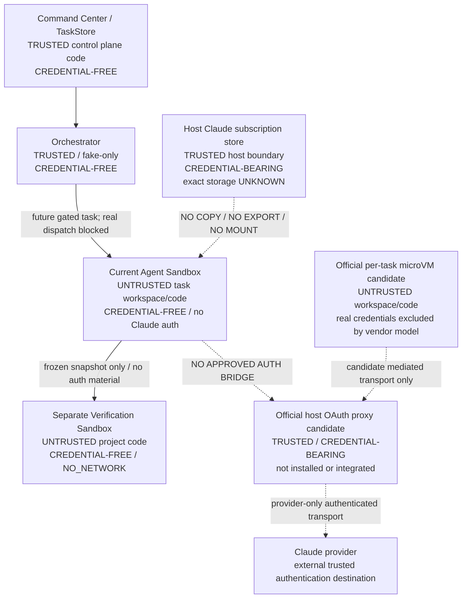

# Phase 3B5A: Claude Docker subscription auth discovery and architecture

Status: **DISCOVERY COMPLETE / AUTH BRIDGE IMPLEMENTATION BLOCKED**.
Decision: **NO_SAFE_SUPPORTED_PATH_FOUND** for the current installed, custom
Docker Agent Sandbox under the full required security contract.
Discovery date: 2026-10-06 (Asia/Singapore). No implementation is included.

An official alternative was found and is recorded below. This decision is not a
claim that subscription isolation is universally impossible. The alternative is
not installed here, is not the existing runtime, and has material policy differences.
It must not be promoted to a compatible, safe implementation without a new
Control Plane architecture decision and the evidence gates in this document.

## 1. Frozen baseline and scope

- Repository: `augusliang23-web/Micro-SaaS-Command-Center`.
- Remote main / discovery baseline: `25692a9a1fdedaf82910630fb767589aa5dccddf`.
- [PR #21](https://github.com/augusliang23-web/Micro-SaaS-Command-Center/pull/21)
  is CLOSED / MERGED. Its reviewed head is
  `a95430ea3fdef5d5a7d30378cc015694c009fd5e`.
- Phase 3B4 proved one bounded host invocation with subscription auth and
  authoritative Sonnet execution evidence. That proof does not establish Linux
  container authentication or credential isolation.
- Orchestrator defaults to `FakeAdapter` and rejects non-fake adapters before
  probe/start. Product Run routing and Agent Console provider activation remain absent.
- Agent Sandbox and Verification Sandbox are separate existing implementations.
- Docker Claude status remains `CLAUDE_AGENT_SANDBOX_AUTH_BRIDGE_REQUIRED`.
- Work is on `codex/agent-console-phase3b5a-claude-docker-auth-architecture`, in
  an isolated worktree from a separate bare Git copy. The app's native worktree
  tool is bound to PM Dashboard, so it was not used to create the wrong repository.
- User-owned dirty main, preservation refs, governance and historical evidence
  are excluded from edits. Only this document and the Phase 3B4 closeout note change.

This is the architectural discovery artifact requested by Control Plane, not
approval to implement a design or execute any future gate.

## 2. Evidence grades and discovery procedure

`OBSERVED_METADATA` means a sanitized read-only command or filesystem metadata
was inspected. `SOURCE_CONTRACT` means exact-baseline repository code.
`DOCUMENTED` means a primary vendor source accessed on the discovery date.
`INFERENCE` is explicitly weaker than observation. `UNKNOWN` never grants access.

Allowed probes performed:

- CLI version, CLI help, auth help, gateway help; no interactive invocation.
- `claude auth status`, captured internally and reduced to exactly loggedIn,
  authMethod, apiProvider, subscriptionType and command exit code. No account
  identity, unfiltered output, token, cookie or environment value is persisted.
- Environment **name presence** only, without reading or printing their values.
- `lstat`/existence on fixed path categories; no file content reads.
- Docker server version/security-option metadata and IDs/status of containers
  carrying the existing `cc.sandbox=1` ownership label; no full inspect output.
- Presence of the standalone `sbx` executable and `docker sandbox --help`.

No Keychain lookup, secret-store listing, credential export, credential file
read, Docker create/start/exec, image pull/build, login/logout or inference ran.
No discovery probe or executable code is added to Git.

## 3. Host authentication: metadata versus secrets

| Fact | Result | Authority / limit |
|---|---|---|
| Installed Claude Code | `2.1.260` | OBSERVED_METADATA; version command |
| Auth status exit | `0` | OBSERVED_METADATA |
| loggedIn | `true` | Sanitized CLI status |
| authMethod | `claude.ai` | Sanitized CLI status |
| apiProvider | `firstParty` | Sanitized CLI status |
| subscriptionType | `pro` | Sanitized CLI status; not a quota claim |
| API/token overrides | All four known overrides absent | Name-presence probe only |
| Other routing/config overrides | Config-dir/base-URL/Bedrock/Vertex/Foundry overrides absent | Name-presence probe; no settings content inspection |
| Default configuration directory | Exists, current-user owned, mode `0755` | Metadata only; this is not a credential-file permission claim |
| Filesystem credential candidate | Does not exist at the default category | Metadata only; does not exclude another location |
| Home configuration candidate | Regular file, current-user owned, mode `0600` | Metadata only; contents deliberately not read |
| macOS Keychain | Documented normal credential store | DOCUMENTED; actual entry not inspected |
| Browser/session credential source | Not established | UNKNOWN; login browser is not proof of persistent cookie dependence |

Authentication classification: **claude.ai subscription is OBSERVED_METADATA;
macOS Keychain storage is DOCUMENTED and consistent with the metadata, but the
exact active secret location is UNKNOWN / SECRET_INSPECTION_NOT_ALLOWED**.
There is no claim that a specific Keychain entry was found or that its contents
were read. Inodes and personal absolute paths are not included in this document.

The [official authentication documentation](https://code.claude.com/docs/en/authentication)
describes macOS Keychain storage, a filesystem fallback, Linux credential files
and config-directory separation. Its current version-dependent features are not
assumed to exist in installed CLI 2.1.260. CLI help exposes an enterprise gateway,
not evidence of a personal-subscription auth socket.

The existing host adapter strips API/OAuth overrides from its child environment
and requires observed `claude.ai` auth. Host adapter source/evidence remains the
accepted authority for Phase 3B4; no new host call was used to reproduce it.

## 4. Existing Docker contract

Source authorities: [policy](../../server/sandbox/sandboxPolicy.mjs),
[runtime](../../server/sandbox/dockerSandboxRuntime.mjs),
[readback](../../server/sandbox/readbackVerifier.mjs),
[workspace view](../../server/sandbox/workspaceView.mjs),
[path safety](../../server/sandbox/pathSafety.mjs),
[image allowlist](../../server/sandbox/sandboxImages.mjs),
[verifier profile](../../server/verifier/verificationProfile.mjs).

| Surface | Exact existing contract | Evidence limit |
|---|---|---|
| Container user | Server-resolved numeric non-root UID:GID; UID must be >0 | SOURCE_CONTRACT; no running agent was inspected |
| HOME / working directory | `HOME=/tmp`; `/workspace` | Fixed source constants, not host environment values |
| Root filesystem | `--read-only` | Strict readback required before use |
| Workspace | One canonical, server-selected, non-recursive bind | Agent RW; verifier source RO |
| Git metadata | `.git` file masked RO or `.git` directory masked by RO tmpfs | Shared host Git authority never mounted |
| Capabilities / privilege | `--cap-drop=ALL`, no-new-privileges, private IPC | No host PID namespace, devices or Docker socket |
| Scratch writes | `/tmp` tmpfs: `rw,noexec,nosuid,nodev,size=64m` | Ephemeral; not secure separation from same-UID code |
| Agent default limits | 1 CPU, 512 MiB, no extra swap, 128 PIDs, 120000 ms, 1048576 output bytes | Source defaults, not a live resource observation |
| Environment | Fixed minimal base; reject secret/provider/routing/proxy names; no generic host-env inheritance | Unknown fields and extra mounts rejected |
| Image | Server-selected immutable reference; create uses pull=never | Default test image is scratch-only, not an approved Claude image |
| Workspace guard | Escaping symlinks, hardlinks, nested Git, special nodes and boundary scans blocked; recheck before start | Non-recursive bind is primary submount containment |
| Identity | Immutable container ID + ownership labels; strict pre/post readback | Ambiguity remains UNKNOWN, never verified |
| Agent network | `PROVIDER_NETWORK` maps to Docker `bridge` | **Not an Anthropic endpoint allowlist** |
| Verifier network | `NO_NETWORK` maps to Docker `none` | Must stay credential-free and independent |
| Verifier private writes | `/verify` tmpfs `rw,exec,nosuid,nodev,size=1g`; source RO | Separate dependency/snapshot runner |
| Verifier command limits | 2 CPU, 2048 MiB, 256 PIDs, 180000 ms, bounded stdout/stderr | Server-owned fixed profile |

Observed Docker Engine: `29.8.1`. Security-option metadata reports builtin seccomp
and cgroup namespace support. There are zero currently owned `cc.sandbox=1`
containers, so **no live Agent Sandbox config or auth is claimed**.
Standalone `sbx` is absent; `docker sandbox --help` is unavailable. Engine version
alone does not establish Docker Sandboxes capability.

Missing today: approved Linux Claude image, container-specific subscription auth,
credential mediation, endpoint-enforced egress, revocation/isolation proof and an
adapter integration that preserves the existing contract. The source comment
`ProviderAuthMount` is not a supported auth interface or authorization to mount secrets.

## 5. Options evaluated

| Option | Decision for current runtime | Concrete reason |
|---|---|---|
| A. Copy/mount host credentials | REJECT | Long-lived secrets become readable in the task trust domain; RO is not confidentiality. Keychain data is not a portable Linux login. Violates lifecycle and compromise containment. |
| B. OAuth/API token environment | REJECT | Process environment, descendants and inspect surfaces can expose the token. API credentials risk PAYG; OAuth still exposes reusable subscription auth. Generic env policy already forbids this. |
| C. Direct login in current container | REJECT for this contract | Official CLI supports container browser/code login, but Linux stores credentials under the CLI user's config. A separate directory with mode 0600 is still readable by compromised same-UID code. Tmpfs removes persistence, not access; persistent volumes introduce cross-task secrets. |
| D1. Custom host transport-only broker | HOLD / not supported here | No installed documented personal-subscription transport delegation interface was established. Do not extract Keychain tokens or reverse-engineer OAuth requests. Ordinary HTTPS CONNECT forwarding alone cannot supply missing CLI auth. |
| D2. Host executes full Claude CLI | REJECT as equivalent sandbox solution | The CLI and its file tools execute on the host; Docker wrapping another process does not relocate those tools. Phase 3B4 proves a different boundary. |
| E. Credential sidecar | REJECT direct secret handoff; HOLD transport-only variant | A sidecar that returns tokens or mounts its volume recreates A/B. A transport-only sidecar needs the same unsupported subscription delegation, authorization and egress proof as D1. Root/compromise boundaries must be explicit. |
| F. Official Docker Sandboxes managed OAuth proxy | DOCUMENTED CANDIDATE, NOT ADOPTED | Official proxy keeps real OAuth outside its microVM, but this is a different backend, absent locally; default privilege, writable state and lifecycle differ from the current runtime. No documented attachment to this custom Docker runtime was established. |

The [official devcontainer instructions](https://code.claude.com/docs/en/devcontainer)
describe container sign-in, browser callback/code handling and a config volume
for rebuild persistence. Non-root login is possible; persistence is not evidence
of isolation from task code. No login or volume setup was attempted.

[Docker credential documentation](https://docs.docker.com/ai/sandboxes/configuration/credentials/)
describes host-managed OAuth for Claude, sentinel credentials and an optional
passthrough mode that reduces isolation. No existing host credential was imported.
OAuth support does not prove this CLI/version/kit combination interoperates with
our raw-container backend. Passthrough, API-key preference and missing binding
must all prevent execution under this contract.

[Docker architecture](https://docs.docker.com/ai/sandboxes/architecture/)
places the mediation proxy outside a microVM. It is transport mediation, not host
execution of the entire Claude CLI. [Its defaults](https://docs.docker.com/ai/sandboxes/security/defaults/)
include sudo, writable/persistent VM state and shared skills. Adopting that backend
without reapproval would change the reviewed sandbox contract. Its default Claude
[startup command](https://docs.docker.com/ai/sandboxes/agents/claude-code/)
also includes bypass-permissions behavior; it is not our restricted edit-only argv.

[Claude gateway documentation](https://code.claude.com/docs/en/llm-gateway)
is not proof of forwarding a personal Pro login. The published
[credential-use guidance](https://code.claude.com/docs/en/legal-and-compliance)
distinguishes a user signing into unmodified Claude Code from a third-party
application intermediating subscription tokens. A custom token broker must not
be approved on an assumption of support. Hosted/product use would need its own
Control Plane support/terms review; this document is not legal clearance.

## 6. Single architecture decision

**NO_SAFE_SUPPORTED_PATH_FOUND** for the current baseline and installed runtime.
No copy, token-env, shared config volume, secret-returning sidecar, SDK/OAuth
wrapper or full host execution fallback is recommended.

The strongest next **discovery question**, not a second implementation
recommendation, is whether a version-pinned official Docker Sandboxes
host-managed OAuth backend can preserve/re-establish every required boundary.
Control Plane must first decide whether a backend change is in scope. If not,
remain blocked and keep the existing fake-only product. Do not infer unsupported
compatibility merely because the vendor offers a separately isolated product.

### Trust-boundary diagram

Solid edges describe control/data separation; dotted edges are blocked or
unimplemented proposals, not running connectivity. The host CLI proved in 3B4
is outside the current Agent Sandbox and is not a Docker sandbox claim.

| Credential question | Current answer | Required before any candidate is accepted |
|---|---|---|
| Where do secrets exist? | Host CLI-managed auth; exact storage UNKNOWN | Official external credential store, no guest passthrough |
| Which process can read them? | Host CLI necessarily consumes its own auth; exact additional readers UNKNOWN | Only approved vendor auth/proxy components and trusted OS administration |
| Which filesystem? | Actual active backing store uninspected | No task-visible bind, volume, environment or shared-memory location |
| Claude Read/Edit/Write access? | Current container has no injected secret | Negative proof against real-secret locations without printing them; synthetic canary first |
| Generated code access? | No provider credentials supplied to current task | No secret in any guest process, filesystem, inherited env or output |
| Another task? | No introduced shared credential surface | Per-task transport authority, fresh isolation, no shared writable auth/skills state |
| Verification Sandbox? | No provider identity/mount/env and NO_NETWORK | Remain completely excluded; snapshot must contain no auth artifacts |

## 7. Required security contract: all 18 principles

These are acceptance conditions, **not** claims of an implemented bridge.
Every condition must PASS; unresolved or unavailable evidence means HOLD.

| # | Required invariant | Concrete acceptance condition |
|---|---|---|
| 1 | Pro subscription-first | Official unmodified Claude login; authoritative claude.ai/firstParty/Pro metadata at the relevant sandbox boundary |
| 2 | No PAYG fallback | Reject API-key, bearer-helper, Console/cloud-provider and imported API-secret paths; no automatic retry into another provider |
| 3 | No browser arbitrary credentials | UI submits task IDs/profiles only; manual vendor login outside product credential fields |
| 4 | No TaskStore secrets | Only auth availability, provider classification and opaque task identity; no secret-bearing blobs |
| 5 | No evidence secrets | Closed schema of sanitized metadata; reject raw headers, token responses, credential file output |
| 6 | No log secrets | No debug/raw transport/auth logging or unsanitized stderr; bounded diagnostics and controlled crash handling |
| 7 | No UI secrets | Availability and blocked reason only, never masked-prefix token values |
| 8 | No Git secrets | Documentation/source only; no auth exports, cached auth files or capture fixtures |
| 9 | No image secrets | Approved immutable image and build inputs contain no credential material; no login during image build |
| 10 | Code cannot read secrets | Credentials outside guest/task process and filesystem boundary, not merely a mode-0600 directory |
| 11 | Code cannot exfiltrate secrets | No raw guest secrets; authenticated transport only to reviewed provider destinations; output/header leak tests |
| 12 | No traversal into auth | No auth bind/volume inside task namespace; reject symlink/hardlink/submount/special-node escapes |
| 13 | One task cannot persist auth compromise | Fresh task isolation, scoped/revocable transport authority; no guest refresh token or persistent shared writable store |
| 14 | Revocation possible | Demonstrate transport denial immediately; separately establish official OAuth revocation, with no implied equivalence |
| 15 | Auth failure closes execution | Missing binding, unavailable proxy, expired login, wrong provider or failed preflight prevents model call |
| 16 | UNKNOWN is not authenticated | Positive authoritative boundary metadata required; UNKNOWN cannot become PASS from prose or a created VM |
| 17 | API versus subscription distinct | Preserve exact auth-method/provider evidence; dummy env tokens or a proxy placeholder are not subscription proof |
| 18 | Verifier credential-free | No OAuth store, provider env, auth socket or network; immutable sanitized snapshot only |

## 8. Network model and provider requirements

- Current `NO_NETWORK`: proper verifier profile, incapable of remote Claude inference.
- Current `PROVIDER_NETWORK`: ordinary Docker bridge, not provider-only egress.
  It is **not** an acceptable production auth-bridge network proof.
- `PROVIDER_ONLY_NETWORK`: potential future mediated model; all TCP/UDP/DNS,
  redirects, IPv6, alternative ports, CONNECT destinations and proxy bypasses
  default-denied. Do not rely on tool allowlists to constrain compromised code.
- `HOST_BROKER_ONLY`: task can reach only a reviewed transport mediator; the
  mediator may authenticate, but must never run file tools on the host or return
  tokens. There is no approved implementation here.

The [official network reference](https://code.claude.com/docs/en/network-config)
lists inference, OAuth/account and optional update/telemetry destinations.
`api.anthropic.com` is an inference destination; browser login/refresh may need
additional documented account endpoints. This is not a complete observed trace
for installed 2.1.260. The exact endpoint/method/redirect set is **UNKNOWN** until
version-specific review and a separately authorized sanitized trace.

Any future proposal must separate admin bootstrap/login traffic from task
inference traffic. Approve exact vendor destinations from the pinned CLI/kit,
never `*.anthropic.com`, arbitrary CONNECT, unrestricted bridge, package registry
or user-selected proxy URLs. Disable optional traffic where supported without
changing installed settings now. [Docker's network policy](https://docs.docker.com/ai/sandboxes/governance/access-controls/network/)
is a candidate native enforcement surface; current code does not use it.
Even an allowed provider can receive malicious task content. Destination filtering
alone is not data-loss prevention or protection against subscription quota abuse.

## 9. Credential lifecycle and fail-closed state machine

No credentials are created, moved or retired in this phase. Existing host auth
remains under the CLI/user's control. Its active backing store, refresh behavior
and exact revocation semantics are UNKNOWN / SECRET_INSPECTION_NOT_ALLOWED here.

Required future lifecycle:

1. Install/approve a version-pinned native mechanism without secrets or inference.
2. Explicitly authorize manual official login, if required; never scrape/import
   existing host credentials. Same Pro account is not the same token/session.
3. Authorize only the reviewed subscription transport for one task. Do not grant
   API-key fallback, global all-task bindings or token passthrough.
4. Refresh only within the trusted vendor auth boundary; failures block new calls.
5. On task end/cancel/timeout, deny transport before any reuse; confirm guest and
   ephemeral storage absence. A stopped VM is not proof of deletion.
6. On compromise, revoke transport then use the vendor-supported login revocation
   procedure after separate authorization. Removing a local binding/file is not
   assumed to revoke a provider refresh token.
7. Reuse no task VM or guest auth cache. Cross-task authorization is independently
   reassessed. Verifier inputs exclude all credential and session artifacts.

Future states: `BRIDGE_REQUIRED -> CAPABILITY_REVIEWED -> AUTH_UNAVAILABLE or
AUTH_UNKNOWN or AUTH_SUBSCRIPTION_CONFIRMED`. Only the last state with verified
sandbox, egress, scope and expiry permits a separately authorized call. Expired,
ambiguous, API-backed or missing observations transition to BLOCKED. Current
state remains `BRIDGE_REQUIRED`. No existing Orchestrator code is changed.

## 10. Threat model

PASS here means an existing baseline boundary/no-change rule is retained.
HOLD means a proposed auth bridge lacks required implementation/negative evidence.
Residual risk is never removed by a prompt or by naming a directory private.

| Threat | Required mitigation | Residual risk | Status |
|---|---|---|---|
| Malicious model output | Restricted edit-only tools, structured policy enforcement, no auth output surfaces | Model can misuse allowed edits and provider calls | HOLD for authenticated sandbox |
| Malicious repository content | No project hooks/plugins/settings loaded; immutable trusted launcher and config | Prompt injection remains possible | HOLD for new backend integration |
| Dependency scripts | Run project builds/tests only in credential-free NO_NETWORK verifier; no installs in authenticated task domain | Dependency/vulnerability risks persist within verifier | PASS boundary retained; new integration HOLD |
| Path traversal | Canonical workspace, no credential mount, exact route/path checks | Native backend semantics unverified | HOLD |
| Symlink/hardlink/submount tricks | Reuse fail-closed workspace scans, non-recursive bind and pre-start rescan | TOCTOU and new VM mount semantics require proof | HOLD |
| Environment leakage | No raw token env, fixed allowlist, synthetic inspection tests | Same-UID code reads any accidentally inherited secret | HOLD |
| /proc leakage | No raw guest secrets, private PID boundary, no secret broker colocated with tools | Guest memory is readable after guest compromise | HOLD |
| Process inspection | No secrets in argv/stdin outside trusted auth flow; no shared task process namespace | Trusted-host administrator remains privileged | HOLD |
| Docker inspect leakage | No secret Config.Env, command, mount source or labels; inspect allowlisted fields only | Full debug/inspect output would expose accidental secrets | HOLD |
| Container/VM escape | Non-root/no-new-privileges/cap-drop baseline; immutable images; native boundary review | Docker/kernel/hypervisor/vendor compromise remains a trusted-boundary risk | HOLD; no absolute escape guarantee |
| Credential-volume leakage | No task-visible secret volume; native OAuth passthrough forbidden | Vendor bug/misconfiguration can breach separation | HOLD |
| Logs | Sanitized closed schemas, no header/token/raw auth output | Unexpected vendor stderr may contain sensitive data | HOLD |
| Crash dumps | Disable guest cores; no guest secrets; trusted-host crash telemetry must be reviewed | Host auth/proxy memory contains secrets | HOLD |
| Child processes | No shell/MCP/customization in agent; verifier alone runs project code | New launcher/CLI behavior must be rechecked | HOLD |
| Cross-task persistence | Destroy task VM/ephemeral storage; no shared skills/auth writes; bind per task | Official default persistence/shared skills do not satisfy this automatically | HOLD |
| Compromised previous task | Never reuse previous guest; deny its transport; rotate/revoke only through authorized native flow | Revocation propagation and concurrent-session scope unknown | HOLD |
| Malicious PR code | External exact-SHA review/clean checkout before trusted execution; repo cannot redefine its own safety gate | Malicious yet-approved change or compromised host remains possible | PASS no runtime edits; future gate HOLD |
| Network exfiltration | Enforce host-mediated destination policy, no arbitrary DNS/CONNECT/UDP, no guest raw credentials | Allowed provider endpoints can carry task content/quota abuse | HOLD |

Critical blockers: no compatible official mechanism installed; no supported
transport-only attachment to the current runtime; direct-login secrets share a
task trust domain; no enforced provider-only egress; alternative backend policy
and lifetime/revocation semantics unproved. No live Production fault is asserted.

## 11. Future gates: conditional, not authorized

Because no safe compatible path is accepted, these are stop-gated follow-up
outlines, not an executable implementation plan. Control Plane must first approve
whether to evaluate a different native backend. No automatic provider or auth budget
is granted by this document. Actual budgets below are future upper bounds that
still need explicit per-gate authorization.

| Gate | Allowed changes / evidence after separate approval | Forbidden | Rollback / stop boundary | Provider-call budget |
|---|---|---|---|---|
| 3B5B1: official capability qualification | Pin vendor versions/kit/source/provenance; decide raw-container compatibility versus explicitly reviewed backend change; prove a supported subscription-only transport and retained privilege/mount/resource policy | Secret reads/imports, login, inference, runtime integration, network relaxation | If no supported compatible design, retain this BLOCKED decision; uninstalling future tooling requires its own permission | 0 |
| 3B5B2: isolation foundation and synthetic negatives | Only after revised architecture approval: isolated server-owned integration/tests using fake credentials and a synthetic responder; prove traversal, env/proc/inspect/log/header/redirect/passthrough and cross-task denial; retain fake-only product | Real credentials, provider access, auth operations, verifier networking, Orchestrator activation | Discard isolated branch/fixtures; retain current backend; no production rollback needed | 0 |
| 3B5B3: official auth and sanitized preflight | Separate authorization for user-operated native login if necessary; validate subscription-only method, mediated storage, non-root/config/egress readback and revocation test procedure | Credential export/copy/mount, API fallback, secret diagnostics, inference | Deny transport; user/vendor-supported logout/revocation only if expressly authorized; never silently revoke existing host sessions | 0 |
| 3B5B4: one bounded sandbox smoke | Exact reviewed frozen source and synthetic fixture; one invocation, authoritative model/denial, exact output, no leak/persistence, resources/process/guest cleanup; compare host auth metadata and verifier exclusion | Retry, larger scope, billing fallback, product dispatch, deployments | Stop guest/deny transport using preauthorized cleanup; preserve sanitized FAIL/UNKNOWN evidence; no automatic login recovery | At most 1, separately authorized |
| 3B5B5: independent security review | Review exact head and sanitized evidence; verify all 18 principles and denied paths; review-only call if explicitly budgeted | Additional task smoke, implementation, merge/deploy, token inspection, product activation | Any blocker retains BRIDGE_REQUIRED; implementation/live approval remains separate | 0 by default; at most 1 review-only call if separately authorized |

## 12. Unresolved unknowns and final recommendation

- Actual host secret store/entry and all readers: UNKNOWN / SECRET_INSPECTION_NOT_ALLOWED.
- Installed CLI support for any external subscription-auth socket: NOT ESTABLISHED.
- Exact official Sandboxes version/kit and compatibility with CLI 2.1.260: UNKNOWN;
  not installed, not downloaded, not tested.
- OAuth-only precedence, placeholder/auth-status semantics, passthrough protection,
  effective task binding, refresh/revocation behavior and guest-crash handling:
  vendor model documented in part; this application's proof remains UNKNOWN.
- Exact runtime egress and account endpoints for the pinned versions: UNKNOWN.
- Retaining non-root/no-sudo, immutable root, .git masking, resources and per-task
  destruction under another backend: UNKNOWN; defaults differ materially.
- Official licensing/hosting suitability and any additional tooling/subscription
  cost: NOT VERIFIED; do not invent cost or subscription quota telemetry.

**Final recommendation: NO_SAFE_SUPPORTED_PATH_FOUND.** Keep Docker subscription
auth and real product execution blocked. Review this documentation-only Draft PR;
if Control Plane wants the official native alternative, authorize a separate
capability/architecture gate before any installation, login or implementation.
There is no second equally recommended path and no host-provider fallback.

## 13. Validation and safety record

This patch contains Markdown only. Validate structural Markdown, local links,
required sections/security/threat/gate coverage, exact diff scope and
`git diff --check`. No dependencies, executable probes, runtime source, image,
auth policy or governance are changed. No full test suite, local build or live
smoke is required or claimed. Local document checks are not GitHub CI; GitHub
currently reports zero exact-head checks for this baseline.

Inference calls: **0**. Login/logout/setup-token: **0**. API PAYG: **no**.
Credential contents read/copied/exported/mounted: **no**. No Docker state-changing
operation, deployment, Orchestrator activation or historical-evidence alteration.
