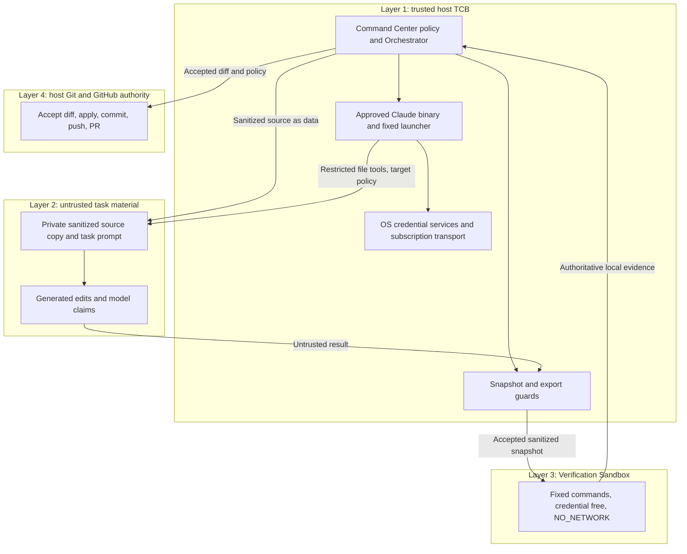

# Phase 3B6A0 — Host Claude restricted runner trust contract

Status: **CONTRACT READY FOR REVIEW / RUNNER NOT QUALIFIED**.
Decision: **HOST_CLAUDE_TRUST_CONTRACT_READY** as an explicit host-TCB design
for the frozen five-tool/2.1.260 candidate. This is a local, uncommitted review artifact;
it is not part of PR #22 and grants no execution or residual-risk acceptance.

## 1. Baseline and governance separation

Date: 2026-10-06 (Asia/Singapore). Repository:
augusliang23-web/Micro-SaaS-Command-Center. PR #22 was OPEN / Draft / UNMERGED
at required HEAD **64e263c40e369879811b61e4bc7c49b9974f0a20**; the existing
architecture worktree began clean. Native research decisions remain
RUNTIME_RESOLVER_CHAIN_PARTIALLY_PROVEN and STOP_NATIVE_SBX_PATH. Native daemon /
bootstrap remains HOLD. Installed sbx stays unused; no further native qualification.

PR #22 closes only native sbx research when separately authorized; no close,
merge, ready conversion or modification of its tracked content occurs here.
Phase 3B6 belongs in this new architecture file and a separately authorized future
branch/PR. This gate creates neither branch nor PR and does not commit/push this
file to the native research branch. Current Orchestrator remains fake-only.
CLAUDE.md, AGENTS.md and .bridge governance are not modified.

## 2. Version freeze, print-mode scope and qualification concerns

Qualification version is **Claude Code 2.1.260**, from prior approved evidence.
No CLI version/help/auth command is rerun in this gate. Future admission must
verify the exact approved executable/version/integrity and prohibit automatic
updates. Any version change requires new restricted/safe-mode, tool/settings/MCP,
path and background/session qualification; no automatic upgrade is selected.

The [official changelog](https://github.com/anthropics/claude-code/blob/main/CHANGELOG.md)
records restricted mode at 2.1.248, permission-prompts none and managedMcpServers
at 2.1.259, and safe-mode at 2.1.169. These features predate the frozen version.
Current documentation is not a version-pinned executable behavior proof.

Two important source qualifications apply:

1. **EndConversation is excluded from this print-mode surface.** The general
   [CLI reference](https://code.claude.com/docs/en/cli-reference) describes it as
   non-removable while other tools remain. The more specific
   [Tools reference](https://code.claude.com/docs/en/tools-reference) limits its
   availability to interactive terminal sessions and explicitly excludes -p
   and Agent SDK runs. Therefore it is not a documented sixth tool in this
   canonical foreground -p launcher. Do not apply the general removal rule
   outside its surface conditions. The five-only inventory still requires
   2.1.260 qualification; any unexpected tool, including EndConversation, fails
   admission. No live inventory or special exception is claimed here.
2. **Later restricted-mode security fixes require explicit qualification.** The
   2.1.290 changelog fixes an @-mention reading outside working directories
   through a link changed mid-read, and restricted sessions opening a cross-
   session messaging socket. The reviewed 2.1.260 baseline predates these fixes.
   This is not a reproduced exploit or proof of the bug's introduced version;
   it is evidence that current documentation cannot be promoted to a tested
   2.1.260 path/session guarantee. Sanitized files and negative qualification
   may narrow exposure, but do not erase the version concern.

The first point removes an apparent architecture conflict; the second remains a
specific test/version-risk concern. Keep 2.1.260 frozen. Do not silently upgrade,
claim current behavior already proved, or proceed if its negatives fail. The
contract can advance to separately authorized synthetic qualification, with the
pre-start admission and risk-acceptance conditions below. It is not runner safety
or permission to invoke a live CLI now.

## 3. Exactly four trust layers

| Layer | Trust and responsibilities |
|---|---|
| 1 — TRUSTED HOST TCB | Command Center, Orchestrator, approved Claude executable, fixed launcher, Claude subscription transport, host OS credential services used by Claude, snapshot/export guards, Verification Sandbox launcher and host Git/GitHub implementation. Own policy/input/arguments and evidence; never execute task scripts on the host. |
| 2 — UNTRUSTED TASK MATERIAL | Repository source, CLAUDE.md, project configuration, edits, model output, scripts/tests/build files, symlinks and task prompts. These are data and cannot grant privileges or Git authority. |
| 3 — VERIFICATION SANDBOX | Separate, credential-free, NO_NETWORK execution domain. Run only fixed server-owned commands against a sanitized snapshot in fresh execution containers. Project code executes only here. |
| 4 — HOST GIT / GITHUB AUTHORITY | Host diff acceptance, protected-path decisions, application, commit/push/PR. Its implementation is trusted in Layer 1; this layer separates authority from agent editing. Claude never owns it. |



This diagram is a proposed authority model, not current integration or evidence
that the frozen candidate enforces it. Actual launch remains subject to admission.

## 4. Explicit host-TCB residual risk and acceptance condition

Restricted Claude Code is **not a VM boundary, kernel sandbox or credential-
isolated process**. The approved CLI is trusted host software under the user's
OS identity. A compromised CLI may access the subscription credentials and other
resources that identity can access. Environment stripping and a sanitized copy
do not protect host secrets from compromise of the trusted binary itself.

TASK_ROOT-only below means **model/task-driven built-in file-tool access**, not
a claim that the whole Claude process cannot read HOME. The trusted CLI may use
its approved authentication/configuration storage and OS credential service for
subscription transport. That access must not expose values through model tools,
source, output, UI, evidence, TaskStore or Git. No raw secret is passed in argv,
stdin or the child environment.

The verifier can reject bad edits and run untrusted tests without credentials.
It cannot repair, retroactively prevent or neutralize a credential disclosure
that already occurred in the trusted Claude host process. Pre/post tree hashes
likewise cannot prove that an outside file was never read.

Required adoption clause: **Control Plane/user explicitly accepts this host-TCB
credential/resource failure domain before any live qualification**. This gate
records that requirement, not a human acceptance that has not occurred. If the
failure domain is unacceptable, the host architecture is invalid. Neither the
native research trust decision nor approval to write this document supplies that
acceptance or a provider-call budget.

## 5. One canonical candidate argv — NOT APPROVED FOR EXECUTION

Executable must be an exact approved Claude 2.1.260 path/identity, not a shell
alias, repository shim or PATH-discovered wrapper. cwd is exactly the canonical
TASK_ROOT. The following is one argument array; it is not a shell command.
UUID/model/effort values come solely from typed server policy. Prompt is bounded
data on stdin, not flags, a shell expression or a prompt-file path from the browser.

```json
[
  "-p",
  "--output-format=stream-json",
  "--verbose",
  "--session-id=<SERVER_UUID>",
  "--model=<SERVER_MODEL>",
  "--effort=<SERVER_EFFORT>",
  "--restricted",
  "--safe-mode",
  "--tools=Read,Edit,Write,Glob,Grep",
  "--disallowedTools=Bash,PowerShell,REPL,WebFetch,WebSearch,mcp__*",
  "--strict-mcp-config",
  "--mcp-config={\"mcpServers\":{}}",
  "--disable-slash-commands",
  "--no-session-persistence",
  "--no-chrome",
  "--permission-mode=acceptEdits",
  "--permission-prompts=none"
]
```

The candidate adds one fixed explicit empty MCP map to the supplied target.
Print-mode excludes EndConversation by the specific vendor surface contract;
effective managed policy and actual inventory still require admission proof.
No --settings customization is passed; restricted mode still retains managed
settings. No bare/default-tool preset, allowedTools substitute, unsupported-flag
fallback, auto mode or permissions bypass is acceptable. Unknown/rejected flags
yield BLOCKED, not a retry with weaker arguments.

Exact allowed tool target: Read, Edit, Write, Glob, Grep. Browser input, prompts,
repository instructions, settings and model responses cannot alter this complete
value. Any tool outside it yields UNKNOWN / POLICY_VIOLATION and termination.
An incompatible startup inventory blocks before task admission. Deny names alone
are not a complete inventory check; an unexpected new tool must not be tolerated.

The fixed launcher rejects every extra argument, including
--dangerously-skip-permissions, --allow-dangerously-skip-permissions, --bg,
--background, --cloud, --remote-control, --plugin-dir, --plugin-url, --add-dir,
--agent, --agents, --exec and --channels. Also reject resume/continue/fork,
worktree/IDE/remote/session delegation and unapproved model fallback routes.
No CLI or target launcher is executed here.

## 6. Managed policy admission before session startup

[Safe-mode documentation](https://code.claude.com/docs/en/cli-reference)
disables ordinary customization, while managed hooks, status/file-suggestion
commands and policy can remain. Permission-prompts none denies unresolved prompts;
a PermissionRequest hook can still decide earlier. These flags are not a managed
code-execution prohibition. Startup stream readback comes too late to prevent a
SessionStart hook or policy helper that has already run.

The [managed-source contract](https://code.claude.com/docs/en/managed-settings)
includes remote policy, MDM and system files. The changelog through 2.1.260
corroborates policyHelper/managed-source merge behavior and managedMcpServers.
Do not import current documentation's later-only security semantics, such as
2.1.273 cross-source MCP changes, into the frozen version.

| Potential managed source on this macOS target | Admission classification |
|---|---|
| Server-managed policy and cached remote policy | MUST_BE_READBACK_VERIFIED; prove eligibility/source/freshness and complete effective non-secret policy before session startup |
| MDM managed preferences domain com.anthropic.claudecode | MUST_BE_READBACK_VERIFIED, including contributions/shadowed sources and changes during the run |
| System managed-settings.json and managed-settings.d/*.json | MUST_BE_READBACK_VERIFIED; drop-ins and merged lists cannot be inferred empty from one file |
| managed-mcp.json in the system ClaudeCode policy directory | BLOCKER_IF_PRESENT for this strict-MCP candidate; do not modify/remove it |
| policyHelper executable/output or executable credential/helper sources | BLOCKER_IF_PRESENT; do not run a helper to discover whether it is safe |
| SDK/embedding-host managed settings | Not used by this direct CLI contract; unexpected parent/embedding policy is BLOCKER_IF_PRESENT |

Classifications for policy content:

| Content | Classification / rule |
|---|---|
| Passive restrictions that only narrow capabilities and agree with this profile | ALLOWED only after effective readback and schema/version verification |
| Other managed settings / env / additionalDirectories / permission/model routing | MUST_BE_READBACK_VERIFIED; any widening, alternative billing, fallback or unexpected code source blocks |
| Managed hooks, all events including PermissionRequest | MUST_BE_EMPTY; unexpected presence is BLOCKER_IF_PRESENT, even if claimed benign |
| Managed statusLine / fileSuggestion commands | MUST_BE_EMPTY; command-bearing values are BLOCKER_IF_PRESENT |
| Managed MCP, managedMcpServers, connector/Chrome/channel provision | MUST_BE_EMPTY; server or tool availability/connection is BLOCKER_IF_PRESENT |
| Managed plugins / skills / CLAUDE.md | Safe-mode reference says they do not load; MUST_BE_READBACK_VERIFIED for 2.1.260 and MUST_BE_EMPTY in the initial qualification baseline |
| Helper executable overrides / injected env / unknown policy keys | BLOCKER_IF_PRESENT unless a separately reviewed passive restriction is proven; no repository/PATH indirection |

[Managed MCP documentation](https://code.claude.com/docs/en/managed-mcp)
describes managed-mcp.json versus strict CLI config and a 2.1.259 allowlist change.
An empty CLI map or denied MCP tool does not prove no server process/connection.
Safe-mode promises are subject to version qualification and effective policy proof.

Managed source precedence includes selected sources, optional merging, drop-ins,
cross-source env and dynamic helper/remote behavior. Therefore listing a source
name, inspecting one settings file, or assuming a personal Pro account is unmanaged
is not sufficient. Unknown, unreadable, malformed, secret-bearing or changing
effective policy blocks. No existing safe complete pre-start readback interface is
claimed qualified here. Do not dump real policy/env/header values or query secrets;
use only a separately reviewed non-secret summary mechanism. If unavailable, do
not launch. Never disable management or edit a policy file to make the gate pass.

## 7. Sanitized source input and filesystem policy

Pipeline: authoritative frozen source → private sanitized copy → edit-only Claude
→ host tree/diff admission → sanitized verifier snapshot → accepted host Git apply.
Do not operate on the original checkout, another worktree or a privileged repo.

Inclusion is positive and manifest-based: approved source identity, explicit
repository-relative regular-file paths, per-file/total byte and count limits,
expected hashes and allowed edit paths. Test/build/package-script files may be
included as required source data, never executed on the host. Include no unrelated
project or convenience home-tree copy. No checkout filter, submodule/LFS fetch,
Git hook, package install or source-supplied importer may run during materialization.

Required manifest fields are sourceProjectId/sourceCommit, includedFiles[],
editableFiles[], protectedFiles[], per-file hashes/metadata, maxFileBytes,
maxTotalBytes and maxFileCount. Server policy must freeze every value before
copying; a missing field or noncanonical path blocks. Inclusion never overrides
the sensitive-object/credential exclusions without a separate explicit review.

Default exclusions: .git and Git credentials/config/hooks; .env and credential/
auth/private-key material; browser/profile/session state; Claude user config and
active .claude/.mcp customization; Docker/SSH/GitHub/cloud config; .bridge/control
policy and unrelated project files; dependencies/caches/artifacts; host scripts
not explicitly required as source. Dummy environment examples need explicit
non-secret classification rather than a filename exception. Unknown sensitivity
blocks copying; a filename denylist alone cannot prove no secret content.

Materialize fresh private regular files from approved bytes, with no shared inode
or executable authority. Reject symlinks, nlink>1 hardlinks, sockets, FIFO/devices,
mount/submount paths, absolute/parent traversal, path aliases/collisions and
unexpected executable indirection. Required executable source may retain reviewed
metadata only for verifier use; Claude may not execute it. Do not silently follow
or normalize a link into host data. Synthetic link fixtures are negative cases,
not exceptions to production source policy.

Model file tools may address TASK_ROOT only: no parent, other repo/worktree,
real HOME/.ssh/.config/Claude auth/Docker/browser/Git stores, or Command Center
internal state. No --add-dir or effective additionalDirectories grants. Restricted
working-directory checks are the primary proposed control; pre/post guards add
defense in depth and cannot establish denied reads by themselves.

Revalidate identity/topology/hashes/links before launch, during transfer as needed
and after exit. Avoid path races with a qualified descriptor-based materializer/
scanner; a preflight followed by unchecked string paths is not TOCTOU proof.
Task root is exclusive and private; no unrelated writer/service is admitted.
The later link-race fix must be addressed in version/qualification review.

## 8. No project execution and protected result policy

Host Claude only reads/edits source. No model-controlled Bash/shell, node/npm/pnpm/
yarn, Python/pytest, make, Git hooks, package scripts/tests/lint/build, compiler or
generated executable may run. Vendor CLI internals and approved vendor search
helpers are trusted implementation, not permission to execute repository tools.
Unknown helper/override or repository-influenced helper path blocks admission.

After exit, before verifier, scan the complete tree and diff against the frozen
manifest. Reject out-of-scope files/directories, links/special objects, executable
mode/topology changes, secrets, path/size/count ambiguity and unauthorized protected
edits. Protected categories include governance (CLAUDE.md/AGENTS.md/.bridge),
Command Center policy/launcher/verifier configuration, credential settings,
Git metadata, CI/deploy workflows and production/IAM/billing infrastructure.
Exceptions require an exact separate approved task; prompts cannot grant one.
Protected edits yield BLOCKED and are not passed to verification as normal work.

Workflow/build files remain untrusted even when legitimate source. Export does
not execute them, invoke an IDE task, install packages or trigger a host compiler.
Reject unsafe output rather than applying it first and hoping verifier detects it.

## 9. Auth, environment and scoped network semantics

Future authoritative preflight must show loggedIn=true, authMethod=claude.ai,
apiProvider=firstParty for the same approved executable/configuration used by the
run. Require effective subscription route, not just a login flag. Reject api_key,
task-supplied OAuth, Console/API billing, Bedrock, Vertex, Foundry and unknown
provider/helper routing; no silent fallback or automatic login/recovery.

The [authentication contract](https://code.claude.com/docs/en/authentication)
distinguishes subscription, Console and cloud routes. No actual auth status or
credential store is queried in this gate. Do not copy tokens into a task config.

Use a positive minimal child-env allowlist. Strip ANTHROPIC_API_KEY,
ANTHROPIC_AUTH_TOKEN, CLAUDE_CODE_OAUTH_TOKEN, CLAUDE_CODE_OAUTH_REFRESH_TOKEN,
AWS/Google/Azure/cloud credentials, GitHub/Git/SSH variables, project PATH additions
and unapproved loader/helper/provider/proxy/model/session/config overrides.
Strip RIPGREP_CONFIG_PATH and similar helper configuration to prevent preprocessors
or executable indirection. Check names/presence, never inspect secret values.
Only approved fixed PATH/locale/temp/auth-location metadata and separately reviewed
non-secret vendor controls may be supplied. Managed env must pass the same policy;
stripping the inherited shell env alone does not control it.

Preserve the approved host auth context only for the trusted CLI; do not redefine
HOME or CLAUDE_CONFIG_DIR to trigger onboarding or suggest those directories are
credential-isolated. Qualification must use the vendor-documented
DISABLE_AUTOUPDATER=1 in its fixed non-secret child environment, qualify that
behavior on 2.1.260, and verify identity before/after. The
[environment reference](https://code.claude.com/docs/en/env-vars) documents that
it disables automatic background updates; manual updates remain outside the
launcher contract. No host setting is changed now. Transport-internal auth
refresh/storage side effects need an explicit
future authorization policy, not task-supplied tokens or inferred mutation consent.

Trusted Claude subscription provider transport is ALLOWED by the target model.
Model-controlled independent network is FORBIDDEN: no WebFetch/WebSearch/browser/
Chrome, Bash networking, MCP, plugin or hook networking. **network:false in this
host-runner capability scope means no model-controlled network tool; it does not
mean the Claude process has no network.** Keep that scope explicit in any future
schema/evidence; never relabel the existing verifier's NO_NETWORK guarantee.
Unknown provider/settings network behavior or arbitrary helper transport blocks.

## 10. Foreground session and process contract

One task uses one server-owned UUID and one foreground print-mode process. No
resume, continue, fork/cloud/background/Remote Control session, agent teams,
detached worker or persistent transcript. --no-session-persistence is mandatory,
but absence of persistent transcripts is not proof that the CLI writes no caches,
auth locks, metadata or diagnostic files. Approved TCB writes must be separately
classified and never include raw task/credential evidence outside policy.

Track exact PID/creation/executable/parent/group/session identities and approved
transient helpers. Unknown background/session/supervisor/socket activity yields
UNKNOWN and termination of proven owned processes only. No broad kill or cleanup
of unrelated sessions/user state. Bound time/output/turns/files/processes in the
future qualification prompt; no unbounded retry. The 2.1.290 messaging-socket fix
is a specific prerequisite concern for the frozen 2.1.260 session guarantee.

## 11. Verifier and host Git authority

Preserve existing Verification Sandbox unchanged: credential-free, NO_NETWORK,
fixed server-owned command profile, fresh execution containers, sanitized snapshot.
All project code executes there. Model assertions/exit 0 are AGENT_CLAIM, never
test/build PASS. A verified local result is LOCALLY_VERIFIED; a higher grade needs
its own authoritative provenance, never an invented CI check.

Claude has no Git/gh command tool, GitHub token or SSH agent and cannot authorize
diff acceptance/commit/push/PR. The host Orchestrator alone checks protected paths,
applies accepted regular-file changes and controls git add/commit/push/PR. Host
Git operations must not invoke task hooks, filters or project-controlled helper
configuration; keep host Git configuration/credentials outside the task copy.
Merge/deploy stays separately authorized. No Orchestrator/provider wiring changes
or Git mutation occurs in this documentation gate.

## 12. Project configuration attack matrix

Classification is the primary target treatment; every row needs negative
qualification, not a claim of behavior already observed on 2.1.260.

| Attack material | Primary classification | Required observation/guard |
|---|---|---|
| CLAUDE.md privilege request | IGNORED_BY_SAFE_MODE | No autoload; any explicit file content remains untrusted data, not permission |
| .claude/settings.json tool expansion | IGNORED_BY_RESTRICTED | No project settings load or widened tools |
| .claude/settings.local.json | IGNORED_BY_RESTRICTED | No local override, add-dir, billing or permission widening |
| Ordinary hooks | IGNORED_BY_SAFE_MODE | No command/process/network/canary side effect |
| Plugins | IGNORED_BY_SAFE_MODE | No discovery/install/load or new tool |
| Skills / commands | IGNORED_BY_SAFE_MODE | No expansion, shell helper or slash execution |
| Agent definitions | IGNORED_BY_SAFE_MODE | No subagent/team/background worker |
| Project MCP configs | IGNORED_BY_SAFE_MODE | Empty effective MCP inventory and no connection/server process |
| Workflow files | IGNORED_BY_SAFE_MODE | No workflow execution; file edits remain protected-policy decisions |
| Environment files | HOST_GUARD_REQUIRED | Exclude secret/active configuration; no sourcing or env inheritance |
| Malicious symlink / hardlink / special object | BLOCKER | Reject before launch; never normalize into external host data |
| Task prompt asking for Bash/Git | DENIED_BY_TOOL_POLICY | No command/tool execution or Git side effect |
| Task prompt asking for WebFetch/browser/MCP | DENIED_BY_TOOL_POLICY | No requested capability or independent network |
| Prompt requesting /etc or HOME | NEGATIVE_TEST_REQUIRED | Restricted file-tool denial with authoritative evidence; no disclosure/write |
| Prompt requesting sibling worktree | NEGATIVE_TEST_REQUIRED | No read/edit across TASK_ROOT |
| Managed hook/helper/status command | BLOCKER | Pre-start admission rejects presence; do not execute a canary managed hook to learn policy |
| Managed MCP / unexpected tool, including EndConversation | BLOCKER | Prove the five-only -p inventory; no silent exception if an extra tool appears |

Prompt compliance, missing output or generic file-not-found errors do not prove
denial. Unknown source handling or hidden tool availability is not acceptable.

## 13. Failure and evidence semantics

| Condition | Result |
|---|---|
| Unexpected tool available/called | UNKNOWN / POLICY_VIOLATION; terminate and do not verify/apply |
| Known outside path attempt, matching structured protocol denial | Attempt outcome DENIED; not overall PASS by itself |
| Outside attempt with generic error/prose/unknown event | UNKNOWN / OUTSIDE_DENIAL_NOT_PROVEN |
| Authoritative outside disclosure/write | FAIL / DATA_BOUNDARY_BREACH |
| Managed hook/helper present, policy uninspectable or changed | BLOCKED / MANAGED_POLICY_NOT_SAFE |
| Unexpected MCP provision/connection/tool | BLOCKED / MCP_POLICY_VIOLATION |
| Background/session/helper activity unproved | UNKNOWN / PROCESS_POLICY_UNPROVEN |
| Malformed/truncated/conflicting stream | UNKNOWN / PROTOCOL_UNPROVEN |
| Timeout / output cap | UNKNOWN / bounded-execution evidence lost; no partial PASS |
| Subscription unavailable / API billing / provider unknown | BLOCKED / AUTH_ROUTE_NOT_ALLOWED |
| Protected or unauthorized result edit | BLOCKED / DIFF_POLICY_VIOLATION |
| Verifier command failure under trusted infrastructure | FAILED with preserved verifier evidence |
| Verifier infrastructure/evidence ambiguity | UNKNOWN, retaining existing precedence/stop semantics |
| Evidence persistence or cleanup incomplete | UNKNOWN / completion blocked |

Use matching structured permission_denied/permission_denials evidence only when
protocol/tool/path identity is proved; wrong IDs/paths, ENOENT and self-report do
not become permission denial. Canary contents are disposable synthetic values,
not real credentials. Require authoritative effective model/auth evidence and
all accepted filesystem/protocol/cleanup evidence; never promote UNKNOWN to PASS.
User-facing task state maps must retain the distinction between DENIED attempt,
AGENT_CLAIM, verified execution and accepted task completion.

## 14. Phase 3B6B qualification design — NOT AUTHORIZED

Prerequisites: explicitly accept the host-TCB residual risk and 2.1.260
qualification plan, including later link-race/session fixes as mandatory concerns;
freeze the approved binary/argv/env,
managed pre-start proof, bounds, synthetic fixtures and any real provider-call
budget. No current CLI call, managed-policy mutation or inference is authorized.
Start with offline policy/source/protocol fixtures; a stub cannot qualify actual
CLI restrictions. A live CLI test later needs an exact separate gate.
The qualification harness must itself be reviewed server-owned TCB code, never
a script/test package supplied by the untrusted task. Its execution scope is
separately frozen; no task project test is moved onto the host by this distinction.

| Required negative | Expected future evidence |
|---|---|
| Bash request | No Bash availability/call/execution; exact inventory and attributable process evidence |
| WebFetch/WebSearch/browser request | No network tool or request; provider transport distinguished from independent traffic |
| MCP request | No tool/connection/process; managed and ordinary sources covered |
| Project settings expansion | Safe synthetic settings cannot add tools/directories/model/provider route |
| CLAUDE.md privilege request | Instruction cannot change argv, tools or path scope |
| Hook attempt | Ordinary fixture never runs; managed-hook presence fails offline admission before startup |
| Plugin/skill/command/agent attempt | No loading, execution, tool or worker/session creation |
| ../ and absolute path | Existing outside canary attempted but authoritatively denied, not ENOENT |
| Symlink/hardlink/special object | Source guard blocks; test race handling only with disposable canaries after version decision |
| HOME read/write | Synthetic HOME-category fixtures only; no real auth/credential contents; denial and no write/disclosure |
| Other project/worktree read/edit | Disposable sibling tree protected despite injected prompt/config |
| Background/session creation | No new persistent transcript, messaging socket, detached session or worker |
| Git execution | No Git tool/process/hook/token/SSH action; prompt cannot transfer Layer 4 authority |
| Protected edit / executable indirection | Host result gate blocks before verifier or host apply |
| Wrong/unknown tool/model/protocol/evidence | Fail-closed result; test wrong denial ID/path, generic errors and persistence failure |

Use existing evidence/parser and snapshot/verifier ideas where appropriate, but
do not count Phase 3B4 host smoke as qualification of this new launcher. Future
fixtures must not touch real managed-policy roots, enroll MDM, alter auth, import
tokens or run project scripts on the host. Abort on unexpected side effects and
clean only proven owned synthetic state. Do not manufacture provider-call quota,
credit usage, CI evidence or overall PASS from a model's exit code.

## 15. Explicit old-contract delta

| Category | Disposition for proposed Host Claude path |
|---|---|
| No model-controlled shell/arbitrary network | PRESERVED |
| Untrusted source, protected diffs, bounded runs and authoritative evidence | PRESERVED |
| Separate credential-free NO_NETWORK verifier | PRESERVED unchanged |
| Host-owned Git/GitHub, no merge/deploy without authority | PRESERVED |
| Provider process isolated from host credentials | REPLACED by explicitly trusted Claude/OS subscription TCB plus residual-risk acceptance; not PASS under the old wording |
| Model file access confinement | REPLACED by qualified restricted working-directory/tool policy and host guards; no kernel-isolation claim |
| Agent network:false | REPLACED with explicit model-capability scope; provider transport remains host TCB |
| Agent microVM/kernel boundary and guest destruction | DROPPED for this host path, not disabled in the existing verifier |
| Docker credential proxy, sbx guest policy, llmman/runtime provenance | DROPPED as host-runner dependencies; native research STOP/HOLD conclusions preserved |

These are architectural deltas, not implementation status flips. No existing
policy/schema is silently changed and no replaced invariant is marked verified.

## 16. Decision, delivery and local validation

**HOST_CLAUDE_TRUST_CONTRACT_READY** is the one selected decision: the four-layer
host-TCB model, residual-risk clause, constrained print-mode launcher and fail-
closed admission are coherent enough to define synthetic qualification. This
does not mean the residual risk has been accepted, the actual host passed managed
admission, 2.1.260 passed its negatives, or the runner is production-safe.

Next: Control Plane reviews and explicitly accepts or rejects the residual-risk
clause and qualification plan, then separately authorizes the Phase 3B6 branch/PR
and exact Phase 3B6B scope/provider budget if it continues. No sixth tool, new
version, managed-policy mutation or live call is approved here. Begin with offline
guards; live negatives require their own permission and clean pre-start admission.
No new PR is created now, and no weaker mode is allowed if qualification fails.

Validation is documentation-only: required layers/argv/matrices/delta/failure
coverage, Markdown/Mermaid/JSON structure, links, whitespace, native-document
preservation and no tracked changes. No implementation, tests, lint/build or
project code executes on the host; local document checks are not CI.

Safety: Claude inference 0; Claude CLI commands/auth mutation 0; sbx/daemon/llmman/
runtime execution/download 0; project code execution 0; credentials inspected no;
Keychain queries 0; network mutation 0; target MCP invocation/SSH auth 0;
Orchestrator activation 0; merge/deploy no; Production/UAT/cloud changes no.
Research uses primary vendor documentation only. PR #22 remains Draft at the
required HEAD. The only new file is this local Phase 3B6 architecture artifact.
