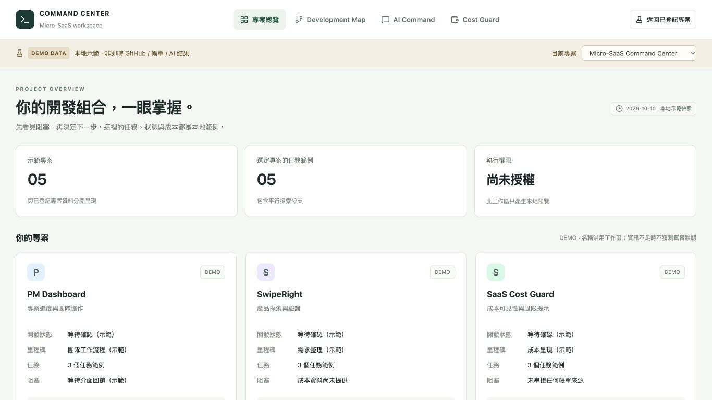
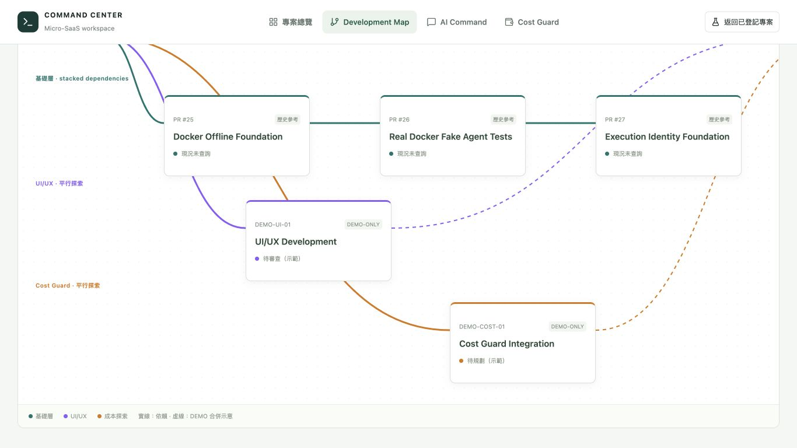
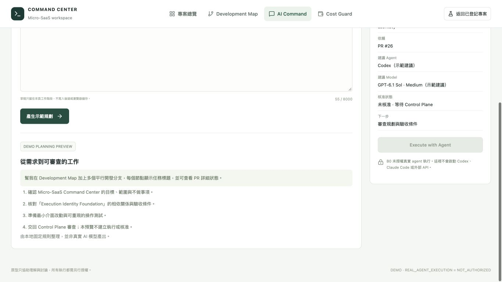
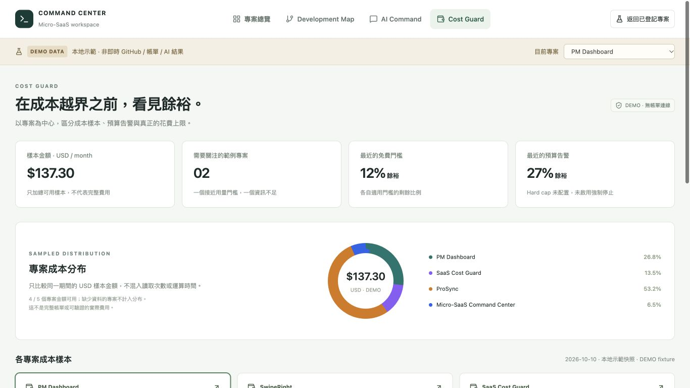

# Track B B0 — Interactive Command Center UI

Frontend prototype only. `REAL_AGENT_EXECUTION = NOT_AUTHORIZED`.

Base: `25692a9a1fdedaf82910630fb767589aa5dccddf`.
Branch: `feat/track-b-uiux-prototype`.

## Experience the prototype locally

From the isolated `command-center-track-b-uiux` worktree:

```sh
npm exec --offline -- vite --host 127.0.0.1 --port 5173 --strictPort
```

Open **http://127.0.0.1:5173/?mode=demo** for the explicit DEMO workspace. The URL was verified in the Codex in-app browser on macOS. The default URL retains the API-backed registered portfolio; a Vite-only server has no backend routes and missing state remains unavailable, never authoritative fixture data.

## Implemented behavior

- Persistent four-page navigation: 專案總覽, Development Map, AI Command, Cost Guard. Shared project/task context survives page navigation, including a selected registered project's name/repository handed into explicitly labeled demo pages.
- Five local project samples. Statuses, milestones, blockers, task counts, timestamps and costs are labeled DEMO. Existing CockpitHeader, portfolio/cards, detail drawer, Needs Attention and AI status functions remain in the registered view; no existing component was rewritten.
- Native SVG development map with distinct curved branches, horizontal scrolling, visible titles/references/statuses and task details. PR #25 → #26 → #27 is a historical dependency reference, not current GitHub status. Independent UI/UX and Cost Guard nodes are DEMO-ONLY, not real PRs. Dashed merge curves are explicitly hypothetical, not completed merges.
- AI Command accepts Traditional Chinese, transfers the chosen task, preserves only in-memory drafts and produces a deterministic **DEMO PLANNING PREVIEW**. Project/task/prompt changes invalidate old plans. Agent/model suggestions are demo suggestions, not actual execution or approval. Execute with Agent is disabled. Demo code makes no API requests and writes no prompt storage.
- Cost Guard uses one monthly USD sample distribution (4 of 5 samples available). Reads/time remain separate per-limit indicators. Missing amounts/accounts/limits display unavailable or insufficient data, not zero. Budget alerts are distinguished from unconfigured hard caps; no cloud enforcement exists.

## Local validation — not CI

| Check | Result |
| --- | --- |
| `npm run lint` | PASS |
| `npm run test:ui` | 7 files / 44 tests PASS, 0 failed; original 25 retained plus 19 prototype tests |
| `npm run build` | PASS, with the existing backend CJS/import.meta warning |
| `git diff --check` | PASS |
| Independent read-only frontend review | No blockers found; separate from test/browser verification |
| Original main preservation | HEAD/status and all eight dirty-file hashes unchanged |
| Track A branch preservation | Existing Track A branch refs match the implementation preflight snapshot; no Track A writes |
| Dependency manifests | package.json/package-lock.json unchanged; no added dependency |

Build warning: esbuild's existing CommonJS backend bundle cannot preserve `import.meta` at server.ts:24. The backend entrypoint was not executed or changed. UI tests also retain the expected network-forbidden diagnostic for legacy tests that deliberately simulate an unavailable /api/state; those tests pass.

## Actual browser verification

Used the local Vite-only frontend, including a 1366 × 768 viewport to check the initial MacBook Air layout; the temporary viewport override was reset afterwards. These are actual browser screenshots, not generated mockups. The map and planner screenshots intentionally show a scrolled viewport so branch/task and preview/disabled-execution details are visible.

- A: Overview → Micro-SaaS Command Center → PR #27 details → AI Command → Chinese prompt → local planning preview; context observed and execution disabled.
- B: Overview → PM Dashboard cost sample → matching detail → return to Overview with the project preserved.
- C: Parallel UI/UX demo task → details → AI Command; task selection preserved.
- Additional check: SwipeRight's missing cost/account/limits display Not available / Not enough data, with no invented zero or progress value.

| Overview | Development Map |
| --- | --- |
|  |  |

| AI Command | Cost Guard |
| --- | --- |
|  |  |

## Boundaries and remaining limitations

No backend/Orchestrator/ApprovalGate/store/Docker/identity-journal changes, provider call, agent execution, GCP/Firebase action, billing credential access, SaaS Cost Guard repository edit, merge or deployment. Only the feature branch is published as a Draft PR against main.

Demo plans are fixed-rule previews, historical PR status is unqueried, demo costs are fictional and not billing advice, and the standalone Vite preview cannot provide real backend state. UI drafts/selection intentionally reset on full reload; no backend integration begins in this phase.
