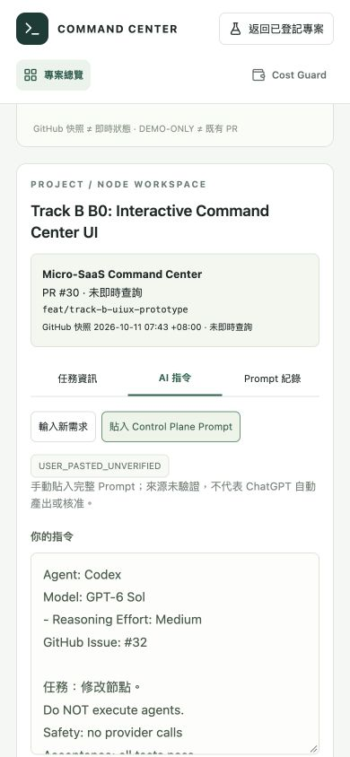

# Track B B0 / B0.1 / B0.2 — Interactive Command Center UI

Frontend prototype only. `REAL_AGENT_EXECUTION = NOT_AUTHORIZED`.

**Current evidence: B0.2, authorized by [Issue #32](https://github.com/augusliang23-web/Micro-SaaS-Command-Center/issues/32).** B0 and B0.1 sections below preserve historical behavior/results; they are superseded by the B0.2 section at the end. The five images now show B0.2. B0.1 technical review passed but human UX required revision. Issue #32 does not retroactively approve the original B0 process. Human UX acceptance and merge remain pending.

Base: `25692a9a1fdedaf82910630fb767589aa5dccddf`.
Branch: `feat/track-b-uiux-prototype`.

## Experience the prototype locally

From the isolated `command-center-track-b-uiux` worktree:

```sh
npm exec --offline -- vite --host 127.0.0.1 --port 5173 --strictPort
```

Open **http://127.0.0.1:5173/?mode=demo** for the explicit DEMO workspace. The URL was verified in the Codex in-app browser on macOS. The default URL retains the API-backed registered portfolio; a Vite-only server has no backend routes and missing state remains unavailable, never authoritative fixture data.

## Implemented behavior

- Persistent four-page navigation: 專案總覽, Development Map, AI Command, Cost Guard. Shared project/task context survives page navigation, including a selected registered project's name/repository handed into explicitly labeled demo pages.
- Five local project samples. Statuses, milestones, blockers, task counts, timestamps and costs are labeled DEMO. Existing CockpitHeader, portfolio/cards, detail drawer, Needs Attention and AI status functions remain in the registered view; no existing component was rewritten.
- Native SVG development map with distinct curved branches, horizontal scrolling, visible titles/references/statuses and task details. PR #25 → #26 → #27 is a historical dependency reference, not current GitHub status. Independent UI/UX and Cost Guard nodes are DEMO-ONLY, not real PRs. Dashed merge curves are explicitly hypothetical, not completed merges.
- AI Command accepts Traditional Chinese, transfers the chosen task, preserves only in-memory drafts and produces a deterministic **DEMO PLANNING PREVIEW**. Project/task/prompt changes invalidate old plans. Agent/model suggestions are demo suggestions, not actual execution or approval. Execute with Agent is disabled. Demo code makes no API requests and writes no prompt storage.
- Cost Guard uses one monthly USD sample distribution (4 of 5 samples available). Reads/time remain separate per-limit indicators. Missing amounts/accounts/limits display unavailable or insufficient data, not zero. Budget alerts are distinguished from unconfigured hard caps; no cloud enforcement exists.

## Local validation — not CI

| Check | Result |
| --- | --- |
| `npm run lint` | PASS |
| `npm run test:ui` | 7 files / 44 tests PASS, 0 failed; original 25 retained plus 19 prototype tests |
| `npm run build` | PASS, with the existing backend CJS/import.meta warning |
| `git diff --check` | PASS |
| Independent read-only frontend review | No blockers found; separate from test/browser verification |
| Original main preservation | HEAD/status and all eight dirty-file hashes unchanged |
| Track A branch preservation | Existing Track A branch refs match the implementation preflight snapshot; no Track A writes |
| Dependency manifests | package.json/package-lock.json unchanged; no added dependency |

Build warning: esbuild's existing CommonJS backend bundle cannot preserve `import.meta` at server.ts:24. The backend entrypoint was not executed or changed. UI tests also retain the expected network-forbidden diagnostic for legacy tests that deliberately simulate an unavailable /api/state; those tests pass.

## Actual browser verification

Used the local Vite-only frontend, including a 1366 × 768 viewport to check the initial MacBook Air layout; the temporary viewport override was reset afterwards. These are actual browser screenshots, not generated mockups. The map and planner screenshots intentionally show a scrolled viewport so branch/task and preview/disabled-execution details are visible.

- A: Overview → Micro-SaaS Command Center → PR #27 details → AI Command → Chinese prompt → local planning preview; context observed and execution disabled.
- B: Overview → PM Dashboard cost sample → matching detail → return to Overview with the project preserved.
- C: Parallel UI/UX demo task → details → AI Command; task selection preserved.
- Additional check: SwipeRight's missing cost/account/limits display Not available / Not enough data, with no invented zero or progress value.

| Overview | Development Map |
| --- | --- |
|  |  |

| AI Command | Cost Guard |
| --- | --- |
|  |  |

## Boundaries and remaining limitations

No backend/Orchestrator/ApprovalGate/store/Docker/identity-journal changes, provider call, agent execution, GCP/Firebase action, billing credential access, SaaS Cost Guard repository edit, merge or deployment. Only the feature branch is published as a Draft PR against main.

Demo plans are fixed-rule previews, historical PR status is unqueried, demo costs are fictional and not billing advice, and the standalone Vite preview cannot provide real backend state. UI drafts/selection intentionally reset on full reload; no backend integration begins in this phase.


## B0.1 — UX refinement under Issue #31 (2026-10-11)

Starting HEAD: `6690c220aeacd86d0529bd30bed8c7de4fe9bd50`. Exact issue is OPEN with `model:sol`, `risk:medium`, `bridge:ready` and Medium effort, and the explicit file allowlist. No `bridge:approved` was added. Existing PR #30 remains the delivery destination against main; no new PR or backend integration.

### Verified, bounded topology snapshot

GitHub PR reads establish main → #25 → #26 → #27 → #28, independently main → #30. Snapshot observation is `2026-10-10T23:43:21Z` / `2026-10-11 07:43 +08:00`. Node titles match the actual PR titles. Every known node stores its source URL, observed timestamp, head SHA, base SHA/ref and observed OPEN / Draft state. UI status says **未即時查詢**; those fields are a dated snapshot, never live telemetry. PR #30's recorded head is the starting B0 commit; this delivery advances PR #30, intentionally without pretending the historical snapshot was refreshed.

| PR | Observed base | Observed head |
| --- | --- | --- |
| [PR #25](https://github.com/augusliang23-web/Micro-SaaS-Command-Center/pull/25) | `25692a9a1fdedaf82910630fb767589aa5dccddf` | `f5addc4a9cbab419b43ebb38159b07f51daa60ea` |
| [PR #26](https://github.com/augusliang23-web/Micro-SaaS-Command-Center/pull/26) | `f5addc4a9cbab419b43ebb38159b07f51daa60ea` | `ae3f1e5ae518aa0ed234d96c66934372b8ba213c` |
| [PR #27](https://github.com/augusliang23-web/Micro-SaaS-Command-Center/pull/27) | `ae3f1e5ae518aa0ed234d96c66934372b8ba213c` | `c7c751df3acd5e3be22cc5c2ac7d3001278ab453` |
| [PR #28](https://github.com/augusliang23-web/Micro-SaaS-Command-Center/pull/28) | `c7c751df3acd5e3be22cc5c2ac7d3001278ab453` | `cf7fc7db9ebdef236a0d2f72a2399fca644ad755` |
| [PR #30](https://github.com/augusliang23-web/Micro-SaaS-Command-Center/pull/30) | `25692a9a1fdedaf82910630fb767589aa5dccddf` | `6690c220aeacd86d0529bd30bed8c7de4fe9bd50` |

Connections are rendered from dependency data. Selecting a task highlights its upstream path only: #28 highlights Track A; #30 highlights main → #30 and does not imply a #28 → #30 edge. The separate UI/UX and Cost Guard samples remain DEMO-ONLY. Hypothetical merge curves were removed; no merge completion is fabricated. Other projects still have only their own demo/unknown topology, not the Command Center's PR chain.

### AI discovery and navigation

An obvious **向 AI 提需求** action is available from every page, reusing the sole AI Command editor and preserving selected project/task. The editor shows adjacent project/task context; absent branch/task is explained and does not prevent a general Chinese request. Prompt/project/task changes invalidate unrelated previews. Planning remains local deterministic DEMO output; execution stays disabled and prompts are not written to backend or browser storage.

Registered portfolio source/UNKNOWN behavior is unchanged. Cost Guard retains USD-only sample distribution, per-unit usage indicators, dated DEMO provenance, missing != zero, and explicit budget-alert versus unconfigured hard-cap wording. No billing or provider integration was added.

### Newly executed verification

| Gate | B0.1 result |
| --- | --- |
| `npm run lint` | PASS |
| `npm run test:ui` | 7 files, **52/52 PASS**, 0 failures; all previous 44 rerun plus 8 focused regressions |
| `npm run build` | PASS; existing CJS/import.meta warning in server.ts:24 remains |
| `git diff --check` | PASS |
| Independent read-only frontend review | No blocker found; separate from actual browser checks |
| Browser workflows A / B / C / D / E | Observed PASS, not human acceptance |
| 1366×768 desktop, 768×1024 tablet, 390×844 mobile | All four pages checked at each size: 12/12 body/document widths matched viewport, no page-wide horizontal overflow |
| Actual keyboard | Enter opens PR30 details; Tab enters PR nodes; visible solid focus outline; graph ArrowRight changed internal scrollLeft from 199 to 223.5 |

No overflow was masked using a page-wide clipping rule. The graph canvas scrolls inside a keyboard-focusable panel. Long exact titles wrap without ellipsis; smaller screens stack task details below the graph. Viewport overrides were reset after testing.

The tested preview was `http://127.0.0.1:5173/?mode=demo`; the Vite listener's cwd was independently verified as the Track B worktree. No unrelated process was stopped. Updated screenshots show Overview, selected independent PR30 details, local planning and Cost Guard; some frames are scrolled to expose the relevant controls.

A: Overview → Command Center → PR28 details (depends on PR27) → AI entry → Chinese prompt → DEMO preview, execution disabled.

B: PR30 details show main dependency, main edge highlighted and Track A edge not highlighted → AI entry preserves PR30.

C: PM Dashboard overview → matching Cost Guard detail → overview retains PM Dashboard.

D: Direct AI navigation without a task explains missing context; Chinese prompt produces only unapproved DEMO planning.

E: Changing project after a plan removes the old preview; editing the prompt also removes the preview.

### Human UX acceptance checklist — pending

- [ ] On your Mac, find **向 AI 提需求** without guidance from every page.
- [ ] Distinguish Track A's stack, independent Track B, and DEMO-ONLY examples.
- [ ] Read each complete task title and verify which upstream edges highlight.
- [ ] Transfer PR28 and PR30 to the editor and confirm the desired project/task.
- [ ] Use the map's internal horizontal/vertical scroll on tablet/mobile; confirm inline details below the graph are comfortable.
- [ ] Understand unavailable cost values and why a budget alert is not a spending stop.
- [ ] Confirm the layout, typography and keyboard focus feel appropriate before accepting B0.1.

Remaining limitations: exact long PR titles may require graph panning; mobile details are inline below the graph. No formal assistive-technology/WCAG audit or human UX acceptance is claimed. Source/status snapshots and costs are not live; local plans are not AI inference; backend/agent/billing integration remains unauthorized. This refinement does not resolve or retroactively validate the original B0 governance gap.


## B0.2 — Project workspaces and inline node commands (2026-10-11)

Starting HEAD: `0e7c4820a191aeebe7ae08d6bde9b8c12c65787b`. Worktree: `/Users/augusliang/Developer/worktrees/command-center-track-b-uiux`, branch `feat/track-b-uiux-prototype`. Before edits, local/remote HEAD matched and the worktree was clean. Issue #32 was read in full and verified OPEN with `model:sol`, Medium effort, `risk:medium`, `bridge:ready` and its exact file allowlist. PR #30 was OPEN / Draft against main. No `bridge:approved` was added. This is B0.2 implementation authorization, not human UX acceptance, merge authorization or original B0 retroapproval.

### Current experience and trust boundaries

- Global navigation is now only **專案總覽 | Cost Guard**. Each project card has **進入工作區**; its map, task details, AI instructions and Prompt history stay within that project workspace. **返回專案總覽** is explicit. Existing registered portfolio querying/provenance/UNKNOWN behavior remains in the original view.
- The dated Command Center topology from B0.1 remains main → #25 → #26 → #27 → #28 and independently main → #30. Other projects show their own DEMO-ONLY examples and unverified-topology wording, never this PR chain. No live status or agent activity is fabricated.
- Selecting a node opens adjacent **任務資訊 / AI 指令 / Prompt 紀錄** tabs. On narrower screens the panel stacks below the internally scrolling graph. Context includes project, repository if known, task/ref, branch, dependencies, source, snapshot time and missing information. Copying context is a manual Control Plane handoff only.
- **輸入新需求** and **貼入 Control Plane Prompt** retain independent drafts. Full imported text is `USER_PASTED_UNVERIFIED`, with supplied Agent/Model marked unverified. It grants no execution or approval authority. The local planning preview exists only for the plain request mode and is fixed-rule DEMO output; changing content/mode invalidates it.
- Maximum size per input is **64 KiB UTF-8 (65,536 bytes)**. Oversized text remains visible and intact with an explicit error; save/copy/planning actions are disabled until the user reduces it. There is no silent truncation. Paste stores raw clipboard text, including CRLF; subsequent edits splice only the changed display range into the raw draft, preserving untouched original line endings. Save/history copy use that raw draft.
- Clipboard writes occur only from explicit copy clicks. No automatic clipboard read or provider handoff exists. Failures are visible and leave manual selection available. The browser's own permission/availability still applies.
- Multiple immutable Prompt entries are isolated by registered project identity/repository (or demo project identity) plus node ID. Each shows sequence, source, supplied Agent/Model, created-in-session time, Draft/Imported state, content and copy. Drafts/history/candidates use React memory only: **本次工作階段暫存，重新整理後清除。** They are not a durable audit trail and are never written to browser storage, backend, GitHub or external services.
- **+ 新增開發任務** works without selecting a PR. It creates only a LOCAL DEMO candidate with uncreated branch/unknown external identity and opens its prefilled inline editor. No issue, branch, PR, approval or agent run is created.
- Cost Guard code and risk semantics are unchanged. USD samples, separate reads/time units, DEMO source dates, missing != zero and budget alert != spending hard cap remain. No billing integration or standalone Cost Guard engine was added.

### Newly executed local validation — not CI

| Gate | B0.2 result |
| --- | --- |
| `npm run lint` | PASS |
| `npm run test:ui` | **54/54 PASS**, 7 files, 0 failed |
| `npm run build` | PASS; existing server.ts:24 CJS/import.meta warning remains |
| `git diff --check` | PASS |
| Independent read-only frontend review | CRLF-edit fidelity issue found, reproduced by a failing test, corrected, then rechecked with no remaining concrete blocker |
| Actual workflows A–F | Observed PASS; not human acceptance |
| Responsive matrix | 1366×768 / 768×1024 / 390×844 × overview / workspace / inline AI / history / cost = **15/15**, document scroll width equals viewport |
| Actual clipboard | Prompt copied byte-for-byte against known synthetic payload; context copy includes PR30; failures separately covered by UI tests |
| Actual keyboard | ArrowRight moves tab focus/selection from task information to AI instructions; graph remains internally keyboard-focusable |
| Actual full reload | Previously saved PR30 Prompt entries cleared |

The B0.1 baseline was 52/52. All 25 tests outside Prototype.test.tsx remain unchanged. Obsolete four-global-page navigation expectations were replaced by the approved workspace flows; relevant topology, provenance, unavailable cost, non-execution, draft and registered-view regressions remain covered. Prototype.test.tsx now has 29 focused tests, including independent modes, two histories/node-project isolation, empty/oversized input, explicit copy/failure, CRLF paste/edit/save/copy, local candidates and no network/storage execution. Do not describe this as 52 unchanged tests plus additions.

Build and legacy test diagnostics are the same limitations recorded above. Backend production behavior was not executed or changed. No unrelated baseline fixes or dependency installation occurred.

### Actual browser workflows and captures

The existing Vite listener on port 5173 was independently confirmed to run from this worktree. Browser verification used `http://127.0.0.1:5173/?mode=demo` on macOS; no unrelated process was stopped. Temporary viewport overrides were reset afterwards.

A. Overview → Command Center workspace → PR28 → AI instructions → Chinese requirement → inline DEMO planning preview. Execute remained disabled.

B. PR30 → pasted mode → complete synthetic Control Plane prompt → unverified source → explicit copy. UI success and exact known clipboard payload were observed; no execution.

C. Two different imported versions saved to PR30 → both entries visible. PR28 history empty; returning to PR30 retained exactly two entries.

D. SwipeRight workspace contained only its own DEMO nodes and no Command Center PR25–30.

E. Without an existing selected PR, a Chinese requirement created a SwipeRight LOCAL DEMO candidate and opened its prefilled inline editor.

F. Global Cost Guard → PM Dashboard detail → Overview retained PM Dashboard context. Missing SwipeRight amounts remained unavailable and hard cap remained unconfigured.

All five states were measured at all three requested sizes. Actual desktop, tablet-history and mobile-editor screenshots were visually inspected. The graph deliberately scrolls internally; no page-wide clipping rule hides overflow. Exact long task titles wrap or require graph panning. This is not a formal WCAG/assistive-technology audit.

Current captures (some intentionally scrolled to expose controls):

- [overview.jpg](overview.jpg): desktop cards with workspace actions and two-item navigation.
- [development-map.jpg](development-map.jpg): desktop workspace, bounded topology notice and adjacent selected PR28 details.
- [ai-command.jpg](ai-command.jpg): desktop PR28 graph and inline Chinese instruction editor.
- [node-command.jpg](node-command.jpg): actual 390×844 mobile PR30 pasted-prompt panel.
- [cost-guard.jpg](cost-guard.jpg): PM Dashboard detail, separate limits and explicit unconfigured hard cap.



### Review boundary and remaining limitations

Only Issue32-allowlisted frontend/test/evidence files changed. App.tsx, CostGuard.tsx, dependency manifests, AGENTS.md, backend, Orchestrator, Run API, auth/provider, billing configuration and Track A implementation remain unchanged. Original main's HEAD/status and eight dirty-file hashes remain equal to the preflight snapshot. Track A PR25–28 heads are unchanged. Only the existing PR30 branch is the delivery target; Draft and Issue32 bridge:ready remain.

Human UX acceptance is still pending. Prompts/candidates vanish on refresh, preview plans are deterministic examples, supplied Agent/Model are not verified, topology is dated/non-live, and costs are fictional samples. There is no automatic ChatGPT sync, durable prompt audit, task execution, provider integration, backend/billing integration, merge or deployment. B1/B2 has not started.

Pending human checks:

- [ ] Find project workspace and inline node instructions without guidance.
- [ ] Paste your complete Control Plane prompt and confirm the handoff is comfortable.
- [ ] Switch nodes/projects and confirm the history/context separation is clear.
- [ ] Review the tablet/mobile stacked panel and internally scrolling map.
- [ ] Confirm session-only retention and unverified-import wording are understood.

**READY_FOR_REVIEW. REAL_AGENT_EXECUTION = NOT_AUTHORIZED.**
